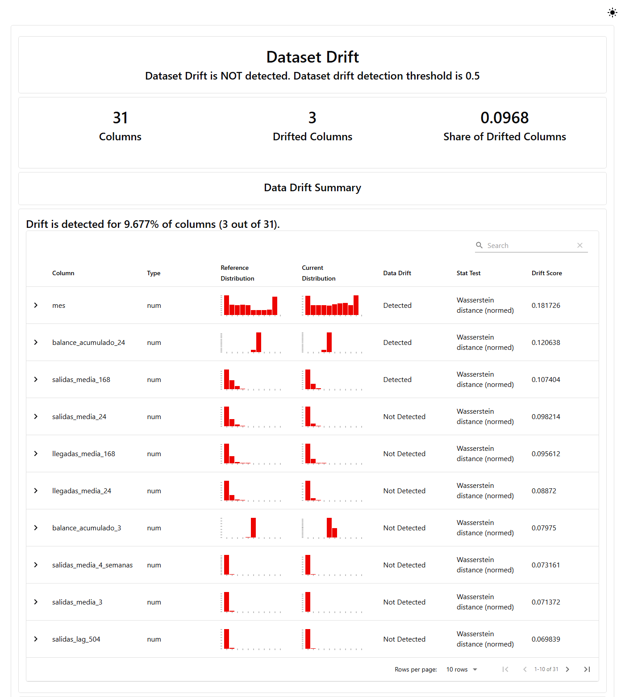
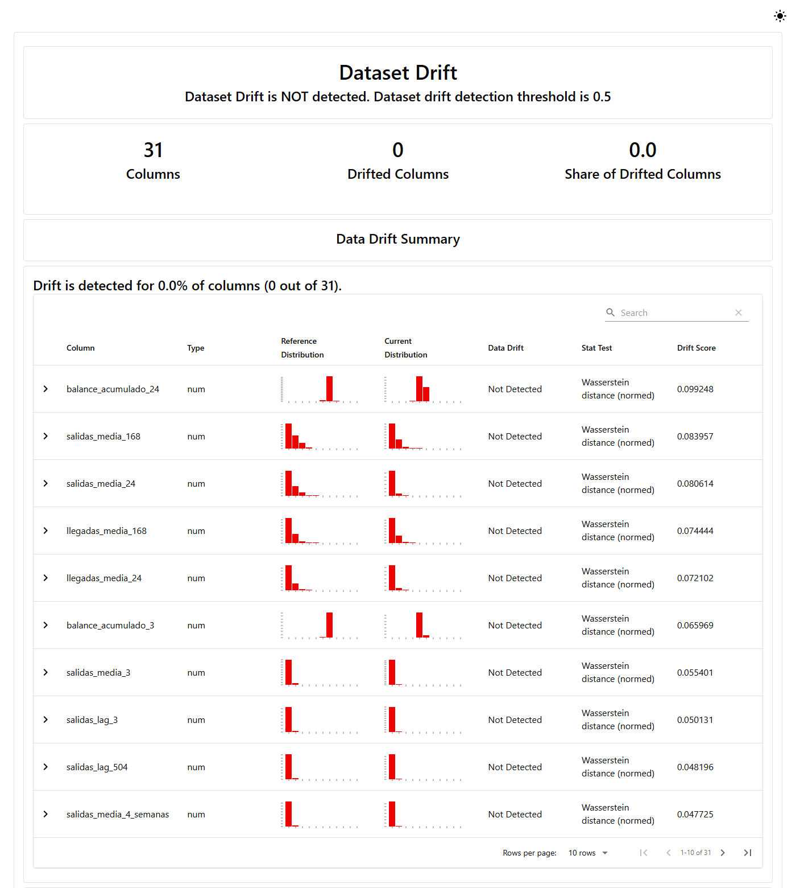

# Entrega 5: conjuntos de referencia y actual, y reporte de drift con Evidently

Este documento cubre los pasos 1 y 2 de la entrega: qué periodos se comparan, por qué, y cómo se genera
el reporte de drift y calidad de datos del modelo de P1 (`mibici-equipo25-p1-demanda`, versión 1 con
alias `champion`). La interpretación detallada, la versión alternativa y el A/B testing se documentan
aparte.

## 1. Conjuntos de datos

Los periodos se definen por fecha (`hora`) sobre la tabla supervisada que ya usa el modelo
(`data/processed/tabla_supervisada.parquet`, `data_version=09a6a584dd5d`), con las mismas 30 variables
de entrada y el mismo objetivo (`salidas`). No se reconstruye la tabla: hacerlo con otros cortes la
sobrescribiría y rompería el linaje de la versión 1. Todos los periodos se derivan de los cortes de
`config.py` en `proyecto_mibici/monitoreo/periodos.py`, que además rechaza periodos que se traslapen.

| Periodo | Inicio | Fin (excluido) | Para qué |
| --- | --- | --- | --- |
| `referencia` | 2023-10-01 | 2025-07-01 | Datos con los que se entrenó la versión 1 |
| `actual` | 2025-10-01 | 2026-10-01 | Producción: periodo de prueba de la versión 1, que no participó en su entrenamiento ni en su selección |
| `referencia_estacional` | 2024-10-01 | 2025-07-01 | Control: meses de la referencia que también están en el periodo actual |
| `actual_estacional` | 2025-10-01 | 2026-07-01 | Los mismos meses de calendario, un año después |
| `entrenamiento_v2` | 2023-10-01 | 2026-07-01 | Ventana de la versión alternativa: el protocolo de la versión 1 desplazado un año |
| `evaluacion_ab` | 2026-07-01 | 2026-10-01 | A/B testing: ninguna de las dos versiones la vio |

**Por qué estos periodos.** La referencia es exactamente lo que vio el modelo al entrenarse. El periodo
actual son los doce meses más recientes de los datos abiertos de MiBici y nunca se usaron para entrenar
ni para elegir el modelo, así que representan lo que el modelo encuentra en producción. Julio a
septiembre de 2025 (validación de la versión 1) queda fuera de ambos porque sí se usó para seleccionar
el modelo. No se usan los registros de la API de la Entrega 4: la API no guarda las peticiones, y un
periodo posterior de los datos abiertos es más grande y trae el valor observado.

**Por qué un control estacional.** La referencia abarca 21 meses y el periodo actual 12, así que la
mezcla de meses es distinta por construcción y cualquier variable ligada al calendario puede mostrar
drift sin que el sistema haya cambiado. Comparar los mismos meses de calendario (octubre a junio) un año
contra otro separa la estacionalidad del drift real.

## 2. Reporte de Evidently

```bash
uv sync --frozen --extra monitoreo
uv run --frozen --extra monitoreo python -m proyecto_mibici.monitoreo.drift --comparacion principal
uv run --frozen --extra monitoreo python -m proyecto_mibici.monitoreo.drift --comparacion estacional
```

Evidently es una dependencia opcional (extra `monitoreo` en `pyproject.toml`): la imagen de la API no
crece, porque `requirements.txt` se exporta sin ese extra. Cada comando requiere el servidor de MLflow
(`MLFLOW_TRACKING_URI`); con `--sin-mlflow` solo genera los archivos.

- **Presets:** `DataDriftPreset` (drift por variable) y `DataSummaryPreset` (calidad de datos) sobre las
  30 variables de P1 y el objetivo. `fin_semana` se declara categórica y el resto numéricas.
- **Muestra:** 100,000 filas por periodo con semilla 42 (`--max-filas`, `--semilla`). Con millones de
  filas el reporte tarda y pesa mucho más sin cambiar las conclusiones, porque los métodos que usa
  Evidently con más de 1,000 filas son distancias y no pruebas de hipótesis.
- **Métodos y umbrales (los de Evidently por defecto):** distancia de Wasserstein normalizada para las
  variables numéricas y distancia de Jensen-Shannon para `fin_semana`; hay drift en una variable si la
  distancia es ≥ 0.1, y en el conjunto si al menos el 50 % de las variables tiene drift.
- **Salidas** en `reports/monitoreo/<comparacion>/`: `drift_<comparacion>.html` (reporte interactivo,
  no se versiona por su tamaño), `drift_<comparacion>.json` (resultado completo de Evidently),
  `drift_por_variable_<comparacion>.csv` y `resumen_<comparacion>.json` (periodos, filas, estaciones,
  linaje y resumen). Los mismos archivos y el código ejecutado quedan como artefactos de un run de MLflow
  con `run_kind=drift_report` y `stage_of_work=monitoring`, que el Model Registry no considera candidato.

### Resultados

| | Principal | Estacional |
| --- | --- | --- |
| Referencia | oct-2023 a jun-2025 · 370 estaciones en la muestra | oct-2024 a jun-2025 · 368 estaciones |
| Actual | oct-2025 a sep-2026 · 469 estaciones en la muestra | oct-2025 a jun-2026 · 383 estaciones |
| Variables con drift | 3 de 31 (9.7 %) | 0 de 31 |
| Drift del conjunto | No | No |
| Calidad del periodo actual | Sin faltantes, filas duplicadas ni columnas constantes o vacías | Igual |

Variables con mayor distancia en la comparación principal:

| Variable | Distancia | Drift | Distancia en el control estacional |
| --- | --- | --- | --- |
| `mes` | 0.182 | Sí | 0.006 |
| `balance_acumulado_24` | 0.121 | Sí | 0.099 |
| `salidas_media_168` | 0.107 | Sí | 0.084 |
| `salidas_media_24` | 0.098 | No | 0.081 |
| `llegadas_media_168` | 0.096 | No | 0.074 |
| `salidas` (objetivo) | 0.060 | No | 0.041 |





**Lectura inicial.** El drift de `mes` desaparece al comparar los mismos meses (0.182 → 0.006): es
efecto del calendario, no un cambio del sistema. Las variables de balance y de demanda media de la
última semana bajan, pero siguen cerca del umbral. Además, el número de estaciones distintas crece de
370 en la referencia a 469 en el periodo actual, y ese crecimiento se concentra en julio a septiembre de
2026, fuera del control estacional. El análisis de estas variables y de su efecto en el error del modelo
se documenta en la sección de interpretación.

Las capturas se tomaron del HTML de cada reporte con Edge sin interfaz:
`msedge --headless --blink-settings=preferredColorScheme=1 --window-size=1400,1560
--virtual-time-budget=20000 --screenshot=<png> <html>`.
