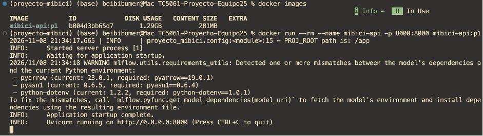
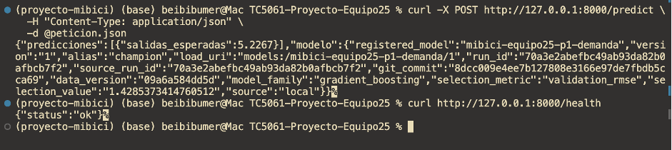

# Entrega 4 — Evidencias del cliente de la API

## 1. Objetivo

Documentar las verificaciones del cliente REST desarrollado para el proyecto MiBici Equipo 25, incluyendo validación de entradas, pruebas automatizadas, calidad de código y preparación de una petición HTTP.

El cliente se encuentra en `proyecto_mibici/api/cliente.py` y sus pruebas en `tests/test_api_cliente.py`.

## 2. Pruebas unitarias del cliente

Comando ejecutado:

```bash
uv run --frozen python -m pytest tests/test_api_cliente.py -q
```

Resultado obtenido:

```text
6 passed in 0.54s
```

Las seis pruebas del cliente finalizaron correctamente.


**Evidencia 01 — Seis pruebas unitarias aprobadas:**


## 3. Pruebas generales del proyecto

Comando ejecutado:

```bash
uv run --frozen python -m pytest tests -q
```

Resultado obtenido después de integrar el PR #23:

```text
136 passed, 1 skipped, 18 warnings in 45.49s
```

No se registraron pruebas fallidas. Las advertencias reportadas corresponden a dependencias como Matplotlib y scikit-learn.


**Evidencia 02 — Pruebas generales del proyecto:**


## 4. Análisis estático con Ruff

Comando ejecutado:

```bash
uv run --frozen ruff check proyecto_mibici tests
```

Resultado:

```text
All checks passed!
```

No se detectaron infracciones de las reglas de Ruff configuradas para el proyecto.


**Evidencia 03 — Análisis estático con Ruff:**


## 5. Validación con un registro real de MiBici

Comando ejecutado:

```bash
uv run --frozen python -m proyecto_mibici.api.cliente --solo-validar
```

Datos seleccionados:

| Campo | Valor |
|---|---|
| Estación | 519 |
| Fecha y hora | 2026-09-10T22:00:00 |
| Conjunto | 2 |
| Salidas observadas | 1.0 |
| Variables históricas | 24 |
| Estado | peticion_validada_sin_envio |

El cliente obtuvo un registro del archivo supervisado, preparó las variables históricas y validó la estructura de entrada mediante Pydantic.

Esta prueba no ejecuta el modelo ni envía una petición HTTP.


**Evidencia 04 — Validación de la petición con datos reales de la estación 519:**


## 6. Prueba de conexión HTTP

Comando ejecutado:

```bash
uv run --frozen python -m proyecto_mibici.api.cliente
```

Resultado obtenido:

```text
Error del cliente: No se pudo conectar con http://127.0.0.1:8000/predict.
Verifica que FastAPI esté levantada: [Errno 61] Connection refused
```

La petición no pudo realizarse porque no había un servidor escuchando en el puerto 8000.

Este resultado no constituye una predicción real ni una prueba satisfactoria de integración HTTP.

**Estado:** pendiente de repetir con la API en ejecución y el modelo P1 exportado.

### 6.1. Pruebas de integración HTTP realizadas por el equipo

Como complemento a las pruebas individuales del cliente, se incorporan evidencias de integración proporcionadas por un compañero del Equipo 25.

**Evidencia 05 — Ejecución del contenedor de la API**

La captura muestra el arranque del contenedor y los registros de Uvicorn que indican que la aplicación inició correctamente.



**Evidencia 06 — Peticiones HTTP reales a la API**

La captura muestra pruebas realizadas mediante `curl` contra los endpoints de la API:

- `POST /predict`: petición HTTP que devuelve una predicción y metadatos del modelo.
- `GET /health`: comprobación del estado del servicio con respuesta `{"status":"ok"}`.



**Alcance de estas evidencias:**

Estas pruebas fueron realizadas por un integrante del equipo y permiten documentar la comunicación HTTP con el contenedor.

Las pruebas individuales del cliente `proyecto_mibici/api/cliente.py` verifican la preparación y validación de las entradas. La ejecución HTTP exitosa de ese cliente específico, utilizando el registro real de la estación 519 y comparando la predicción con el valor observado, continúa pendiente de verificarse.

## 7. Verificación de Git e integración

Rama utilizada:

`feature/api-client-docs`

Commits del trabajo:

- `d4865a7`: cliente de predicción y pruebas.
- `22bde4b`: integración de los cambios de `main`, incluyendo el PR #23.
- `2aa0c08`: documentación del cliente y estrategia de inferencia.

Después de la integración, se ejecutaron nuevamente las pruebas generales y Ruff, ambos con resultados satisfactorios.


## 8. Estado de las evidencias y actividades pendientes

### Evidencias disponibles

- [x] Pruebas unitarias del cliente: 6 aprobadas.
- [x] Pruebas generales del proyecto: 136 aprobadas y 1 omitida.
- [x] Análisis estático con Ruff: sin errores.
- [x] Validación de un registro real de la estación 519 con 24 variables históricas.
- [x] Evidencia del arranque del contenedor proporcionada por un compañero.
- [x] Evidencia de peticiones HTTP a `/predict` y `/health` realizadas por un compañero.

### Actividades pendientes

- [ ] Ejecutar el cliente `cliente.py` contra una API activa con el modelo P1.
- [ ] Registrar la predicción de la estación 519, el valor observado y su error absoluto.
- [ ] Completar la verificación desde un entorno limpio, según los requisitos de la entrega.

## 9. Conclusión

El cliente REST desarrollado para MiBici Equipo 25 permite seleccionar un registro real, preparar las 24 variables históricas y validar la petición antes de enviarla a la API.

Las seis pruebas unitarias del cliente finalizaron correctamente. Después de integrar los cambios del contenedor, las pruebas generales del proyecto registraron 136 resultados aprobados, una prueba omitida y ningún error de Ruff.

Adicionalmente, se incorporaron capturas proporcionadas por un compañero del equipo que muestran el arranque del contenedor y respuestas HTTP de los endpoints `/predict` y `/health`.

Estas evidencias respaldan la integración de la API a nivel de equipo. Sin embargo, todavía está pendiente comprobar que el cliente Python desarrollado en este PR realice exitosamente la petición HTTP utilizando el registro de la estación 519 y calcule el error absoluto respecto al valor observado.