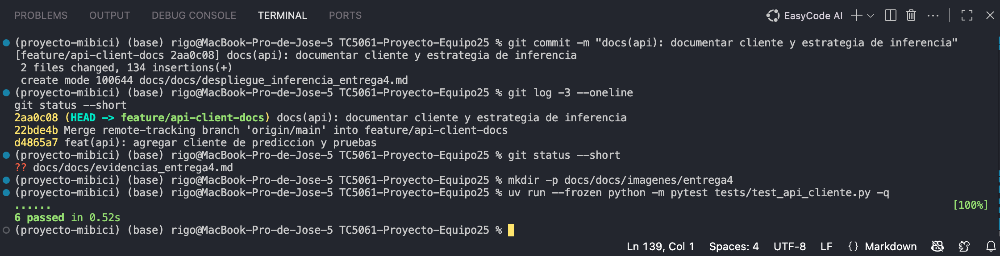
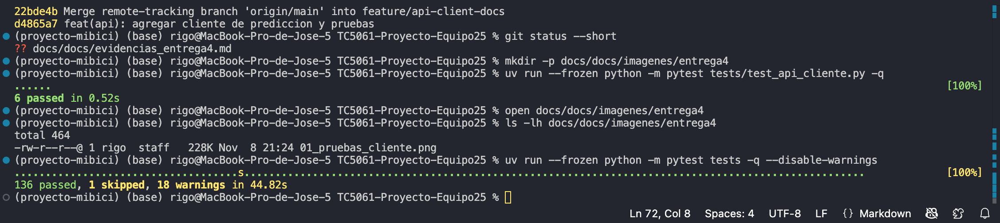
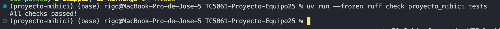
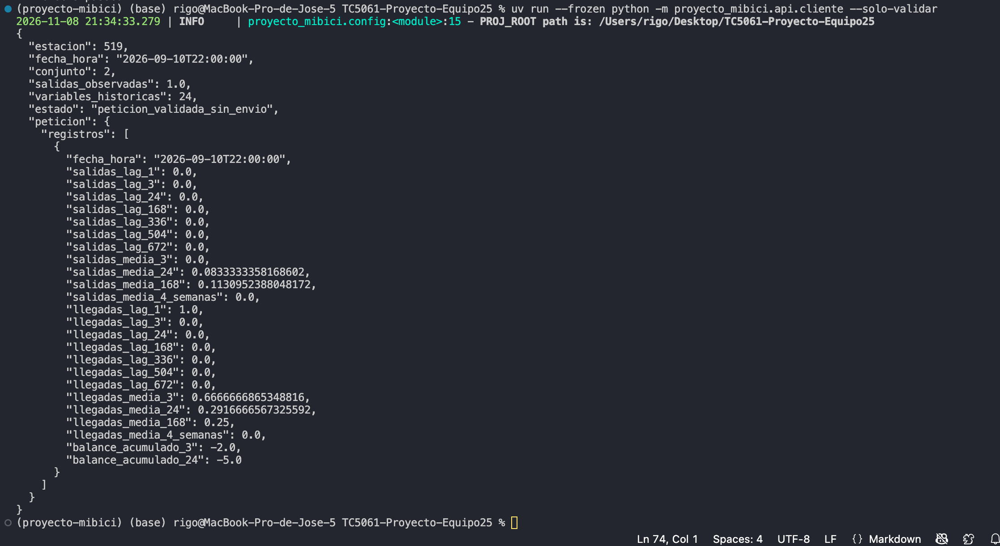

# Entrega 4 — Evidencias del cliente de la API

## 1. Objetivo

Documentar las verificaciones del cliente REST desarrollado para el proyecto MiBici Equipo 25, incluyendo validación de entradas, pruebas automatizadas, calidad de código y preparación de una petición HTTP.

El cliente se encuentra en `proyecto_mibici/api/cliente.py` y sus pruebas en `tests/test_api_cliente.py`.

## 2. Pruebas unitarias del cliente

Comando ejecutado:

```bash
uv run --frozen python -m pytest tests/test_api_cliente.py -q
```

Resultado obtenido:

```text
6 passed in 0.54s
```

Las seis pruebas del cliente finalizaron correctamente.


**Evidencia 01 — Seis pruebas unitarias aprobadas:**




## 3. Pruebas generales del proyecto

Comando ejecutado:

```bash
uv run --frozen python -m pytest tests -q
```

Resultado obtenido después de integrar el PR #23:

```text
136 passed, 1 skipped, 18 warnings in 45.49s
```

No se registraron pruebas fallidas. Las advertencias reportadas corresponden a dependencias como Matplotlib y scikit-learn.


**Evidencia 02 — Pruebas generales del proyecto:**




## 4. Análisis estático con Ruff

Comando ejecutado:

```bash
uv run --frozen ruff check proyecto_mibici tests
```

Resultado:

```text
All checks passed!
```

No se detectaron infracciones de las reglas de Ruff configuradas para el proyecto.


**Evidencia 03 — Análisis estático con Ruff:**




## 5. Validación con un registro real de MiBici

Comando ejecutado:

```bash
uv run --frozen python -m proyecto_mibici.api.cliente --solo-validar
```

Datos seleccionados:

| Campo | Valor |
|---|---|
| Estación | 519 |
| Fecha y hora | 2026-09-10T22:00:00 |
| Conjunto | 2 |
| Salidas observadas | 1.0 |
| Variables históricas | 24 |
| Estado | peticion_validada_sin_envio |

El cliente obtuvo un registro del archivo supervisado, preparó las variables históricas y validó la estructura de entrada mediante Pydantic.

Esta prueba no ejecuta el modelo ni envía una petición HTTP.


**Evidencia 04 — Validación de la petición con datos reales de la estación 519:**




## 6. Prueba de conexión HTTP

Comando ejecutado:

```bash
uv run --frozen python -m proyecto_mibici.api.cliente
```

Resultado obtenido:

```text
Error del cliente: No se pudo conectar con http://127.0.0.1:8000/predict.
Verifica que FastAPI esté levantada: [Errno 61] Connection refused
```

La petición no pudo realizarse porque no había un servidor escuchando en el puerto 8000.

Este resultado no constituye una predicción real ni una prueba satisfactoria de integración HTTP.

**Estado:** pendiente de repetir con la API en ejecución y el modelo P1 exportado.

## 7. Verificación de Git e integración

Rama utilizada:

`feature/api-client-docs`

Commits del trabajo:

- `d4865a7`: cliente de predicción y pruebas.
- `22bde4b`: integración de los cambios de `main`, incluyendo el PR #23.
- `2aa0c08`: documentación del cliente y estrategia de inferencia.

Después de la integración, se ejecutaron nuevamente las pruebas generales y Ruff, ambos con resultados satisfactorios.

## 8. Evidencias pendientes para completar la entrega

- Incorporar capturas de las pruebas unitarias del cliente.
- Incorporar capturas de las pruebas generales y Ruff.
- Incorporar captura de la validación del registro real.
- Ejecutar la API con el modelo P1 exportado.
- Obtener una respuesta real del endpoint `/predict`.
- Registrar la predicción, el valor observado y el error absoluto.
- Verificar la ejecución desde un entorno limpio, según los requisitos de la entrega.

## 9. Conclusión preliminar

El cliente REST y sus pruebas automatizadas se encuentran implementados y pasan las verificaciones locales realizadas.

La integración completa con la API y el modelo desplegado todavía requiere una ejecución HTTP satisfactoria, por lo que no se considera validada en esta etapa.
