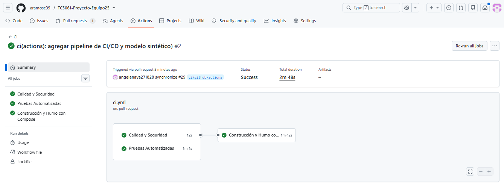
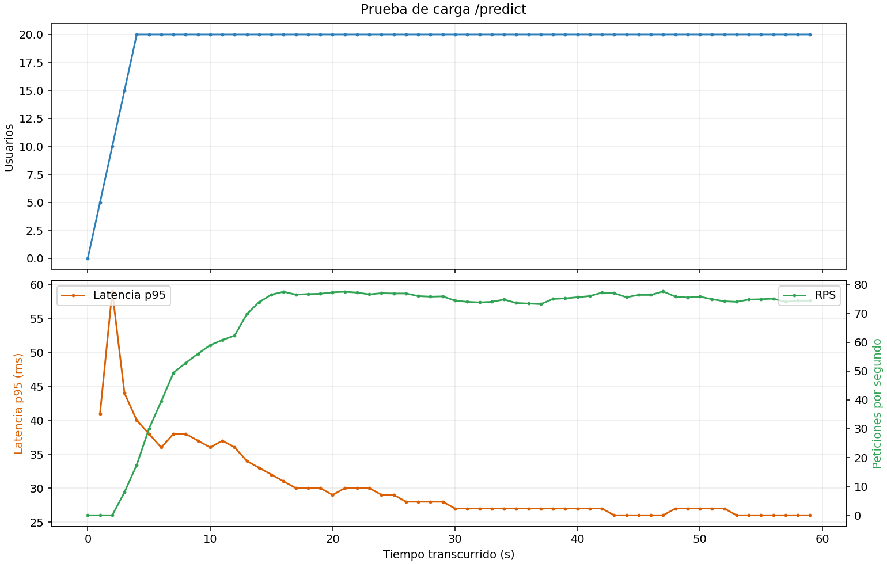
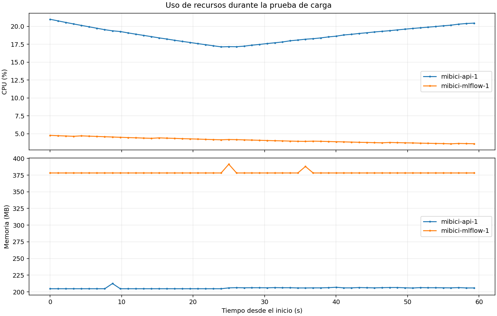

# Operación del sistema MiBici (Entrega 6)

Microservicios, CI/CD y FinOps sobre el modelo de demanda P1 (`mibici-equipo25-p1-demanda`).
Este documento reúne las secciones técnicas de la entrega. Cada PR agrega la suya: §1 orquestación
(PR 1), §2 pipeline de CI/CD (PR 2), §3 pruebas de carga y recursos (PR 3) y §4 análisis FinOps (PR 4).

## 1. Orquestación con Docker Compose

### 1.1 Servicios

`docker-compose.yml` levanta el sistema con un solo comando (`podman compose up -d --build` o
`docker compose up -d --build`). Los tres servicios usan **la misma imagen** (`Containerfile` de la
Entrega 4, que ya incluye MLflow 3.17.2), construida una sola vez:

| Servicio | Qué hace | Arranca cuando | Puerto (host) |
| --- | --- | --- | --- |
| `mlflow` | Servidor de tracking y Model Registry. SQLite y artefactos en el volumen `mibici-mlflow-data` | De inmediato; sano cuando responde `/health` | `127.0.0.1:5000` |
| `registrar-modelo` | De un solo uso: sube la copia exportada del `champion` al Registry de este servidor, con su linaje, y termina | `mlflow` sano | — |
| `api` | FastAPI de la Entrega 4. Carga `models:/mibici-equipo25-p1-demanda@champion` desde el Registry; sana cuando responde `/health` | `mlflow` sano y `registrar-modelo` terminado con código 0 | `127.0.0.1:8000` |

```text
                    red "mibici" (bridge)
 ┌──────────────────────────────────────────────────────────────┐
 │  registrar-modelo ──(1) registra v1 @champion──▶ mlflow:5000  │
 │                                                    │  ▲       │
 │                                volumen mibici-mlflow-data     │
 │                                                       │       │
 │  api:8000 ──(2) carga models:/…@champion ─────────────┘       │
 └──────┬───────────────────────────────────────────────┬───────┘
  127.0.0.1:8000 (/health, /model-info, /predict)   127.0.0.1:5000 (UI de MLflow)
```

### 1.2 Decisiones

- **MLflow con su propio almacenamiento.** El `mlflow.db` de cada integrante guarda rutas absolutas
  de Windows y versiones distintas, así que no puede montarse en un contenedor Linux. El servidor de
  Compose empieza vacío y `registrar-modelo` lo llena con la copia que `modelo exportar` dejó en
  `models/api/p1/`: sube **los mismos archivos**, sin reentrenar ni volver a serializar. La versión
  queda con los tags del linaje original (`source_run_id`, `git_commit`, `data_version`,
  `model_family`, `selection_metric`, `selection_value`) más `version_origen` y `registrado_desde`.
- **Idempotente.** Si el alias `champion` ya existe, `registrar-modelo` no crea otra versión
  (`"estado": "ya_registrado"`), así que `compose up` puede repetirse. `compose down -v` borra el
  volumen y el siguiente `up` vuelve a registrar desde cero.
- **La API carga desde el Registry** (`MODEL_SOURCE=registry`), lo que prueba dentro de un
  contenedor el modo que en la Entrega 4 solo se verificó en el host. Con `MODEL_SOURCE=local` usa
  la copia empaquetada en la imagen y deja de depender del servidor; ambas dan la misma predicción.
- **Una sola imagen** para los tres servicios: un solo build, una sola superficie de dependencias
  para pip-audit y menos espacio en disco y en el registro de imágenes.
- **Ejecutor de trabajos de MLflow desactivado** (`MLFLOW_SERVER_ENABLE_JOB_EXECUTION=false`).
  MLflow 3.17 arranca por defecto 7 procesos `huey` para evaluación de GenAI que este proyecto no
  usa. Con ellos, el servidor en reposo ocupaba **1.97 GB y ~113 % de CPU**; sin ellos y con un
  worker, **~370 MB**.
- **Límites de recursos de la API** (`API_CPUS=1.0`, `API_MEMORY=1g` por defecto). La prueba de
  carga y el costo por inferencia se miden contra estos límites, que se pueden variar sin tocar el
  YAML (por ejemplo `API_WORKERS=2 API_CPUS=2.0`).
- **Seguridad.** Los puertos se publican solo en `127.0.0.1`; los contenedores corren como
  `appuser` (UID 10001), no root; el servidor MLflow solo acepta los encabezados `Host` de la red
  interna y de localhost (`--allowed-hosts`).

### 1.3 Variables de entorno

Todas tienen un valor por defecto en el YAML. Para cambiarlas se descomentan en `.env` (a partir
de `.env.example`) o se pasan en la línea de comandos.

| Variable | Defecto | Uso |
| --- | --- | --- |
| `MIBICI_TAG` | `latest` | Etiqueta de la imagen `localhost/mibici-api` |
| `API_PORT` / `MLFLOW_PORT` | `8000` / `5000` | Puertos en el host (cambiar `MLFLOW_PORT` si el servidor local ya usa el 5000) |
| `MODEL_SOURCE` | `registry` | `registry` o `local` |
| `MODEL_URI` | `models:/mibici-equipo25-p1-demanda@champion` | Alias o versión que carga la API |
| `API_WORKERS` | `1` | Procesos de uvicorn |
| `API_CPUS` / `API_MEMORY` | `1.0` / `1g` | Límites del contenedor de la API |

### 1.4 Verificación (18-nov-2026, Windows 11 + Podman 5.8.3 con `docker-compose` 5.5.1)

| Prueba | Resultado |
| --- | --- |
| `podman compose up -d --build` (primera vez, con build) | 3 min 9 s; `mlflow` sano, `registrar-modelo` sale con 0, `api` arriba |
| `podman compose down -v` y `up -d` (sin build, volumen vacío) | 30 s hasta que `/health` responde |
| `registrar-modelo` | Registra la v1 `@champion` con `source_run_id=77ccfab…`, `git_commit=3f3e233…`, `data_version=09a6a584dd5d` |
| `GET /model-info` | `"source": "registry"`, versión 1, alias `champion`, linaje completo |
| `POST /predict` con `peticion.json` | `salidas_esperadas = 5.0772`, igual que con `MODEL_SOURCE=local` |
| `down` y `up` conservando el volumen | `"estado": "ya_registrado"`, no se duplica la versión |
| `API_WORKERS=2 API_CPUS=2.0 API_MEMORY=1536m podman compose up -d` | 2 procesos de uvicorn; límites de 2 CPU y 1.5 GB aplicados; al volver sin variables regresa a 1 CPU y 1 GB |
| Lotes en `/predict` | 1,000 registros → 1,000 predicciones (HTTP 200); 1,001 → HTTP 422 |
| `podman stats` en reposo | `api` ~205 MB; `mlflow` ~370 MB (1.97 GB antes de desactivar el ejecutor de trabajos) |
| Pruebas | `tests/test_api_registrar.py`: registro con linaje, carga desde el Registry, idempotencia, error sin copia exportada y rechazo de un modelo que no es P1 |


## 2. Pipeline de CI/CD con GitHub Actions

El flujo de integración continua (`.github/workflows/ci.yml`) automatiza la verificación de calidad, las pruebas automatizadas y la validación del despliegue contenerizado en cada `push` y `pull_request` hacia `main`, además de permitir su ejecución manual mediante `workflow_dispatch`.

### Arquitectura de los trabajos (Jobs)

| Trabajo (`job`) | Depende de | Qué ejecuta | Tiempo en Actions |
| :--- | :--- | :--- | :--- |
| `calidad` | — (en paralelo) | `ruff check`, `bandit -r proyecto_mibici` y `pip-audit -r requirements.txt` | *12s* |
| `pruebas` | — (en paralelo) | `uv sync --frozen --extra monitoreo` y `pytest tests -q` con caché de `uv` | *1m 1s* |
| `imagen` | `calidad`, `pruebas` | Genera modelo sintético (`modelo_humo.py`), levanta `docker compose up -d --build`, valida `/health`, `/model-info` (`registry`) y `/predict`, y limpia con `down -v` | *1m 42s* |

### Modelo sintético para CI (`modelo_humo.py`)

Dado que `models/api/p1/` está excluido del control de versiones (`.gitignore`), el job `imagen` ejecuta `python -m proyecto_mibici.api.modelo_humo` para entrenar un `HistGradientBoostingRegressor(loss="poisson", max_iter=5)` sobre datos aleatorios de las 30 columnas de `COLUMNAS_MODELO` en `float32`. El artefacto se guarda con `version="0"` y `model_family="humo"`, y el comando bloquea cualquier sobrescritura sobre un modelo real existente salvo que se indique explícitamente `--forzar`.



## 3. Pruebas de carga con Locust

### 3.1 Diseño del escenario

La carga se ejecuta contra `/predict` sobre el sistema levantado con Compose.
[`locustfile.py`](../../locustfile.py) genera entradas válidas para el esquema
Pydantic de P1 y usa una semilla configurable para reproducir la misma distribución.
Cada petición contiene lotes de registros, de modo que se mide también el costo de
procesamiento por lote permitido por la API.

| Parámetro | Valor usado |
| --- | --- |
| Usuarios concurrentes | 20 |
| Crecimiento | 5 usuarios por segundo |
| Duración | 60 segundos |
| Registros por petición | 10 |
| Semilla | 42 |
| Endpoint | `POST /predict` |
| Recursos de la API | 1 CPU y 1 GB por defecto |

Los archivos y gráficas se generan con:

```bash
uv sync --frozen --extra carga
make load-test
uv run --frozen --extra carga python -m proyecto_mibici.carga_reporte
```

El HTML generado por Locust contiene las gráficas de latencia y throughput, y el
historial CSV permite reproducirlas:

- [`Reporte interactivo de Locust`](../../reports/figures/entrega6/locust_report.html)
- [`Gráfica resumen de rendimiento`](../../reports/figures/entrega6/locust_desempeno.png)
- [`Resumen estructurado`](../../reports/monitoreo/carga/locust_2026-11-22_resumen.json)
- [`Estadísticas finales`](../../reports/monitoreo/carga/locust_2026-11-22_stats.csv)

### 3.2 Resultados

La prueba se realizó el 22 de noviembre de 2026 contra la API de Compose cargada
desde el Registry. La API respondió correctamente sin fallos:

| Métrica | Resultado |
| --- | --- |
| Solicitudes | 4,372 |
| Fallos | 0 (0 %) |
| Throughput promedio | 73.97 solicitudes/s |
| Latencia mediana | 8 ms |
| Latencia promedio | 10.32 ms |
| Latencia p95 | 26 ms |
| Latencia máxima | 103.34 ms |

El throughput mantuvo aproximadamente 74–78 solicitudes por segundo una vez
alcanzados los 20 usuarios. La latencia p95 permaneció mayormente entre 26 y
40 ms durante el periodo estable, sin respuestas con error.



## 4. Monitoreo de uso de recursos

### 4.1 Método

El uso de CPU y memoria se muestreó cada segundo con `podman stats`
simultáneamente a Locust. El módulo
[`monitoreo_recursos.py`](../../proyecto_mibici/monitoreo_recursos.py) conserva
la evidencia en CSV y genera una gráfica para API y MLflow. También admite
Docker mediante `--runtime docker`.

```bash
podman compose up -d --build
make load-test
make monitor-resources
```

Para que ambos procesos cubran exactamente la misma ventana, deben iniciarse
simultáneamente. `make monitor-resources` usa una duración de 60 segundos y un
intervalo de un segundo por defecto.

### 4.2 Evidencia

La prueba final tuvo 20 usuarios concurrentes, lotes de 10 registros y 60
segundos de duración:

| Contenedor | CPU promedio | CPU máximo | Memoria promedio | Memoria máxima | Límite |
| --- | ---:| ---:| ---:| ---:| ---:|
| `mibici-api-1` | 18.88 % | 20.99 % | 205.71 MB | 212.50 MB | 1 GB |
| `mibici-mlflow-1` | 4.11 % | 4.78 % | 378.61 MB | 391.30 MB | 2 GB |

En `mibici-api-1`, el límite efectivo fue alrededor de 1.075 GB y la memoria
máxima observada representó aproximadamente 19.9 % de ese límite. En
`mibici-mlflow-1`, la memoria máxima representó 18.7 % de su límite observado
de aproximadamente 2.034 GB.

- [Evidencia CSV de recursos](../../reports/monitoreo/recursos/recursos_carga.csv)
- [Gráfica de CPU y memoria](../../reports/figures/entrega6/recursos_carga.png)

