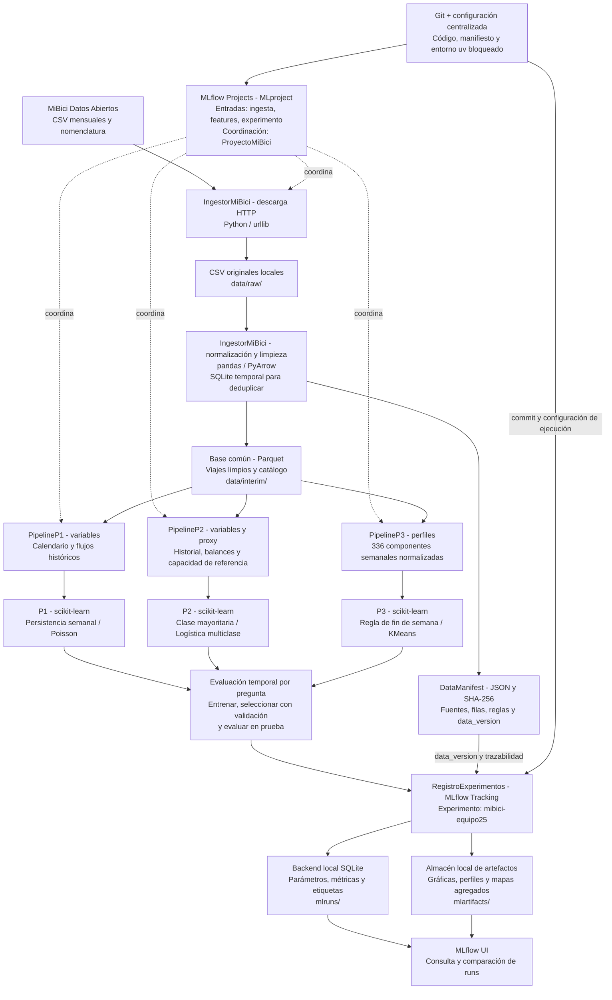

# Propuesta de solución MiBici

Este documento construye las respuestas a la **Parte A de [context.md](./context.md)**, punto por punto. En cada revisión se leerá la instrucción, se elaborará la respuesta a partir de sus fuentes y evidencias y se reemplazará o ajustará la sección correspondiente. El contenido previo no se considera correcto por defecto ni demuestra que una implementación cumpla los requisitos.

**Estado de esta revisión:** se han revisado los puntos 1–5: formulación basada en el [ML Canvas del equipo 25](../Machine%20Learning%20Canvas_Equipo%2025.pdf), definición de datos, propuesta de pipelines sobre una ingesta común implementada conforme al punto 10 de la Parte B, modelos y métricas por pregunta y arquitectura con énfasis en MLflow Projects y POO. Los puntos 6–7 quedan pendientes de revisión conforme se avance en las instrucciones.

Cuando una respuesta requiera evidencia computacional, se desarrollará en notebooks separados por propósito (por ejemplo, exploración, conteos o gráficas), dentro de `notebooks/` y con la convención `1.0-iniciales-descripcion.ipynb`. Conforme a la Parte B, las transformaciones y ejecuciones finales reutilizables deberán vivir en el módulo del proyecto; los notebooks documentarán la exploración y la justificación, sin sustituir el código ejecutable requerido.

## Parte A. Propuesta de solución

### 1. Formular el problema

#### Instrucción, fuente y alcance

El punto 1 de [context.md](./context.md) exige un ML Canvas y, para cada pregunta, precisar **qué se predice o agrupa, con qué granularidad y horizonte, por qué es relevante y quién utilizaría el resultado para tomar qué decisión**.

La fuente de esta formulación es el [Machine Learning Canvas del equipo 25](../Machine%20Learning%20Canvas_Equipo%2025.pdf), diseñado para MiBici por el equipo 25, con fecha **17/10/2026, iteración 1**. A continuación se desarrollan sus diez bloques y se aclaran sus límites; no se afirma que las funcionalidades propuestas estén implementadas ni desplegadas.

**Alcance:** experimento académico retrospectivo, por lotes y con revisión humana. La frecuencia horaria describe el uso operativo propuesto para P1/P2, no la disponibilidad de datos en tiempo real: los CSV mensuales permiten estudiar horas históricas, pero no emitir alertas actuales. El rango de fechas y el periodo de agregación de P3 se justificarán en el punto 2, sin asumir que los establecidos en la versión anterior sean correctos.

#### Formulación por pregunta

Se conserva la redacción de las tres preguntas de negocio de [context.md](./context.md).

| Pregunta y tarea | Qué se predice o agrupa | Granularidad y horizonte | Relevancia para MiBici | Usuario y decisión apoyada |
| --- | --- | --- | --- | --- |
| **P1. ¿Cuántos viajes se iniciarán en una estación o zona en un periodo futuro?** Regresión. | Conteo de viajes que se iniciarán en cada estación durante la siguiente hora. El alcance inicial es por estación; no se definen zonas en esta etapa. | **Estación × hora; horizonte de una hora.** Al cierre de una hora se estima el conteo de la siguiente, usando solo información disponible al corte. | Anticipar la concentración de viajes iniciados permite planear la distribución de la flota a corto plazo. Es demanda observada de viajes realizados, no demanda total o insatisfecha. | **Operador del sistema:** priorizar estaciones para revisar la disponibilidad y planear la asignación de bicicletas. El conteo previsto no determina por sí solo cuántas bicicletas mover. |
| **P2. ¿Una estación estará en riesgo de quedarse sin bicicletas o sin anclajes disponibles en un periodo futuro?** Clasificación mediante una aproximación. | La pregunta busca riesgo de desabasto o saturación. Con los datos descritos se propone clasificar **presión neta de flujo** como variable sustituta: salidas elevadas respecto de llegadas o el caso inverso, considerando la capacidad si se valida su disponibilidad y pertinencia temporal. No es una etiqueta de inventario observado. | **Estación × hora; horizonte de una hora.** Se predice la clase de presión para la siguiente hora. Las clases y los umbrales se justificarán al construir el objetivo en el punto 2. | Identificar desequilibrios de flujo puede orientar la revisión de estaciones con posible presión de extracción o acumulación. La aproximación es necesaria porque no se conoce el inventario. | **Equipo de rebalanceo:** priorizar verificaciones; con disponibilidad real adicional podría decidir llevar o retirar bicicletas. El proxy por sí solo no autoriza esos movimientos ni confirma estaciones vacías o llenas. |
| **P3. ¿Qué grupos de estaciones comparten patrones de uso y dónde se ubican en la ciudad?** Clustering. | Estaciones con perfiles temporales de uso similares, caracterización de cada grupo y localización de sus integrantes mediante coordenadas. | **Una observación por estación**, representada por su perfil agregado por hora/día de semana en el periodo que se justifique en el punto 2. **Sin horizonte de predicción:** análisis descriptivo. La actualización trimestral es una propuesta de cadencia, no un horizonte. | Distinguir patrones y su distribución espacial permite analizar necesidades diferenciadas de servicio, capacidad y cobertura. | **Planeación urbana y expansión:** seleccionar estaciones y áreas para estudiar ajustes de capacidad o expansión. Los grupos son insumos de análisis, no una recomendación automática de nuevas ubicaciones. |

#### P2: justificación y límite de la aproximación

El contexto solicita expresamente aproximar el riesgo a partir de viajes y capacidad. Se adopta, como plantea el Canvas, una **clasificación exploratoria de presión de flujo**, manteniendo separadas la pregunta de negocio y la variable que realmente puede observarse.

Más salidas que llegadas representan presión de extracción; más llegadas que salidas representan presión de acumulación. Comparar el desequilibrio con la capacidad permitiría distinguir su magnitud relativa entre estaciones, siempre que esa capacidad sea válida para el periodo analizado. La fórmula, las clases y los umbrales no quedan fijados en este punto: requieren justificación en el punto 2 y selección sin consultar el conjunto de prueba.

**El flujo no reconstruye el inventario:** faltan existencias iniciales y movimientos de rebalanceo, y un balance horario puede ocultar faltantes dentro de la hora. Además, los viajes realizados no registran intentos fallidos. Por tanto, clasificar bien el proxy no demuestra que se predigan correctamente estaciones vacías/llenas. Para validar el riesgo real se necesitarían registros históricos de disponibilidad o eventos de falta, idealmente acompañados de acciones de rebalanceo.

#### ML Canvas — desarrollo de los diez bloques

**Metadatos del documento fuente:** diseñado para MiBici; diseñado por el equipo 25; fecha 17/10/2026; iteración 1. Las siguientes respuestas desarrollan ese Canvas para la propuesta académica.

##### Prediction Task — tarea de predicción

- **Tipo de tarea:** regresión supervisada de conteos para P1; clasificación supervisada de un proxy de presión para P2, diferenciada del riesgo real; clustering descriptivo y no supervisado para P3.
- **Entidad:** estación-hora en P1/P2; estación representada por un perfil de uso en P3.
- **Resultados posibles:** P1 produce una estimación no negativa de viajes iniciados; P2, una clase de presión de flujo cuya definición queda pendiente del punto 2; P3, una asignación de grupo y su descripción temporal y espacial. Las etiquetas numéricas de los grupos no representan un orden de calidad.
- **Observación del resultado:** el conteo real de P1 y el flujo usado como etiqueta proxy de P2 se calculan tras concluir la hora objetivo y disponer de los registros. Con archivos mensuales, su disponibilidad efectiva depende de la publicación. El riesgo real de P2 no se observa en estos archivos. P3 se obtiene al agregar el periodo elegido, sin un resultado futuro que predecir.

##### Decisions — decisiones

- **Conversión del resultado en una acción:** P1 ordenaría estaciones por viajes previstos para apoyar la planificación de flota. P2 señalaría estaciones que conviene verificar por presión de extracción o acumulación; no emitiría una orden automática basada en inventario desconocido. P3 permitiría comparar perfiles y seleccionar áreas para estudios de cobertura o capacidad.
- **Parámetros del proceso de decisión:** estación, hora objetivo y conteo previsto en P1; estación, hora y clase de presión en P2; grupo, perfil y ubicación en P3. Las prioridades finales requieren disponibilidad real, capacidad vigente, distancias, costos y recursos operativos. Los umbrales de intervención deberán acordarse con MiBici, no confundirse con los umbrales estadísticos del proxy.

##### Value Proposition — propuesta de valor

- **Beneficiarios y necesidades:** usuarios de MiBici y responsables de operación y planeación. P1 busca anticipar el uso observado; P2, orientar la revisión de posibles desequilibrios; P3, hacer visibles patrones territoriales de uso. Se espera mejorar la información para decidir, no se presume una mejora ya demostrada del servicio.
- **Integración en el flujo e interfaz:** en el proyecto se presentarán tablas, gráficas, mapas y artefactos de experimentos. Un tablero para operación sería una extensión futura. La validación humana precedería cualquier intervención y P2 requeriría contrastar la presión con disponibilidad real.
- **Valor por comprobar:** mayor disponibilidad, menos viajes fallidos y menores costos de rebalanceo son hipótesis que necesitarían datos y evaluación operativa adicionales; las métricas de modelos no prueban esos beneficios.

##### Data Collection — recolección de datos

- **Conjunto inicial de entidades y resultados:** archivos mensuales de viajes y nomenclatura de estaciones, obtenidos por lotes desde la fuente oficial. Se derivarán conteos estación-hora para P1, etiquetas proxy para P2 y perfiles por estación para P3. No se plantea etiquetado manual. **No se derivará una etiqueta de riesgo real a partir del flujo.**
- **Actualización, costo y frescura:** incorporar nuevos meses publicados y regenerar los agregados afectados con una versión identificable de los datos. La publicación mensual limita la frescura; no se presupone una API ni acceso a inventario en tiempo real. La descarga reproducible requerida por la Parte B no se sustituye por una dependencia permanente de archivos cargados manualmente.

##### Data Sources — fuentes de datos

- **Origen de entidades y resultados observados:** [Datos abiertos de MiBici](https://www.mibici.net/es/datos-abiertos/): archivos de viajes `datos_abiertos_AAAA_MM.csv` y nomenclatura de estaciones indicada en el contexto, `nomenclatura_2026_09.csv`.
- **Información pertinente:** fechas y horas de inicio/fin, identificadores de origen/destino y catálogo de estaciones con ubicación y capacidad. Los nombres efectivos de columnas, cobertura, enlaces por archivo y validez temporal se verificarán en el punto 2; los nombres normalizados citados en el Canvas no se toman como comprobación del esquema original.
- **Información faltante:** inventario, disponibilidad de anclajes, incidentes de estaciones vacías/llenas y acciones de rebalanceo para validar P2 y evaluar decisiones operativas.

##### Features — representación y transformaciones

- **Representación al predecir:** P1/P2 usarían calendario de la hora objetivo y resúmenes de salidas/llegadas ya observadas por estación. P3 usaría perfiles de uso por hora y día de semana; las coordenadas servirían para localizar e interpretar grupos, sin imponer de antemano que la cercanía geográfica defina la similitud de uso.
- **Transformaciones propuestas:** agregar salidas por estación de origen y hora de inicio, y llegadas por estación de destino y hora de fin; distinguir horas sin viajes de periodos sin datos o sin operación. Explorar rezagos de 1 h, 3 h, 24 h y 7 días y promedios móviles solo de horas completas conocidas al corte. El conteo o flujo de la hora futura se usará como objetivo, nunca como predictor.
- **Perfiles de P3:** explorar su normalización para comparar la forma temporal sin que el volumen domine la agrupación; conservar el volumen como información descriptiva. La elección se justificará con exploración, no queda validada por mencionarla aquí.
- **Datos personales:** no se necesitan identificadores de usuario, género ni año de nacimiento para esta formulación. Se propone excluirlos del modelado y de los artefactos; el tratamiento detallado se documentará en el punto 2.

##### Making Predictions — generación de resultados

- **Lotes o tiempo real:** ejecución retrospectiva por lotes en el proyecto. Una aplicación operativa de P1/P2 necesitaría datos actualizados; no se ofrece tiempo real con CSV mensuales.
- **Frecuencia propuesta en el Canvas:** pronósticos horarios para P1/P2 y revisión trimestral de grupos para P3. Son propuestas de uso futuro, no procesos programados cuya existencia se haya verificado en esta revisión.
- **Tiempo disponible:** el Canvas propone cinco minutos por ejecución de P1/P2 y quince minutos por actualización de P3. También menciona una ejecución «diaria» de P1/P2, incompatible con la frecuencia horaria declarada. Para esta formulación se mantiene la frecuencia **horaria** y se considera cinco minutos por lote horario como presupuesto provisional, pendiente de medición y validación operativa; el tiempo de decisión humana se mide aparte.
- **Recursos:** CPU local y Python para el experimento. Archivos de resultados y artefactos bastan para la entrega; tablero, base de datos de servicio, APIs y despliegue en nube son posibilidades futuras, no requisitos ni componentes confirmados.

##### Building Models — construcción de modelos

- **Cantidad y alcance:** una solución por pregunta —regresión, clasificación del proxy y clustering—, cada una con referencia sencilla y modelo candidato a justificar en el punto 4. No se contempla un despliegue productivo en esta entrega.
- **Actualización propuesta:** revisar P1/P2 mensualmente y considerar reentrenamiento ante deterioro en evaluación temporal o cambios de datos; revisar P3 trimestralmente o ante cambios importantes en las estaciones. No se puede vigilar deterioro respecto de incidentes reales de P2 sin obtener esos incidentes.
- **Tiempo para construir y analizar:** el Canvas no establece un presupuesto de entrenamiento. Se medirán tiempos de preparación, ajuste y evaluación del experimento; no se confunden con los presupuestos de inferencia anteriores.
- **Recursos:** entorno local de Python y librerías de análisis/modelado del proyecto. La selección concreta y su costo computacional se justificarán en los puntos 3–5; no se asume necesidad de nube o GPU.

##### Impact Simulation — simulación de impacto

- **Costo o ganancia de las decisiones:** no hay valores monetarios disponibles. Subestimar uso podría dejar estaciones insuficientemente atendidas; sobreestimarlo podría desviar recursos. Una alerta de presión no pertinente puede provocar revisiones innecesarias y una omisión puede dejar un desequilibrio sin revisar. No se asignan costos numéricos inventados ni se equiparan estos errores con incidentes reales.
- **Datos para simular antes del despliegue:** inventario y anclajes disponibles por estación/hora, eventos de falta, rebalanceo, demanda no satisfecha y costos/tiempos operativos. El Canvas reconoce que no están en los CSV. Con lo descrito se evaluará desempeño retrospectivo, no impacto causal ni una simulación de inventario validada.
- **Criterios de despliegue:** comparación con el baseline en prueba temporal, ausencia de fuga de información y revisión de resultados por estación/periodo. Un uso operativo requeriría además datos oportunos, validación con inventario y aprobación de operación. Los umbrales numéricos de aceptación quedan pendientes; para P3 se requiere también interpretabilidad y estabilidad de los grupos.
- **Equidad:** revisar cobertura y desempeño por estación/zona, sin usar atributos demográficos de usuarios. Excluirlos no garantiza equidad: los viajes observados pueden infrarrepresentar lugares con servicio limitado. Los criterios de atención deben acordarse con responsables de operación y planeación.

##### Monitoring — seguimiento

- **Métricas del modelo y KPIs del servicio:** para P1, error y sesgo de conteos por estación/periodo; para P2, recall/F1 por clase, matriz de confusión y frecuencia de alertas **del proxy**; para P3, calidad de separación, estabilidad e interpretabilidad. Su selección y justificación se desarrollarán en el punto 4. Disponibilidad de bicicletas/anclajes, eventos de falta y costos son KPIs operativos futuros que requieren datos adicionales; no se infieren directamente del desempeño predictivo.
- **Frecuencia de revisión:** en cada evaluación temporal del prototipo. Para un eventual despliegue, el Canvas propone revisión periódica —por ejemplo, mensual— y adicional ante cambios o deriva; no hay una cadencia acordada con MiBici.

#### Decisiones delimitadas y pendientes de los siguientes puntos

Esta formulación establece el alcance estación-hora y horizonte de una hora para P1/P2, la aproximación explícita mediante presión de flujo para P2 y el carácter descriptivo por estación de P3. **No fija todavía** fechas, tamaño de datos, umbrales del proxy, particiones, transformaciones definitivas, modelos, métricas finales ni arquitectura. Esas decisiones se desarrollarán en sus puntos correspondientes, con notebooks de evidencia separados cuando sean necesarios. Para este punto no se requiere generar código ni modificar el PDF del Canvas.

**Atribución del formato:** Machine Learning Canvas, versión 1.2, creado por Louis Dorard, Ph.D., [ownml.co](https://ownml.co/), licencia [Creative Commons Attribution-ShareAlike 4.0 International](https://creativecommons.org/licenses/by-sa/4.0/).

### 2. Definir los datos

#### Rango de fechas y justificación

Se utilizarán **36 meses consecutivos, de octubre de 2023 a septiembre de 2026**, ambos incluidos. Aunque hay archivos locales desde diciembre de 2014, no se incorporará todo el histórico al conjunto de modelado:

- **Vigencia:** se priorizan patrones recientes para la operación actual, reconociendo que la red puede cambiar incluso dentro de estos tres años.
- **Ciclos completos:** el periodo contiene tres ciclos anuales y permite reservar un año completo para prueba. Esto permite estudiar estacionalidad sin garantizar que tres ciclos basten para aprender todos los efectos.
- **Cambio de régimen:** se dejan fuera 2020–2021 para no mezclar directamente los cambios de movilidad de la pandemia con el periodo reciente. No se presupone que usar años anteriores sea incorrecto; se acota el alcance del proyecto.
- **Volumen:** los 13.6 millones de registros obtenidos justifican procesamiento por lotes y almacenamiento columnar, sin requerir cargar todo el histórico desde 2014.

La nomenclatura de septiembre de 2026 coincide con el cierre del rango, pero **no certifica la capacidad, ubicación ni actividad histórica de cada estación**. Se usará como referencia fija para el análisis descriptivo y el proxy de P2, con las limitaciones indicadas abajo. Un periodo de tres años limita la diversidad de eventos extraordinarios observados.

#### 1. Fuente y enlaces a los archivos

Fuente oficial: [Datos abiertos de MiBici](https://www.mibici.net/es/datos-abiertos/). Los archivos mensuales siguen el nombre `datos_abiertos_AAAA_MM.csv`. Los siguientes enlaces directos fueron localizados en la página oficial el **20 de octubre de 2026**:

| Año | Archivos mensuales seleccionados |
| --- | --- |
| 2023 | [Octubre](https://www.mibici.net/site/assets/files/54935/datos_abiertos_2023_10.csv), [noviembre](https://www.mibici.net/site/assets/files/57344/datos_abiertos_2023_11.csv), [diciembre](https://www.mibici.net/site/assets/files/58715/datos_abiertos_2023_12.csv). |
| 2024 | [Enero](https://www.mibici.net/site/assets/files/61450/datos_abiertos_2024_01.csv), [febrero](https://www.mibici.net/site/assets/files/77251/datos_abiertos_2024_02.csv), [marzo](https://www.mibici.net/site/assets/files/77252/datos_abiertos_2024_03.csv), [abril](https://www.mibici.net/site/assets/files/80028/datos_abiertos_2024_04.csv), [mayo](https://www.mibici.net/site/assets/files/81663/datos_abiertos_2024_05.csv), [junio](https://www.mibici.net/site/assets/files/83901/datos_abiertos_2024_06.csv), [julio](https://www.mibici.net/site/assets/files/85500/datos_abiertos_2024_07.csv), [agosto](https://www.mibici.net/site/assets/files/87665/datos_abiertos_2024_08.csv), [septiembre](https://www.mibici.net/site/assets/files/89736/datos_abiertos_2024_09.csv), [octubre](https://www.mibici.net/site/assets/files/91758/datos_abiertos_2024_10.csv), [noviembre](https://www.mibici.net/site/assets/files/93516/datos_abiertos_2024_11.csv), [diciembre](https://www.mibici.net/site/assets/files/94962/datos_abiertos_2024_12.csv). |
| 2025 | [Enero](https://www.mibici.net/site/assets/files/97653/datos_abiertos_2025_01.csv), [febrero](https://www.mibici.net/site/assets/files/99879/datos_abiertos_2025_02.csv), [marzo](https://www.mibici.net/site/assets/files/101986/datos_abiertos_2025_03.csv), [abril](https://www.mibici.net/site/assets/files/103813/datos_abiertos_2025_04.csv), [mayo](https://www.mibici.net/site/assets/files/105513/datos_abiertos_2025_05.csv), [junio](https://www.mibici.net/site/assets/files/107088/datos_abiertos_2025_06.csv), [julio](https://www.mibici.net/site/assets/files/108898/datos_abiertos_2025_07.csv), [agosto](https://www.mibici.net/site/assets/files/111021/datos_abiertos_2025_08.csv), [septiembre](https://www.mibici.net/site/assets/files/113216/datos_abiertos_2025_09.csv), [octubre](https://www.mibici.net/site/assets/files/115104/datos_abiertos_2025_10.csv), [noviembre](https://www.mibici.net/site/assets/files/116773/datos_abiertos_2025_11.csv), [diciembre](https://www.mibici.net/site/assets/files/118153/datos_abiertos_2025_12.csv). |
| 2026 | [Enero](https://www.mibici.net/site/assets/files/120163/datos_abiertos_2026_01.csv), [febrero](https://www.mibici.net/site/assets/files/121761/datos_abiertos_2026_02.csv), [marzo](https://www.mibici.net/site/assets/files/123236/datos_abiertos_2026_03.csv), [abril](https://www.mibici.net/site/assets/files/124927/datos_abiertos_2026_04.csv), [mayo](https://www.mibici.net/site/assets/files/125943/datos_abiertos_2026_05.csv), [junio](https://www.mibici.net/site/assets/files/127734/datos_abiertos_2026_06.csv), [julio](https://www.mibici.net/site/assets/files/129006/datos_abiertos_2026_07.csv), [agosto](https://www.mibici.net/site/assets/files/130362/datos_abiertos_2026_08.csv), [septiembre](https://www.mibici.net/site/assets/files/131825/datos_abiertos_2026_09.csv). |

Catálogo: [nomenclatura de estaciones de septiembre de 2026](https://www.mibici.net/site/assets/files/1118/nomenclatura_2026_09.csv). Las copias locales utilizadas están en `data/raw/`.

#### 2. Tamaño real obtenido

Se volvieron a contar los CSV locales el **20 de octubre de 2026**, mediante el notebook [Verificación de datos del punto 2](../../notebooks/1.3-ARC-verificacion-datos-punto2.ipynb), que conserva los resultados agregados y el detalle mensual.

| Medida | Resultado |
| --- | ---: |
| Meses con archivo disponible y leído | 36 |
| Registros de viajes obtenidos | 13,621,885 |
| Estaciones distintas observadas como origen | 473 |
| Estaciones distintas observadas como destino | 473 |
| Estaciones distintas observadas como origen o destino —unión, no suma— | 473 |
| Estaciones distintas en la nomenclatura de septiembre de 2026 | 484 |
| Estaciones observadas sin correspondencia en esa nomenclatura | 2 |

El número de viajes corresponde a registros leídos **antes de limpieza, deduplicación o filtros por fechas internas**, no al tamaño final de entrenamiento. Los 473 IDs observados no implican que todas las estaciones estuvieran activas durante los 36 meses. Hay 471 IDs observados con correspondencia en el catálogo; los dos restantes requieren conciliación y no recibirán capacidad ni coordenadas imputadas automáticamente.

#### 3. Variables originales y construcción de objetivos

| Variable original | Uso |
| --- | --- |
| `Viaje_Id` | Auditoría de integridad y duplicados; no será predictor ni se publicará. |
| `Inicio_del_viaje`, `Fin_del_viaje` | Agregar salidas por hora de inicio y llegadas por hora de fin; construir calendario e historial temporal. |
| `Origen_Id`, `Destino_Id` | Identificar estaciones y construir flujos por estación-hora; unir el catálogo tras conciliar IDs. |
| `id`, `name`, `latitude`, `longitude` de nomenclatura | Identificación y localización descriptiva de estaciones y grupos de P3. |
| `dpcapacity` de nomenclatura | Capacidad nominal de referencia para normalizar el objetivo proxy de P2; no se presume capacidad histórica. |
| `Usuario_Id`, `Genero`, `Año_de_nacimiento` | No se usarán en el modelado ni en los resultados. El nombre de año de nacimiento deberá normalizarse al corregir la codificación del CSV. |

**Convención temporal:** cada hora objetivo es un intervalo semiabierto $[h,h+1\,\mathrm{hora})$. La predicción se emite al comienzo de ese intervalo, usando únicamente horas anteriores completas.

**P1 — regresión de viajes iniciados.** Para estación $s$ y hora objetivo $h$:

$$
y^{P1}_{s,h}=S_{s,h}=\#\{\text{viajes con origen }s\text{ e inicio dentro de }h\}.
$$

Se predice el conteo de la siguiente hora. Se completarán ceros únicamente cuando exista evidencia de actividad de la estación y cobertura de datos; un periodo sin información no se considerará automáticamente una hora sin demanda. Se mide uso realizado, no intentos de viaje insatisfechos.

**P2 — clasificación de presión de flujo como aproximación al riesgo.** Sea $L_{s,h}$ el número de viajes que terminan en $s$ durante la hora objetivo, y $C_s^{ref}>0$ su capacidad en el catálogo de septiembre de 2026:

$$
B_{s,h}=S_{s,h}-L_{s,h},\qquad P_{s,h}=\frac{B_{s,h}}{C_s^{ref}}.
$$

El signo positivo representa extracción neta y el negativo acumulación neta. Se mantiene la decisión del equipo de usar percentiles 75 y 90 de $|P|$ en **entrenamiento** como umbrales $q_{75}$ y $q_{90}$, con interpolación lineal. La etiqueta combina dirección e intensidad:

| Condición | Clase objetivo |
| --- | --- |
| $P=0$ | Sin presión neta. |
| $0<|P|\le q_{75}$ | Extracción baja si $P>0$; acumulación baja si $P<0$. |
| $q_{75}<|P|\le q_{90}$ | Extracción moderada si $P>0$; acumulación moderada si $P<0$. |
| $|P|>q_{90}$ | Extracción alta si $P>0$; acumulación alta si $P<0$. |

Son hasta siete clases; percentiles coincidentes pueden dejar clases sin observaciones y se reportará esa distribución al construir el conjunto. Los valores de los umbrales se calcularán una vez sobre las horas elegibles de entrenamiento y se congelarán para validación y prueba. No se emplean percentiles futuros para etiquetar el pasado.

**Decisión sobre la capacidad:** los CSV de viajes desde 2014 no contienen un historial de capacidad o inventario. Sin otra evidencia, se utiliza la capacidad de septiembre de 2026 **solo como escala fija para definir este objetivo retrospectivo**, no como predictor disponible en 2023–2025. No se atribuye validez histórica a esa capacidad. Estaciones sin correspondencia inequívoca o capacidad positiva quedan fuera del objetivo normalizado de P2; su exclusión se contabilizará al preparar los datos. Pueden seguir aportando a P1 si sus registros son válidos.

Esta aproximación distingue dirección y magnitud de desequilibrio, pero **no confirma estaciones vacías o llenas**: faltan inventario inicial, rebalanceo e incidentes, y el balance puede ocultar faltantes dentro de la hora. La evaluación será de este proxy definido a posteriori, no una validación histórica del riesgo operativo con capacidades conocidas en cada fecha.

**P3 — clustering.** No existe una variable objetivo etiquetada. Cada estación se representará mediante conteos agregados de salidas y llegadas por hora del día y día de semana; se estudiará la normalización de esos perfiles en el punto 3. La salida será la asignación de grupo, acompañada de su perfil y ubicación. Las coordenadas se usarán para describir los grupos, no como etiqueta verdadera.

Los predictores de P1/P2 se limitarán a calendario conocido y rezagos/resúmenes de salidas y llegadas anteriores al corte. Ni los conteos de la hora objetivo ni los atributos personales entrarán como predictores.

#### 4. Condiciones de uso y tratamiento de datos personales

Consulta de fuentes oficiales: **20 de octubre de 2026**.

- [Datos abiertos de MiBici](https://www.mibici.net/es/datos-abiertos/) invita a explorar, experimentar y compartir los datos. En la página consultada no se identificó una licencia específica de los CSV que detalle atribución, redistribución o uso comercial; no se afirmará que tienen una licencia concreta ni que cualquier reutilización está autorizada. Se citará a MiBici, los archivos y su periodo, y no se redistribuirán registros individuales sin aclarar las condiciones con el proveedor.
- Los [Términos y condiciones](https://www.mibici.net/es/termino-y-condiciones/) describen principalmente suscripción y uso del servicio; no se tomarán como licencia de los archivos.
- El [Aviso de privacidad integral](https://www.mibici.net/es/aviso-de-privacidad/) identifica a la Agencia Metropolitana como responsable de los datos que recaba y cita la normativa de protección de datos de Jalisco y la Ley General aplicable. Ese aviso no equivale a autorización para reidentificar usuarios ni sustituye las obligaciones del equipo.

**Tratamiento acordado:** conservar las copias originales y el Parquet de origen únicamente en almacenamiento local de acceso limitado, excluidos de Git; eliminar `Usuario_Id`, `Genero` y año de nacimiento de los conjuntos de modelado. Usar `Viaje_Id` solo para control de calidad. No publicar filas individuales, identificadores ni trayectorias por persona, ni enviarlos a MLflow o servicios externos. Compartir únicamente resultados agregados revisados para evitar exposición de personas, limitar copias al trabajo académico y eliminar las copias personales cuando dejen de ser necesarias. La disponibilidad pública no elimina el riesgo de reidentificación.

#### 5. Partición temporal y prevención de información futura

Para P1/P2 se conserva la partición cronológica decidida por el equipo, asignando cada observación según su **hora objetivo**, no aleatoriamente por viaje:

| Conjunto | Fechas inclusivas de las horas objetivo | Meses | Uso |
| --- | --- | ---: | --- |
| Entrenamiento | 2023-10-01 a 2025-06-30 | 21 | Ajustar modelos, transformaciones y umbrales del proxy de P2. |
| Validación | 2025-07-01 a 2025-09-30 | 3 | Elegir variables, modelos e hiperparámetros sin ajustar con prueba. |
| Prueba final | 2025-10-01 a 2026-09-30 | 12 | Evaluar el modelo elegido durante un ciclo anual completo. |

**Reglas para evitar información futura:**

1. Calcular rezagos y ventanas móviles solo con horas completas anteriores a la hora objetivo. Las llegadas históricas se conocen por la hora de fin, no por saber que el viaje ya había comenzado. No usar ventanas centradas ni rellenar huecos con valores futuros.
2. Ajustar escalado, imputación, selección de variables y umbrales solo con entrenamiento. Los umbrales de P2 permanecerán congelados incluso si se reentrena el modelo con entrenamiento más validación, para no cambiar la definición de las clases entre evaluaciones.
3. Evaluar secuencialmente las horas posteriores: el historial observado de una hora de validación/prueba puede usarse para pronosticar horas siguientes, pero nunca para ajustar anticipadamente el modelo. Las primeras horas sin historial suficiente se excluyen; el número excluido se reportará.
4. No inferir actividad pasada de estaciones a partir de su presencia en el catálogo final ni de apariciones posteriores. La capacidad y las coordenadas de septiembre de 2026 no entrarán como predictores históricos; la excepción declarada es la escala fija del **objetivo retrospectivo** de P2, que no se presenta como capacidad históricamente disponible.
5. Reservar prueba para la evaluación final, sin seleccionar decisiones mediante sus resultados. Esta es la estrategia acordada; no certifica que las ejecuciones anteriores del repositorio la hayan seguido ni convierte un periodo ya explorado en una prueba nunca vista.

Para **P3**, los perfiles de ajuste y las transformaciones se construirán con el mismo periodo de entrenamiento. Los perfiles de validación y prueba se construirán separadamente y se contrastarán con los grupos fijados en entrenamiento para estudiar estabilidad, sin reajustar escaladores o grupos con esos periodos.

La evaluación horaria supone disponibilidad oportuna de los viajes ya terminados: es una **simulación retrospectiva**, no una afirmación de acceso en tiempo real a los CSV mensuales. Las fechas y reglas acordadas deberán reflejarse en la configuración y en el código al revisar los puntos de implementación correspondientes.

### 3. Diseñar el pipeline de ML

Se propone una **base de datos limpia común para P1, P2 y P3**, producida por la ingesta reproducible del punto 10 de la Parte B. A partir de ella se separan las agregaciones, variables y modelos de cada pregunta. A continuación se describen las etapas propuestas desde los datos crudos hasta el modelo evaluado, junto con las variables que se construirán y su pertinencia.

#### Etapa común: datos crudos → base limpia y versionada

El comando de [dataset.py](../../proyecto_mibici/dataset.py) descarga los meses definidos en el punto 2 y la nomenclatura, sin preparación manual de archivos:

```bash
PYTHONPATH=. uv run --project environments/p1 --frozen python -m proyecto_mibici.dataset procesar-datos
```

| Etapa | Procedimiento común | Salida o justificación |
| --- | --- | --- |
| Obtención | Resolver los enlaces de la página oficial; descargar los CSV faltantes y la nomenclatura de septiembre de 2026. Exigir todos los meses del rango y reutilizar copias locales si existen; una actualización remota debe solicitarse expresamente. | Archivos crudos locales. Cada uno se identifica por URL, nombre y hash; un mes ausente no se sustituye por cero viajes. |
| Normalización | Decodificar UTF-8/BOM, Windows-1252 o Latin-1 sin sustitución silenciosa; identificar columnas por nombre, independientemente del orden; convertir IDs a enteros y fechas mediante formatos explícitos año-mes-día o día/mes/año. | Un único esquema tipado. No se infiere día/mes por el resultado que mejor ajuste al mes del archivo. Las fechas conservan la hora local publicada, sin inventar una conversión de zona horaria. |
| Limpieza y privacidad | Excluir campos de usuario y demografía; descartar registros con ID de viaje/estación inválido, fechas no interpretables, fin anterior al inicio o inicio fuera del mes fuente. Deduplicar por `viaje_id` conservando la primera aparición válida en orden de mes/fila. Registrar conteos de entrada, descartes y duplicados. | Viajes válidos para las tres preguntas. No eliminar viajes por no aparecer su estación en el catálogo actual, ni aplicar aquí umbrales estadísticos aprendidos o reglas exclusivas de un modelo. Las llegadas posteriores al fin del rango se conservan; cada pipeline recorta los eventos por su propia fecha. |
| Catálogo | Validar IDs únicos; normalizar nombre, coordenadas y capacidad. Capacidad no positiva/no entera y coordenadas fuera de límites quedan nulas y se contabilizan, sin imputarlas. | Metadatos de referencia; no certifican capacidad ni actividad histórica. La ausencia de correspondencia se tratará según cada pregunta. |
| Almacenamiento y versión | Procesar por lotes y escribir Parquet comprimido; registrar hashes de CSV y salidas, filas crudas/limpias, codificación, rango, esquemas, versiones de librerías y versión de las reglas de normalización. | Dos Parquet comunes y un manifiesto. Su `data_version` depende de entradas y reglas, no de la hora o ruta de ejecución, y puede registrarse en MLflow. |

**Contrato de salida:**

- `data/interim/viajes_unificados.parquet`: `viaje_id`, `inicio_viaje`, `fin_viaje`, `origen_id`, `destino_id`, `fecha_archivo`. `viaje_id` permite auditoría, pero no será feature. `fecha_archivo` identifica el mes fuente, no reemplaza las marcas de tiempo.
- `data/interim/estaciones.parquet`: `id`, `name`, `latitude`, `longitude`, `dpcapacity`; fotografía de septiembre de 2026.
- `data/data_manifest.json`: versión y metadatos sin filas individuales; se revisará y versionará mediante Git/PR. Los CSV y Parquet no se subirán a Git.

Los tres pipelines usarán estos mismos archivos y registrarán la misma versión de base. Así se asegura un punto de partida consistente y reproducible, sin consolidaciones manuales en notebooks ni columnas personales en la base analítica.

#### P1 — viajes iniciados en la siguiente hora

| Etapa | Procedimiento propuesto | Variables y pertinencia |
| --- | --- | --- |
| Limpieza específica | Leer la base común, seleccionar estación de origen y hora de inicio; revisar cobertura por estación y periodo. Completar ceros solo con evidencia de actividad y cobertura, no por la sola presencia en el catálogo de 2026. | Distingue cero demanda observada de ausencia de información y evita inventar actividad histórica. |
| Agregación y objetivo | Contar salidas por estación × hora y construir el objetivo de la siguiente hora, según el punto 2. Agregar también llegadas por su hora de fin para describir el flujo pasado. | `salidas_hora`, `llegadas_hora` y conteo objetivo. Las salidas son la magnitud que se desea anticipar; las llegadas describen el contexto de uso. |
| Feature engineering | Construir hora y día de semana —con representación cíclica—, indicador de fin de semana y mes; rezagos de salidas/llegadas de 1, 3, 24 y 168 horas y medias móviles de 3, 24 y 168 horas completas anteriores al corte. Mantener el ID de estación como categoría, no como magnitud ordinal. | El calendario capta rutinas; los rezagos captan persistencia reciente y recurrencia diaria/semanal; las medias reducen variabilidad puntual. No se usarán capacidad final, demografía ni conteos de la hora objetivo como predictores. |
| Entrenamiento | Separar por hora objetivo: entrenamiento octubre de 2023–junio de 2025, validación julio–septiembre de 2025 y prueba octubre de 2025–septiembre de 2026. Ajustar transformaciones y regresor con entrenamiento; seleccionar variables e hiperparámetros frente a una referencia sencilla con validación. | Se entrena un modelo de conteos por estación-hora; baseline y algoritmo concreto se justificarán en el punto 4. |
| Evaluación | Congelar decisiones y evaluar secuencialmente en prueba, usando solo historial anterior a cada pronóstico. Comparar error absoluto y errores grandes, y revisar sesgo/cobertura por estación y periodo. | El resultado debe indicar viajes de error y dónde se concentran, no solo un promedio global. Las métricas definitivas se formalizarán en el punto 4. |

#### P2 — clasificación del proxy de presión en la siguiente hora

| Etapa | Procedimiento propuesto | Variables y pertinencia |
| --- | --- | --- |
| Limpieza específica | Partir de los mismos viajes limpios; conciliar estaciones con el catálogo. Excluir de la etiqueta normalizada los casos sin capacidad positiva o correspondencia inequívoca, contabilizando la exclusión; no estimar inventario inicial. | La capacidad es solo escala fija del objetivo retrospectivo. No se introduce como predictor conocido históricamente. |
| Agregación y objetivo | Contar salidas y llegadas por estación × hora. Calcular el balance y dividir por capacidad de referencia; asignar las clases de dirección e intensidad definidas en el punto 2. Calcular percentiles 75 y 90 únicamente con entrenamiento y congelarlos. | La dirección distingue extracción/acumulación; la magnitud relativa compara desequilibrios entre estaciones. El flujo de la hora futura construye la etiqueta, nunca los predictores. |
| Feature engineering | Usar el calendario y los rezagos/medias de salidas y llegadas descritos para P1; añadir balances históricos y acumulados netos de las últimas 3 y 24 horas completas. | Las diferencias y acumulados captan persistencia del desequilibrio. Un acumulado de flujo no se interpretará como inventario. |
| Entrenamiento | Aplicar la misma partición temporal de P1, sin dividir aleatoriamente. Ajustar un clasificador frente a una referencia sencilla; revisar frecuencias de clase y, si se requieren ponderaciones, obtenerlas solo de entrenamiento. Seleccionar decisiones con validación. | Se aprende la clase del proxy; no hay etiquetas reales de estaciones vacías/llenas. La selección de algoritmos y métricas se desarrollará en el punto 4. |
| Evaluación | Medir en prueba el desempeño por clase y macro, examinar matriz de confusión, frecuencia de alertas y cobertura de estaciones. Reportar clases vacías si hay percentiles coincidentes. Mantener fijos los umbrales incluso tras un eventual reajuste con entrenamiento más validación. | Evita que una clase frecuente o la exclusión de estaciones oculte errores. Los resultados validan clasificación de presión, **no riesgo real de desabasto/saturación ni impacto del rebalanceo**. |

#### P3 — grupos de estaciones con patrones de uso similares

| Etapa | Procedimiento propuesto | Variables y pertinencia |
| --- | --- | --- |
| Limpieza específica | Seleccionar fechas y estaciones de la base común, sin ID de viaje como feature. Revisar cobertura por periodo y separar estaciones sin actividad suficiente; no crear perfiles vacíos para estaciones listadas solo en el catálogo. | La cobertura permite distinguir ausencia de datos de un patrón de bajo uso. Estaciones sin coordenadas pueden agruparse, pero no ubicarse en el mapa. |
| Agregación | Transformar cada viaje en un evento de salida y uno de llegada, cada cual con su marca temporal. Agregar por estación × dirección × día de semana × hora, separadamente en entrenamiento, validación y prueba. Recortar eventos a cada intervalo, sin asignar llegadas por el mes de inicio del viaje. | Dos direcciones por 7 días por 24 horas: 336 componentes por estación. Se capturan rutinas de origen y destino sin reconstruir trayectorias personales. |
| Feature engineering | Dividir los conteos entre las ocurrencias de cada franja en el periodo con cobertura válida y normalizar conjuntamente las tasas para sumar uno por estación. Conservar volumen y cobertura como descriptores externos, no como variables de distancia. | Las tasas corrigen diferencias de calendario; la normalización compara la forma semanal y la mezcla de direcciones sin que el volumen domine. Una estación sin actividad tiene perfil indefinido, no un vector válido de ceros. |
| Entrenamiento | Ajustar agrupador y cualquier transformación aprendida solo con perfiles de entrenamiento. Comparar con una segmentación sencilla y seleccionar número de grupos/variantes usando validación e interpretabilidad; mantener la misma representación para comparar métodos. | No existe etiqueta supervisada. Los algoritmos de referencia/candidato se justificarán en el punto 4. |
| Evaluación e interpretación | Asignar perfiles de prueba a los grupos fijados en entrenamiento; revisar separación, tamaños y perfiles, y comparar estabilidad temporal para estaciones comunes, reportando exclusiones por cobertura. Incorporar nombre y coordenadas después del agrupamiento para describir su distribución espacial. | La evaluación mide cohesión y estabilidad, no accuracy contra etiquetas reales. La ubicación no fuerza grupos geográficos. Un eventual reajuste con los 36 meses sería una segmentación descriptiva final, separada de la evaluación temporal. |

**Regla transversal:** las variables temporales solo usan información anterior al corte; no se rellenan huecos con futuro ni se ajustan transformaciones con prueba. Los datos mensuales permiten una evaluación horaria retrospectiva, no garantizan disponibilidad horaria en operación. Los parámetros, la versión de base, las métricas y los artefactos se registrarán al ejecutar los experimentos del punto 6; aquí se especifica su diseño, no resultados ya obtenidos.

La implementación de ingesta se comprobó con pruebas automatizadas y una descarga real aislada del primer mes configurado en el notebook [Validación de ingesta reproducible](../../notebooks/1.4-ARC-validacion-ingesta-reproducible.ipynb). Esa ejecución valida el recorrido descarga → Parquet → manifiesto para un mes; no sustituye una ejecución completa del rango ni una evaluación de modelos.

### 4. Proponer modelos y métricas

Se proponen los siguientes baselines, modelos candidatos y métricas, en coherencia con los objetivos del punto 2 y las variables del punto 3. La elección final dependerá de la evaluación temporal; no se presupone que un candidato superará a su baseline.

#### P1 — regresión del número de viajes iniciados

**Baseline: persistencia semanal.** Predecir para cada estación el número de salidas observado en la misma hora de la semana anterior —168 horas antes de la hora objetivo—. Es una regla sencilla, sin entrenamiento de parámetros, que representa la hipótesis de recurrencia semanal y constituye una referencia pertinente para la planificación horaria de flota. Se aplicará únicamente cuando exista ese historial válido; una observación faltante no se reemplazará automáticamente por cero.

**Modelo candidato: regresión de Poisson regularizada (`PoissonRegressor`).** Usará calendario, rezagos, medias móviles e identidad de estación codificada como categoría, conforme al punto 3. Se propone porque el objetivo es un conteo y su enlace logarítmico produce estimaciones positivas de la demanda esperada, sin necesidad de redondearlas para evaluar. Permite combinar el patrón semanal con actividad reciente y diferencias entre estaciones. La regularización limitará el ajuste excesivo; su intensidad se seleccionará con validación. Es una hipótesis inicial de modelado, no una garantía de que la distribución de viajes se ajuste perfectamente a Poisson.

| Métrica | Función y justificación operativa |
| --- | --- |
| **MAE — principal; menor es mejor** | Error absoluto medio, expresado en viajes por estación-hora. Permite interpretar cuánto se desvía el pronóstico que el operador usará para planear la flota. |
| **RMSE — complementaria; menor es mejor** | También se expresa en viajes, pero penaliza más los errores grandes. Ayuda a detectar fallos importantes en periodos de alta demanda que podrían quedar diluidos en el MAE. |
| **Error medio firmado — diagnóstico; cercano a cero** | Promedio de predicción menos observación: positivo indica sobreestimación y negativo subestimación. Ayuda a identificar una tendencia a sobredimensionar o dejar corta la planificación; no sustituye al MAE porque errores opuestos pueden cancelarse. |

Se reportarán resultados globales y por estación/periodo para no ocultar desempeño desigual. No se usará MAPE como métrica principal porque las horas con cero viajes hacen problemática su interpretación.

#### P2 — clasificación del proxy de presión de flujo

**Baseline: clase mayoritaria (`DummyClassifier`, estrategia `most_frequent`).** Predecir siempre la clase más frecuente de entrenamiento, manteniéndola fija en validación y prueba. Es una referencia determinista que permite comprobar si aprender de los predictores aporta más que repetir la situación más habitual.

**Modelo candidato: regresión logística multiclase regularizada (`LogisticRegression`).** Clasificará las categorías de dirección e intensidad definidas en el punto 2, utilizando calendario, flujos históricos, balances y acumulados del punto 3. Se elige por su sencillez, interpretabilidad y capacidad de combinar señales temporales sin confundir el valor numérico del ID de estación con una magnitud. Las variables numéricas se escalarán y la estación se codificará como categoría, ajustando esas transformaciones solo con entrenamiento. La regularización y la conveniencia de ponderar clases se decidirán con validación; las frecuencias para ponderarlas se obtendrán únicamente de entrenamiento.

| Métrica | Función y justificación operativa |
| --- | --- |
| **F1 macro — principal; mayor es mejor** | Promedia el F1 de las clases dando el mismo peso a cada una. Combina precisión y recall sin permitir que una clase frecuente domine la valoración, algo relevante cuando las clases de presión alta son menos comunes. |
| **Recall por clase, destacando extracción/acumulación altas** | Indica qué proporción de los casos de cada clase se detecta. Permite valorar cuánta presión elevada quedaría sin señalar al equipo de rebalanceo. |
| **Precisión por clase, destacando extracción/acumulación altas** | Indica qué proporción de las alertas de cada clase es correcta respecto del proxy. Permite dimensionar revisiones innecesarias y evita favorecer un modelo que alerte indiscriminadamente para elevar recall. |
| **Matriz de confusión y soporte por clase** | Muestran qué intensidades o direcciones se confunden y cuántos casos sustentan cada resultado. Confundir extracción con acumulación tiene una interpretación distinta de confundir intensidades de la misma dirección. |

Se acompañarán de la proporción de horas señaladas como presión alta para describir la carga de revisión. Las clases sin observaciones se identificarán expresamente: no se interpretará su recall como evidencia de capacidad de detección. Accuracy no será el criterio principal porque podría ser elevada aun ignorando clases poco frecuentes.

**Alcance de las métricas:** tanto el baseline como el candidato predicen el proxy retrospectivo; sus probabilidades y métricas corresponden a clases de presión, no a eventos reales de estaciones vacías/llenas. Por ello apoyan la priorización de verificaciones, no demuestran que un movimiento de bicicletas sea necesario o eficaz.

#### P3 — clustering de patrones de uso de estaciones

**Baseline: dos grupos por proporción de actividad en fin de semana.** Para cada estación, sumar las componentes de sábado y domingo de su perfil normalizado de salidas y llegadas. Calcular la mediana de esa proporción entre estaciones de entrenamiento y separar en dos grupos: proporción mayor que la mediana y proporción menor o igual. Mantener el umbral fijo al asignar perfiles de validación y prueba. Se elige porque resume una diferencia temporal comprensible para planeación —uso relativamente más orientado al fin de semana frente a días laborables— sin ajustar un algoritmo de clustering. No se asumirán grupos útiles solo por aplicar la regla; si los empates generan un único grupo, se reportará esa limitación.

**Modelo candidato: `KMeans`.** Agrupará los perfiles semanales normalizados de 336 componentes del punto 3, sin incluir coordenadas ni volumen bruto en la distancia. A diferencia del baseline, considera conjuntamente día, hora y dirección del flujo; sus centroides permiten describir el patrón característico de cada grupo. Se explorarán entre 2 y 8 grupos, cuando el número de estaciones lo permita, con varias inicializaciones y semilla centralizada en la configuración. Se seleccionará el número de grupos con validación, considerando separación, tamaños e interpretación de perfiles; no se elegirá usando prueba.

| Métrica o diagnóstico | Función y justificación para planeación |
| --- | --- |
| **Silhouette — principal; mayor es mejor** | Evalúa cohesión dentro de cada grupo y separación respecto de otros. Se calculará para baseline y candidato sobre las mismas estaciones, los mismos perfiles de 336 componentes y distancia euclidiana, para que la comparación no dependa de representaciones distintas. |
| **Adjusted Rand Index (ARI) entre periodos — estabilidad** | Compara agrupaciones de las estaciones presentes en ambos periodos, asignadas con la regla o centros fijados en entrenamiento. Valores altos indican mayor concordancia temporal, útil para valorar si la segmentación puede sostener una planificación más allá de una ventana. Un cambio estacional real también puede reducirlo: no equivale por sí solo a mala calidad. |
| **Tamaños, perfiles medios y cobertura de grupos — interpretación** | Permiten comprobar si hay grupos muy pequeños o patrones distinguibles y cuántas estaciones pueden compararse entre periodos. Los perfiles y el mapa posterior ayudan a decidir qué estaciones o zonas requieren un estudio de capacidad o expansión. |

Silhouette se reportará como no definido cuando haya menos de dos grupos no vacíos o tantos grupos como estaciones evaluadas; no se sustituirá por cero. ARI se acompañará del número de estaciones comunes y de las excluidas por cobertura. Al no haber etiquetas verdaderas, no se propondrá accuracy de clustering ni se interpretará una buena separación como prueba de beneficio operativo.

#### Criterio común de comparación

Se utilizarán las particiones temporales del punto 2: ajustar con entrenamiento, seleccionar con validación y evaluar una sola vez el diseño elegido en prueba. Dentro de cada pregunta, baseline y candidato se compararán sobre las mismas observaciones elegibles y con la misma definición del objetivo; se informarán exclusiones por falta de historial, capacidad o cobertura. Una mejora en la métrica principal se revisará junto con los diagnósticos operativos, sin confundir desempeño del modelo con impacto demostrado en el servicio.

**Referencias metodológicas:** [guía de evaluación de modelos de scikit-learn](https://scikit-learn.org/stable/modules/model_evaluation.html), [regresión de Poisson](https://scikit-learn.org/stable/modules/generated/sklearn.linear_model.PoissonRegressor.html) y [evaluación de clustering](https://scikit-learn.org/stable/modules/clustering.html#clustering-performance-evaluation).

### 5. Proponer la arquitectura del sistema

Se propone una **arquitectura local, por lotes y organizada en objetos**, con una base limpia común para las tres preguntas. **MLflow Projects** definirá cómo ejecutar el proyecto reproduciblemente; **MLflow Tracking** registrará y permitirá comparar sus experimentos. Son responsabilidades distintas: registrar un run no sustituye definir sus entradas, dependencias y comando de ejecución.

De acuerdo con los énfasis acordados para este apartado, las elecciones se justifican por reproducibilidad mediante MLflow Projects y por encapsulación, reutilización y facilidad de pruebas mediante programación orientada a objetos (POO).

#### Diagrama de componentes y conexiones



Las flechas continuas representan el flujo de datos, resultados y metadatos; las discontinuas representan coordinación. El diagrama también se conserva como [fuente Mermaid en references/](../../references/arquitectura_propuesta_mibici.mmd).

#### Herramientas por componente y justificación

| Componente | Herramientas propuestas | Justificación |
| --- | --- | --- |
| Fuentes y descarga | Portal oficial de MiBici, HTTP y `urllib` de Python. | Permiten obtener las fuentes publicadas sin carga manual ni depender de un servicio de datos distinto. Los archivos originales se conservan para comprobar sus hashes y rastrear cambios del proveedor. |
| Ingesta y limpieza | Python, pandas y PyArrow; SQLite temporal para los IDs ya procesados. | Python encapsula reglas y validaciones; pandas facilita normalización por lotes y PyArrow escribe Parquet tipado. La deduplicación en disco evita retener todos los IDs en memoria. Esta SQLite temporal no es la base de MLflow. |
| Almacenamiento y versión de datos | CSV originales en `data/raw/`; Parquet limpio en `data/interim/`; JSON y SHA-256 mediante `hashlib` para el manifiesto. | Separar fuentes y derivados conserva trazabilidad. Parquet aporta compresión y lectura selectiva de columnas. El manifiesto identifica entradas y reglas sin versionar millones de viajes en Git; un cambio del proveedor o de limpieza produce una versión de base diferenciada. |
| Procesamiento y features | Objetos de pipeline por pregunta, pandas/PyArrow y transformaciones de scikit-learn. Tablas derivadas en `data/processed/`. | Las tres preguntas reutilizan el mismo contrato de entrada, pero encapsulan sus agregaciones y objetivos. Las transformaciones aprendidas se ajustan solo con entrenamiento; la separación facilita comprobar que no se usa información futura. |
| Entrenamiento y evaluación | scikit-learn y evaluadores específicos de regresión, clasificación y clustering. | Ofrece los candidatos del punto 4 y una interfaz consistente para ajuste y generación de resultados. Separar evaluadores evita tratar clustering como clasificación o las clases del proxy como eventos reales de inventario. |
| Ejecución reproducible | MLflow Projects, un archivo `MLproject`, `uv` y el entorno de dependencias bloqueado. | Los entry points declaran comandos y parámetros, en vez de depender del estado de un notebook. El entorno bloqueado fija Python y paquetes y evita diferencias de instalación entre integrantes. Se propone ejecución local con `--env-manager local`, haciendo que cada comando del proyecto invoque `uv run --frozen` sobre ese entorno; no se confía en los paquetes del Python global. |
| Registro y consulta | MLflow Tracking, backend SQLite, almacén de artefactos en disco y MLflow UI. | Separa metadatos consultables de archivos de resultados y permite comparar runs por pregunta y versión de datos. Es suficiente para un prototipo local con ejecuciones coordinadas; no se requiere una base remota ni un servidor de producción para esta entrega. |
| Código, configuración y colaboración | Git/GitHub y configuración centralizada en `config.py`. | El commit identifica el código; el manifiesto identifica los datos; fechas, rutas y semillas se resuelven desde una configuración común. Los cambios revisados por PR facilitan reproducir y colaborar sin duplicar parámetros entre scripts. |

No se propone despliegue de inferencia, API, procesamiento en tiempo real ni infraestructura en nube: las fuentes son mensuales y el alcance es un experimento reproducible fuera de línea.

#### Organización de la lógica mediante POO

Se organizará el comportamiento en clases con responsabilidades acotadas, combinadas por composición:

| Clase u objeto propuesto | Responsabilidad y colaboración |
| --- | --- |
| `IngestorMiBici` | Coordinar descarga, normalizadores y escritura de la base común. Recibir configuración y cliente de descarga como dependencias, sin incluir lógica de modelos. |
| `DataManifest` | Construir y verificar hashes, conteos y versión de base. Entregar la versión al registro de experimentos sin conocer qué modelo se ejecutará. |
| `RepositorioParquet` | Leer los archivos y columnas del contrato común y guardar derivados; mantener las rutas y el acceso a almacenamiento fuera de los algoritmos de cada tarea. |
| `PipelinePregunta`, con implementaciones `PipelineP1`, `PipelineP2` y `PipelineP3` | Encapsular agregación, construcción de variables, ajuste y evaluación de cada tarea. Compartir operaciones temporales mediante componentes reutilizables, sin copiar la lógica entre preguntas. Recibir baseline y candidato como estrategias intercambiables. |
| `RegistroExperimentos` | Administrar runs y registrar parámetros, métricas, etiquetas y artefactos mediante MLflow. Separar tracking de los cálculos permite probar estos últimos sin una base de experimentos activa. |
| `ProyectoMiBici` | Coordinar los objetos desde los entry points de MLflow Projects y transmitirles configuración, repositorio y registro. No concentrar en este coordinador las reglas de limpieza ni las fórmulas de las métricas. |

El estado aprendido —por ejemplo, escaladores, umbrales del proxy y centroides— pertenecerá al objeto responsable y se mantendrá fijo al evaluar periodos posteriores. La configuración de ejecución se tratará como inmutable. La inyección de dependencias permitirá usar un cliente HTTP simulado, un repositorio temporal o un registrador de prueba, facilitando pruebas aisladas y colaboración sin duplicar procesos. Los notebooks quedarán para exploración y evidencia, no como requisito para ejecutar el proyecto.

#### Contrato de ejecución y trazabilidad con MLflow Projects

1. **Entradas explícitas:** el `MLproject` declarará los entry points `ingesta`, `features` y `experimento`, sus parámetros tipados y las salidas esperadas. Las fechas, cortes temporales, rutas, semilla y selección de pregunta/modelo se resolverán desde la configuración central y sus overrides explícitos, sin repetir valores por defecto en varios archivos.
2. **Entorno y código identificables:** ejecutar desde un commit versionado y limpio, usando el entorno bloqueado. Conservar la revisión Git y la huella del archivo de bloqueo junto con la configuración efectiva de la ejecución.
3. **Datos verificables:** validar el manifiesto antes de generar features o entrenar y transmitir su `data_version`. Si los archivos no corresponden a la versión solicitada, detener la ejecución; no sustituirla silenciosamente por una descarga distinta.
4. **Runs organizados:** usar un único experimento `mibici-equipo25`. La ejecución del entry point `experimento` actuará como run padre y cada combinación de pregunta y baseline/candidato tendrá un run hijo con nombre descriptivo. Se reutilizará el contexto de run proporcionado por Projects para mantener la relación entre ejecución y resultados, sin crear padres desconectados.
5. **Registro completo:** en cada run de modelo, registrar rango, partición, semilla, versión de datos, modelo e hiperparámetros; métricas con prefijo del conjunto —por ejemplo, `validation_mae`, `test_f1_macro` o `test_silhouette`—; etiquetas de equipo, pregunta y commit; y al menos un artefacto agregado pertinente. La elección de modelos seguirá las reglas temporales de los puntos 2–4.
6. **Separación de contenido:** versionar código, configuración, definición del proyecto, bloqueo del entorno y manifiesto en Git. Mantener CSV, Parquet, modelos serializados y carpetas de MLflow excluidos. Los artefactos registrados contendrán resultados agregados, nunca identificadores de usuario ni viajes individuales.

**Referencias técnicas:** [MLflow Projects](https://mlflow.org/docs/latest/ml/projects/) para empaquetado, entry points y entornos de ejecución; [MLflow Tracking](https://mlflow.org/docs/latest/ml/tracking/) para parámetros, métricas, etiquetas y artefactos. La arquitectura se formula conforme a los énfasis de reproducibilidad y POO acordados para este punto.

### 6. Ejecutar el experimento base en MLflow

**Estado: completado.** El comando reproducible `PYTHONPATH=. uv run --project environments/p1 python -m proyecto_mibici.modeling.experiment_baselines` ejecuta los baselines de P1, P2 y P3 desde el código del repositorio y los registra en el experimento `mibici-equipo25`. Usa el entorno fijado para P1, con MLflow `2.21.3`, y una única base SQLite en `mlruns/mibici-equipo25/tracking.db`. Los archivos de datos y artefactos se mantienen localmente y están excluidos de Git.

El ejecutor proyecta desde `data/processed/raw_data.parquet` solo los campos de viaje necesarios para P1/P2; no copia el identificador de usuario, género ni año de nacimiento a los datos de modelado. La proyección generada contiene 13,621,885 viajes de octubre de 2023 a septiembre de 2026. P3 lee por lotes solo sus cinco campos operativos. Los runs registran `data_version=5e95734e844b`, el rango de fechas, las particiones, los parámetros del modelo, las métricas, al menos un artefacto y tags `team`, `question` y `git_commit` (`23f2eda`). P3 incluye además el hash del Parquet y la huella de los módulos usados. Los tags `git_worktree_dirty=true` señalan que las corridas se ejecutaron con cambios locales todavía sin commit; las versiones exactas de esos archivos no están representadas por el hash del commit.

| Pregunta | Run (ID) | Resultados de validación y prueba |
| --- | --- | --- |
| P1 | Baseline `P1-baseline-2023-10-2026-09` (`730e61d3df5544709aa27ce8b7ed6067`); candidato `P1-candidate-2023-10-2026-09` (`29797ac3fde54a36951fad425a37883a`). | `DummyRegressor` vs. `HistGradientBoostingRegressor`. En prueba, el candidato mejora MAE de 1.5905 a 0.8457, RMSE de 2.5203 a 1.5984 y WAPE de 1.2661 a 0.6732. La misma dirección se observa en validación. El candidato supera esta referencia inicial, aunque todavía debe evaluarse con otros criterios y contra variaciones temporales. |
| P2 | Baseline `P2-baseline-2023-10-2026-09` (`663b180da45244a8b2a77579326d5d2a`); candidato `P2-candidate-2023-10-2026-09` (`0ae4213f5074464294d269872038d323`). | `DummyClassifier` vs. `HistGradientBoostingClassifier`. En prueba, la exactitud balanceada mejora de 0.3333 a 0.6927 y macro-F1 de 0.3207 a 0.4320. El candidato obtiene recall 0.6949 para `balanced`, 0.6716 para `bike_pressure` y 0.7117 para `dock_pressure`; el baseline solo detecta la clase mayoritaria. Sigue siendo una etiqueta proxy de flujo, no inventario observado. |
| P3 | `p3-baseline-weekend-median` (`53061616b92d4b2d933cda33cbcd73ec`) | Mediana de proporción de actividad de fin de semana en entrenamiento: 0.1995. Silhouette: 0.0366 en validación (367 estaciones; grupos 177/190) y 0.0421 en prueba (471 estaciones; grupos 167/304). Entrenamiento: 371 estaciones; grupos 186/185. Artefacto `figures/p3-baseline-weekend-share.png`. |

La WAPE de P1 mayor que 1 significa que el error absoluto total de este baseline supera la demanda real agregada; el promedio global sirve como punto de comparación, pero no es un pronóstico operacional satisfactorio. Para P2, aunque el candidato mejora estas métricas, queda pendiente validar el proxy frente a eventos reales de disponibilidad. Para P3, los valores de silhouette cercanos a cero indican poca separación de los grupos en los perfiles medidos y no prueban la existencia de tipos naturales de estación. Los resultados de P1/P2 son una primera comparación de candidatos contra sus baselines, no una selección definitiva ni evidencia de utilidad operacional por sí solos.

La base se consulta con `PYTHONPATH=. uv run --project environments/p1 mlflow ui --backend-store-uri sqlite:///mlruns/mibici-equipo25/tracking.db`. Para registrar los candidatos P1/P2 que se compararán con esos baselines, se ejecuta `PYTHONPATH=. uv run --project environments/p1 python -m proyecto_mibici.modeling.experiment_baselines --candidates-only`; este modo conserva la misma base, versión de datos y particiones, y no vuelve a crear runs P3. Para P1/P2 los cortes son entrenamiento hasta 2026-04-01, validación hasta 2026-07-01 y prueba hasta 2026-10-01; P3 conserva su propia partición temporal documentada en el run. Por ello, las métricas de una pregunta no deben compararse directamente con las de otra.

### 7. Capturar la evidencia

**Estado: pendiente; requiere que los runs estén registrados y MLflow esté disponible.**

Se incorporarán evidencias de: (1) lista de runs del experimento, (2) detalle de un run mostrando parámetros, métricas y etiquetas, (3) artefacto registrado y (4) comparación de dos o más runs. Las capturas no se crearán hasta tener resultados reales.

## Referencias

- [Contexto e instrucciones del proyecto](./context.md).
- [Plan de trabajo del equipo](./Plan_de_trabajo_MiBici_4_integrantes.pdf).
- [Formato Machine Learning Canvas v1.2](./Machine%20Learning%20Canvas%20(v1.2).pdf), de [OWNML](https://www.ownml.co/), Louis Dorard. Versión 1.2, licencia Creative Commons Atribución-CompartirIgual 4.0.
