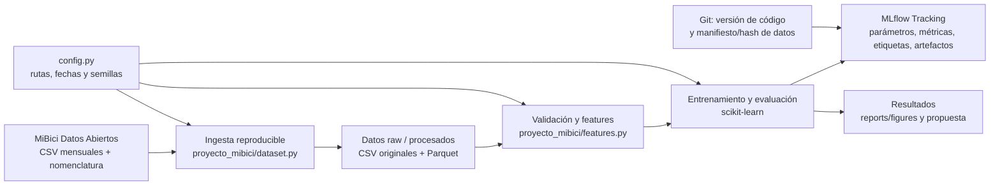

# Propuesta de solución MiBici

Este es el documento de trabajo para **todos los entregables de la Parte A**; se completará de manera incremental. El punto 1 responde las preguntas del ML Canvas. El punto 2 ya documenta el rango, las fuentes y un conteo inicial, y continuará inciso por inciso. Los puntos 3–7 se irán completando y respaldando con exploración, código y resultados conforme avance el proyecto. Las propuestas aún no aprobadas por el equipo están identificadas como tales.

## Parte A. Propuesta de solución

### 1. Formular el problema

Las preguntas de negocio P1, P2 y P3 que aparecen abajo se conservan **sin cambiar su redacción** respecto de [context.md](./context.md). Las columnas siguientes proponen cómo operacionalizarlas como tareas de ML; no modifican lo que pregunta el proyecto. El equipo debe validar esas decisiones antes de implementarlas. En particular, los datos disponibles no registran inventario de bicicletas ni anclajes ocupados, por lo que con los archivos actuales no se puede entrenar ni validar directamente si una estación se quedó sin bicicletas o sin anclajes.

#### Formulación de las preguntas

| Pregunta de negocio (redacción de `context.md`) | Tipo de tarea | Operacionalización propuesta: qué se predice o agrupa | Entidad, granularidad y horizonte | Relevancia operativa, usuario y decisión que apoyaría |
| --- | --- | --- | --- | --- |
| **P1:** ¿Cuántos viajes se iniciarán en una estación o zona en un periodo futuro? | Regresión | Número de viajes iniciados. Para acotar el primer experimento, se propone predecir viajes iniciados **por estación** (no por zona); sumar estaciones en una zona podría explorarse después si se define y justifica esa geografía. | Estación × hora; número de inicios durante la próxima hora (`t+1`), con predictores disponibles hasta el corte `t`. | Permite anticipar dónde se concentrarán los inicios de viaje. El operador del sistema podría priorizar estaciones y planear la disponibilidad de flota para el periodo cercano. |
| **P2:** ¿Una estación estará en riesgo de quedarse sin bicicletas o sin anclajes disponibles en un periodo futuro? | Clasificación | **Objetivo de negocio:** riesgo futuro de falta de bicicletas o de anclajes. **Limitación decisiva:** no hay registros de ocupación ni de eventos de falta, de modo que no es posible construir ni validar directamente la etiqueta verdadera con los datos disponibles. Como análisis alternativo, podría clasificarse presión de flujo, pero sería solo un proxy y no respondería por sí mismo si la estación efectivamente se quedó sin bicicletas o anclajes. | El grano propuesto para investigar el riesgo es estación × hora, con horizonte de la siguiente hora (`t+1`). El horizonte es una decisión de alcance inicial, no parte de la definición original. | La pregunta original es relevante para actuar antes de que una estación no pueda prestar o recibir bicicletas. El equipo de rebalanceo usaría la estimación para priorizar verificaciones o movimientos; sin inventario observado no se puede recomendar una acción fiable ni afirmar que el proxy mida ese riesgo real. |
| **P3:** ¿Qué grupos de estaciones comparten patrones de uso y dónde se ubican en la ciudad? | Clustering | Grupos de estaciones con patrones de uso similares y descripción de sus perfiles; ubicar cada estación del grupo en la ciudad usando coordenadas validadas. | Una entidad por estación, representada por un perfil agregado de uso del periodo octubre de 2025–septiembre de 2026. Es descriptivo y no tiene horizonte de pronóstico. | Ayuda a comparar patrones y su distribución espacial. Planeación urbana y responsables de expansión podrían usar los grupos para identificar zonas y estaciones para análisis adicional de cobertura o expansión, no como decisión automática. |

**P2: diferencia entre la pregunta y un proxy posible.** La pregunta de negocio establecida permanece “¿Una estación estará en riesgo de quedarse sin bicicletas o sin anclajes disponibles en un periodo futuro?”. No se redefine como “¿habrá presión de flujo?”. Los CSV informan viajes iniciados y terminados, pero no inventario inicial, ocupación de anclajes, faltantes observados ni acciones de redistribución; por ello falta la etiqueta necesaria para entrenar y medir directamente la clasificación de riesgo solicitada.

Si el equipo decide conservar un experimento de clasificación con los datos existentes, una variable sustituta posible es el balance de flujo:

`balance(s, t+1) = salidas(s, t+1) - llegadas(s, t+1)`

Opcionalmente podría normalizarse por capacidad solo si se valida que la capacidad de `nomenclatura_2026_09.csv` es pertinente para cada estación y fecha. Un umbral `τ` podría etiquetar dirección/intensidad de presión (por ejemplo, balance positivo elevado frente a negativo elevado), pero `τ` debe definirse sin usar prueba y el valor `0.25` del plan es únicamente un candidato exploratorio. **Ese resultado sería una predicción de presión neta de flujo, no una predicción verificada de quedarse sin bicicletas ni de no tener anclajes.** Para responder la pregunta de negocio literalmente se necesitarían datos históricos de disponibilidad/inventario o eventos de estaciones vacías/llenas, idealmente también de rebalanceo.

#### ML Canvas — respuestas a las preguntas del formato

**Diseñado para:** proyecto MiBici de TC5061, equipo 25.

**Diseñado por:** equipo del proyecto; nombres por completar.

**Fecha:** 15 de octubre de 2026. **Iteración:** propuesta inicial para discusión; las decisiones marcadas como pendientes deben validarse con el equipo.

##### Prediction Task

- **¿Qué tipo de tarea es?** P1 es regresión supervisada de conteos; P2 está planteada en el contexto como clasificación del riesgo de falta de bicicletas o anclajes; P3 es clustering no supervisado y descriptivo.
- **¿Sobre qué entidad se hacen las predicciones?** P1 y P2: cada entidad es una estación en una hora, con granularidad estación × hora. P3: cada entidad es una estación representada por un perfil de uso agregado.
- **¿Cuáles son los resultados posibles?** P1: conteo no negativo de viajes iniciados en la siguiente hora por estación. P2: la salida de negocio sería la clase de riesgo de falta de bicicletas o anclajes. P3: asignación de grupo, perfil interpretativo y ubicación geográfica validada de las estaciones.
- **¿Cuándo se observan los resultados?** P1: se produciría al cierre de cada hora para la hora siguiente (`t+1`) y el conteo real se obtendría después a partir de los viajes observados. P2: el evento real de falta tendría que observarse durante/después del horizonte futuro. P3 no tiene horizonte futuro.
- **P2 — etiqueta y alcance:** no se puede definir una etiqueta supervisada de riesgo real a partir de los CSV disponibles. Solo si el equipo lo aprueba se derivaría un proxy basado en el balance de salidas y llegadas, con clases de presión claramente diferenciadas del objetivo de negocio. La normalización por capacidad y el umbral requieren justificación y validación; el proxy no debe presentarse como predicción de una estación vacía/llena.

##### Decisions

- **¿Cómo se convierten las predicciones en recomendaciones o decisiones accionables?** P1 permitirá priorizar estaciones con mayor demanda prevista para planear el rebalanceo. P2 generará alertas ordenadas por probabilidad y gravedad para priorizar intervenciones. P3 permitirá identificar perfiles de estaciones y zonas que podrían requerir ajustes de capacidad o expansión. Las recomendaciones deberán considerar inventario, capacidad, distancia, costos y disponibilidad de personal; los umbrales operativos deberán definirse con MiBici.
- **¿Qué parámetros del proceso usaría quien decide?** Como salida útil se propone ordenar estaciones por viajes previstos (P1). Para P2, solo si se obtiene y valida la etiqueta real, se podrían mostrar la clase de riesgo, el horizonte y la confianza del modelo; un eventual proxy se mostraría aparte como presión de flujo y no como riesgo. Umbrales de operación, capacidad real, rutas, costos y límites de recursos no están en los CSV y tendrían que ser definidos con MiBici.
- **¿Cómo se integra en el flujo de trabajo o interfaz?** Para la entrega académica, informes, tablas y artefactos del experimento. Una interfaz de operación no forma parte del alcance implementado. A futuro podría ser un tablero consultado por operación/planeación, sujeto a aprobación y a disponibilidad de datos operativos.

##### Value Proposition

- **¿Quién es beneficiario final y qué problema concreto se atiende?** Los beneficiarios son los usuarios de MiBici y los equipos responsables de su operación y planeación. P1 (regresión) busca anticipar la demanda para distribuir mejor las bicicletas; P2 (clasificación) busca identificar estaciones con riesgo de desabasto o saturación; y P3 (clustering) busca agrupar estaciones con patrones de uso similares para orientar decisiones de capacidad y expansión.
- **¿Cómo encaja la solución en su flujo?** P1 podría apoyar la priorización de revisiones y planificación de recursos. P2 solo podría apoyar decisiones una vez que se valide con observaciones reales de disponibilidad; sin ellas, el proxy de flujo se limita a análisis exploratorio. P3 proporciona grupos, perfiles y ubicaciones comparables para análisis de cobertura y expansión. Los resultados se podrían presentar en tableros de visualización y servirán como apoyo para los operadores, sin automatizar inicialmente los movimientos de bicicletas.
- **¿Qué valor se espera?** Mejor información para priorizar atención y planeación. Ahorros, aumento de disponibilidad, reducción de viajes fallidos y otros beneficios son hipótesis: los datos disponibles no permiten cuantificarlos ni atribuirles causalidad.

##### Data Collection

- **¿Cómo se obtiene el conjunto inicial de entidades y resultados?** Descarga por lotes de los archivos CSV mensuales de viajes del rango confirmado y de la nomenclatura disponible; para P1, el procesamiento derivaría entidades estación-hora y los conteos observados. No se realizará etiquetado manual. La etiqueta de riesgo real de P2 no viene en estos datos, por lo que se determinará a partir de la “presión” o “flujo” sobre la estación; en un futuro, sería ideal determinar el inventario de bicicletas y registrar incidentes reales para mejorar estos modelos. P3 construirá perfiles de uso por estación sin necesidad de etiquetas.
- **¿Cómo se actualizarán los datos controlando costo y frescura?** Para el proyecto, una ingesta local reproducible de los archivos descargados es suficiente. Si MiBici publica un nuevo mes, se podría añadir en una actualización mensual y regenerar agregados/versiones. No se requiere ni se ha comprobado una API o transmisión en tiempo real; la frescura depende de la publicación del proveedor.

##### Data Sources

- **¿Dónde se obtienen entidades y resultados observados?** En la página oficial de Datos abiertos de MiBici: https://www.mibici.net/es/datos-abiertos/
Son archivos mensuales `datos_abiertos_AAAA_MM.csv`, además de un archivo para las nomenclaturas y ubicaciones de las estaciones `nomenclatura_2026_09.csv`. Se utilizarán inicio_viaje, fin_viaje, origen_id y destino_id para construir variables de demanda y uso.
El primer mes del que se tiene registro es de Diciembre del 2014.

##### Features

- **¿Qué representaciones se usan para las entidades en el momento de predecir?** P1: vector por estación-hora con calendario y conteos pasados.En P2, cada observación será una estación en un instante determinado, con información de demanda reciente, entradas, salidas. P3: vector por estación con un perfil de demanda agregado (por ejemplo, actividad por hora/día de semana). La latitud/longitud complementarán el análisis descriptivo de los grupos.
- **¿Qué agregaciones o transformaciones se aplican?** `Origen_Id` se agregaría como salidas y `Destino_Id` como llegadas por hora. Se completarán horas sin viajes para estaciones activas. Para P1 se usaría como objetivo el número de salidas en la siguiente hora. Para P2, el balance de salidas y llegadas puede servir únicamente para crear una etiqueta proxy de presión, y bajo ciertos umbrales se definirán niveles de riesgo. Los predictores temporales candidatos incluyen calendario, rezagos de 1 h, 3 h, 24 h y 7 días, y promedios móviles calculados únicamente con observaciones ya disponibles. Para P3 se normalizarán perfiles para que el volumen no domine inadvertidamente la forma horaria, sujeto a exploración.
- **¿Qué se excluye?** `Usuario_Id`, `Genero` y `Año_de_nacimiento` no son necesarios para estas preguntas iniciales y se excluirán del modelado. No se usarán valores de viajes posteriores al corte para predecir P1/P2.

##### Making Predictions

- **¿Batch o tiempo real?** P1 y P3 funcionarán por lotes. P2 también funcionará inicialmente por lotes, pero podría operar con mayor frecuencia si se dispone de inventario actualizado.
- **¿Con qué frecuencia?** P1 generará pronósticos por hora. P2 se ejecutará por hora. P3 actualizará los grupos trimestralmente.
- **¿Cuánto tiempo hay para featurización y decisión?** Se propone un máximo inicial de cinco minutos por ejecución diaria de P1 y P2, y de 15 minutos por actualización trimestral de P3. El tiempo humano necesario para revisar y ejecutar las recomendaciones se medirá por separado.
- **¿Qué recursos computacionales se usarían?** Los modelos se ejecutarán en CPU mediante procesos programados en Python. Los resultados se almacenarán en archivos o bases de datos y se visualizarán en un tablero. Si este proyecto se llevara a producción, se podrían emplear APIs para consumir los modelos y tomar decisiones más precisas.

##### Building Models

- **¿Cuántos modelos se necesitan en producción?** Se proponen tres modelos principales: uno de regresión para P1, uno de clasificación para P2 y uno de clustering para P3. Se utilizarán modelos de referencia para comparar el rendimiento. Por tener fines académicos, no se tiene contemplado que entren en producción.
- **¿Cuándo se actualizan?** Se podría proponer que P1 se evalúe mensualmente y se reentrenará si disminuye su precisión. P2 se revisará mensualmente o cuando cambien los patrones de incidentes. P3 actualizará sus grupos trimestralmente o cuando existan cambios importantes en las estaciones.
- **¿Cuánto tiempo hay para construirlos?** No hay plazo de inferencia/modelado operacional establecido. La entrega se hará como experimento reproducible fuera de línea.
- **¿Qué recursos se usan?** Python local y librerías de análisis/modelado del entorno del proyecto. La selección final dependerá del costo computacional medido y de que los resultados se puedan reproducir. Posteriormente, se podría buscar escalar el proyecto para desplegar en la nube y facilitar entornos de predicción tiempo real.

##### Impact Simulation

- **¿Cuánto cuestan o valen las decisiones correctas e incorrectas?** No se conocen costos monetarios ni consecuencias cuantificadas de una estación con presión, una alerta errónea o un movimiento de bicicleta.
- **¿Qué datos simularían el impacto antes del despliegue?** Inventario por estación y hora, disponibilidad de anclajes, eventos de estaciones vacías/llenas, acciones de rebalanceo, demanda no satisfecha y costos/tiempos de operación. Esos datos no están en los CSV disponibles. Por ahora solo se puede evaluar desempeño predictivo retrospectivo, no impacto causal.
- **¿Qué criterios permitirían desplegar?** Como mínimo: desempeño en prueba temporal frente al baseline, ausencia de fuga temporal, robustez por estación/periodo, revisión por operación y validación con inventario/impacto real. Los umbrales de aceptación numéricos se definirán cuando se acuerden métricas y consecuencias de error.
- **¿Hay restricciones de equidad?** No se usarían atributos demográficos de usuarios. Se debe revisar cobertura y error por estación/zona para detectar sistemáticamente áreas mal representadas o desatendidas. El equipo debe definir criterios de equidad con las personas responsables de las decisiones urbanas y operativas; no se pueden inferir solo de los CSV.

##### Monitoring

- **¿Qué métricas y KPIs medirían el impacto?** Para P1, error de conteos y sesgo por estación/periodo; para P2, solo después de obtener etiquetas de riesgo reales se medirían recall/F1 de esa tarea y la tasa de alertas. Si se evalúa el proxy, recall/F1 y matriz de confusión medirán exclusivamente clases de presión de flujo. Para P3, estabilidad de grupos, calidad estadística e interpretabilidad. KPIs operativos futuros incluirían disponibilidad de bicicletas/anclajes y eventos de falta, que requieren datos adicionales. Las métricas predictivas no deben presentarse como impacto en el servicio.
- **¿Con qué frecuencia se revisan?** No hay un despliegue ni cadencia acordada. En el prototipo se revisarán en cada evaluación temporal. Si se desplegara, se propone revisión periódica (por ejemplo, mensual) y adicional ante cambios de datos o alertas de deriva; la periodicidad definitiva corresponde al equipo operativo.

### 2. Definir los datos

#### Rango de fechas propuesto

**Decisión actual:** utilizar los archivos mensuales desde **octubre de 2023 hasta septiembre de 2026**, ambos meses incluidos (36 meses consecutivos).

**Justificación:**

- Tres años completos permiten observar varios ciclos estacionales y aportan más ejemplos para las agregaciones estación-hora y los perfiles de uso que una sola anualidad.
- Los 36 archivos mensuales del rango están presentes consecutivamente en `data/raw`; el inventario total del repositorio abarca 142 meses, desde diciembre de 2014 hasta septiembre de 2026. Se elige el subconjunto reciente para acotar el análisis y mantener relevancia temporal.
- La ventana está definida por los archivos mensuales publicados. En la preparación se verificarán las fechas registradas en cada archivo; los conteos de este documento corresponden a las filas de esos 36 archivos, no a un filtro independiente por cada timestamp.

**Estado:** rango decidido por el usuario para la propuesta; aprobación del resto del equipo pendiente.

#### 1. Fuente

Los archivos se publican en la página oficial de [Datos abiertos de MiBici](https://www.mibici.net/es/datos-abiertos/), que anuncia descargas CSV clasificadas por mes y año y muestra los enlaces siguientes. La página presenta los datos con la invitación “Explora, experimenta y comparte los datos de uso de Mi Bici”.

**Archivos de viajes del periodo seleccionado y filas leídas:**

| Mes de archivo | Filas de viajes | Archivo CSV oficial |
| --- | ---: | --- |
| 2023-10 | 383,239 | [datos_abiertos_2023_10.csv](https://www.mibici.net/site/assets/files/54935/datos_abiertos_2023_10.csv) |
| 2023-11 | 384,464 | [datos_abiertos_2023_11.csv](https://www.mibici.net/site/assets/files/57344/datos_abiertos_2023_11.csv) |
| 2023-12 | 314,164 | [datos_abiertos_2023_12.csv](https://www.mibici.net/site/assets/files/58715/datos_abiertos_2023_12.csv) |
| 2024-01 | 391,591 | [datos_abiertos_2024_01.csv](https://www.mibici.net/site/assets/files/61450/datos_abiertos_2024_01.csv) |
| 2024-02 | 383,732 | [datos_abiertos_2024_02.csv](https://www.mibici.net/site/assets/files/77251/datos_abiertos_2024_02.csv) |
| 2024-03 | 390,513 | [datos_abiertos_2024_03.csv](https://www.mibici.net/site/assets/files/77252/datos_abiertos_2024_03.csv) |
| 2024-04 | 405,308 | [datos_abiertos_2024_04.csv](https://www.mibici.net/site/assets/files/80028/datos_abiertos_2024_04.csv) |
| 2024-05 | 410,806 | [datos_abiertos_2024_05.csv](https://www.mibici.net/site/assets/files/81663/datos_abiertos_2024_05.csv) |
| 2024-06 | 365,000 | [datos_abiertos_2024_06.csv](https://www.mibici.net/site/assets/files/83901/datos_abiertos_2024_06.csv) |
| 2024-07 | 364,177 | [datos_abiertos_2024_07.csv](https://www.mibici.net/site/assets/files/85500/datos_abiertos_2024_07.csv) |
| 2024-08 | 394,894 | [datos_abiertos_2024_08.csv](https://www.mibici.net/site/assets/files/87665/datos_abiertos_2024_08.csv) |
| 2024-09 | 390,072 | [datos_abiertos_2024_09.csv](https://www.mibici.net/site/assets/files/89736/datos_abiertos_2024_09.csv) |
| 2024-10 | 418,690 | [datos_abiertos_2024_10.csv](https://www.mibici.net/site/assets/files/91758/datos_abiertos_2024_10.csv) |
| 2024-11 | 391,089 | [datos_abiertos_2024_11.csv](https://www.mibici.net/site/assets/files/93516/datos_abiertos_2024_11.csv) |
| 2024-12 | 340,049 | [datos_abiertos_2024_12.csv](https://www.mibici.net/site/assets/files/94962/datos_abiertos_2024_12.csv) |
| 2025-01 | 380,184 | [datos_abiertos_2025_01.csv](https://www.mibici.net/site/assets/files/97653/datos_abiertos_2025_01.csv) |
| 2025-02 | 372,529 | [datos_abiertos_2025_02.csv](https://www.mibici.net/site/assets/files/99879/datos_abiertos_2025_02.csv) |
| 2025-03 | 405,110 | [datos_abiertos_2025_03.csv](https://www.mibici.net/site/assets/files/101986/datos_abiertos_2025_03.csv) |
| 2025-04 | 366,193 | [datos_abiertos_2025_04.csv](https://www.mibici.net/site/assets/files/103813/datos_abiertos_2025_04.csv) |
| 2025-05 | 395,891 | [datos_abiertos_2025_05.csv](https://www.mibici.net/site/assets/files/105513/datos_abiertos_2025_05.csv) |
| 2025-06 | 356,611 | [datos_abiertos_2025_06.csv](https://www.mibici.net/site/assets/files/107088/datos_abiertos_2025_06.csv) |
| 2025-07 | 368,186 | [datos_abiertos_2025_07.csv](https://www.mibici.net/site/assets/files/108898/datos_abiertos_2025_07.csv) |
| 2025-08 | 374,727 | [datos_abiertos_2025_08.csv](https://www.mibici.net/site/assets/files/111021/datos_abiertos_2025_08.csv) |
| 2025-09 | 376,789 | [datos_abiertos_2025_09.csv](https://www.mibici.net/site/assets/files/113216/datos_abiertos_2025_09.csv) |
| 2025-10 | 420,064 | [datos_abiertos_2025_10.csv](https://www.mibici.net/site/assets/files/115104/datos_abiertos_2025_10.csv) |
| 2025-11 | 380,328 | [datos_abiertos_2025_11.csv](https://www.mibici.net/site/assets/files/116773/datos_abiertos_2025_11.csv) |
| 2025-12 | 335,420 | [datos_abiertos_2025_12.csv](https://www.mibici.net/site/assets/files/118153/datos_abiertos_2025_12.csv) |
| 2026-01 | 357,180 | [datos_abiertos_2026_01.csv](https://www.mibici.net/site/assets/files/120163/datos_abiertos_2026_01.csv) |
| 2026-02 | 333,756 | [datos_abiertos_2026_02.csv](https://www.mibici.net/site/assets/files/121761/datos_abiertos_2026_02.csv) |
| 2026-03 | 376,243 | [datos_abiertos_2026_03.csv](https://www.mibici.net/site/assets/files/123236/datos_abiertos_2026_03.csv) |
| 2026-04 | 351,851 | [datos_abiertos_2026_04.csv](https://www.mibici.net/site/assets/files/124927/datos_abiertos_2026_04.csv) |
| 2026-05 | 315,895 | [datos_abiertos_2026_05.csv](https://www.mibici.net/site/assets/files/125943/datos_abiertos_2026_05.csv) |
| 2026-06 | 355,303 | [datos_abiertos_2026_06.csv](https://www.mibici.net/site/assets/files/127734/datos_abiertos_2026_06.csv) |
| 2026-07 | 388,257 | [datos_abiertos_2026_07.csv](https://www.mibici.net/site/assets/files/129006/datos_abiertos_2026_07.csv) |
| 2026-08 | 393,524 | [datos_abiertos_2026_08.csv](https://www.mibici.net/site/assets/files/130362/datos_abiertos_2026_08.csv) |
| 2026-09 | 490,056 | [datos_abiertos_2026_09.csv](https://www.mibici.net/site/assets/files/131825/datos_abiertos_2026_09.csv) |

**Nomenclatura de estaciones:** [nomenclatura_2026_09.csv](https://www.mibici.net/site/assets/files/1118/nomenclatura_2026_09.csv). Este archivo corresponde a septiembre de 2026; su aplicabilidad a todo el periodo se analizará junto con las variables y la calidad de los datos.

#### 2. Tamaño real

La lectura de los **36 archivos mensuales** encontró **13,621,885 filas de viajes**:

| Periodo dentro del rango | Meses | Viajes leídos |
| --- | ---: | ---: |
| 2023-10 a 2023-12 | 3 | 1,081,867 |
| 2024-01 a 2024-12 | 12 | 4,645,921 |
| 2025-01 a 2025-12 | 12 | 4,532,032 |
| 2026-01 a 2026-09 | 9 | 3,362,065 |
| **Total** | **36** | **13,621,885** |

Los campos `Origen_Id` y `Destino_Id` presentan **473 IDs de estación distintos** cada uno y **473 en su unión** a lo largo del periodo. La nomenclatura de septiembre de 2026 contiene **484 filas y 484 IDs distintos**: 471 de esos IDs aparecen en los viajes del periodo; 2 IDs de viaje no aparecen en esa nomenclatura y 13 IDs de la nomenclatura no aparecen en los viajes de estos 36 meses. Por tanto, 473 es el número de estaciones observadas en viajes, no una afirmación de que todas operaron durante los 36 meses. La nomenclatura es una instantánea actual, no un catálogo histórico.

Los conteos son de filas leídas, no todavía de viajes válidos después de depuración. Se contrastó la suma de las filas de los CSV seleccionados con los registros del Parquet completo filtrados por `mes_archivo`; ambas sumas coinciden en 13,621,885. La auditoría está en [1.0-eq25-auditoria-tamano-datos.ipynb](../../notebooks/1.0-eq25-auditoria-tamano-datos.ipynb).

**Auditoría de fechas del Parquet:** los archivos fuente de noviembre de 2023, septiembre de 2024 y octubre de 2024 escriben `Inicio_del_viaje` y `Fin_del_viaje` como `DD/MM/YYYY H:mm`; los demás meses usan `YYYY-MM-DD HH:MM:SS`. Esto afecta 1,193,226 filas en cada columna de fecha. La comparación de las 39,078,984 filas confirmó que el Parquet previo conservaba exactamente las cadenas de los CSV: no se encontró evidencia de que la escritura Parquet hubiera intercambiado los componentes de fecha. Sin embargo, la mezcla sí podía provocar interpretaciones ambiguas o incorrectas al parsear fechas automáticamente. El notebook ahora aplica cada formato de entrada de forma explícita y normaliza ambas columnas a `YYYY-MM-DD HH:MM:SS` al regenerar el Parquet.

#### 3. Variables originales y construcción de objetivos

| Variable original | Uso propuesto |
| --- | --- |
| `Viaje_Id` | Identificador del registro; solo para auditorías de duplicados/integridad. No será predictor ni se incluirá en las tablas analíticas o resultados publicados. |
| `Usuario_Id` | Identificador de usuario; se conserva únicamente en el Parquet local de datos de origen solicitado. Se excluye de predictores, tablas derivadas de modelado, MLflow y reportes. |
| `Genero`, `Año_de_nacimiento` | Datos demográficos; se conservan únicamente en el Parquet local de origen. No se usarán como predictores ni se expondrán en reportes. |
| `Inicio_del_viaje` | Fecha-hora de inicio; sirve para agregaciones temporales de viajes iniciados y variables de calendario. |
| `Fin_del_viaje` | Fecha-hora de fin; sirve para calcular llegadas a estaciones por hora. |
| `Origen_Id`, `Destino_Id` | Estación donde inicia y termina cada viaje; se usan para construir flujos por estación-hora y unir atributos de estación después de validar IDs. |
| `id`, `name`, `latitude`, `longitude`, `dpcapacity` de nomenclatura | Identificador, nombre, ubicación y capacidad nominal de la estación. Coordenadas y capacidad se usarían solo tras validar la correspondencia y las limitaciones temporales de la nomenclatura de septiembre de 2026. |

**Objetivos por pregunta:**

- **P1 — demanda:** para estación `s` y hora objetivo `h`, `viajes_inicio(s,h)` es el número de registros con `Origen_Id = s` y `Inicio_del_viaje` dentro de `h`. El objetivo de regresión es ese conteo en la siguiente hora (`h=t+1`). Las horas sin viajes se completarán con cero solo para estaciones activas en ese momento, cuya vigencia se debe verificar; no se supondrá que el catálogo de 2026 describe estaciones de 2023.
- **P2 — riesgo aproximado de falta de bicicletas o anclajes:** los archivos no observan ocupación ni eventos reales de estaciones vacías/llenas. En coherencia con el Canvas editado, se propone estimar el riesgo indirectamente mediante presión de flujo en la hora futura. Para estación `s`, hora `h` y capacidad nominal positiva `C_s`, definir `salidas(s,h)` como los viajes cuyo `Origen_Id` es `s` y `Inicio_del_viaje` ocurre en `h`; definir `llegadas(s,h)` como los viajes cuyo `Destino_Id` es `s` y `Fin_del_viaje` ocurre en `h`. Luego `balance(s,h) = salidas(s,h) - llegadas(s,h)` y `presion_relativa(s,h) = balance(s,h) / C_s`. Un valor positivo apunta a presión de salidas (posible falta de bicicletas); uno negativo, a presión de llegadas (posible falta de anclajes). Como punto de partida reproducible, se propone establecer en entrenamiento los percentiles 75 y 90 de `abs(presion_relativa)` como límites entre niveles bajo, moderado y alto; la dirección del balance diferencia la presión de salidas y de llegadas. Estos umbrales se congelan antes de validación/prueba y se reportan junto con las probabilidades de clase del clasificador. Esta etiqueta mide desequilibrio de viajes relativo a capacidad; **no confirma un faltante real**, porque no incluye inventario inicial, ocupación ni rebalanceo. La capacidad debe ser válida y estar conciliada históricamente; estaciones sin capacidad utilizable no tendrán etiqueta normalizada.
- **P3 — clustering:** no tiene variable objetivo etiquetada. Cada estación se representará con un perfil agregado de uso (por ejemplo, salidas/llegadas según hora y día de semana durante el periodo) y coordenadas para ubicar los grupos. La membresía del grupo y el perfil resultante son la salida del algoritmo no supervisado; no se utilizarán `Usuario_Id` ni atributos demográficos.

Las variables predictoras temporales para P1 y P2 serán conocidas al corte de predicción: calendario y rezagos/promedios históricos de salidas y llegadas. No incluirán el conteo de la hora objetivo ni información posterior al corte. `mes_archivo`, añadido al consolidar las fuentes, identifica el CSV mensual de origen y ayuda a auditar el rango; no sustituye las fechas de inicio/fin observadas. La construcción final se afinará después de la auditoría de calidad.

#### 4. Condiciones de uso y tratamiento de datos personales

La página de [Datos abiertos de MiBici](https://www.mibici.net/es/datos-abiertos/) invita a explorar, experimentar y compartir los datos y publica archivos descargables por mes. En la página consultada no se identificó una licencia de reutilización específica ni términos separados que definan atribución, redistribución o uso comercial del CSV. Por ello, se citará a MiBici como fuente, se conservará el nombre y periodo de los archivos, y no se afirmará una licencia abierta específica ni se redistribuirán los datos fila a fila sin confirmar antes las condiciones con MiBici.

Los [Términos y condiciones](https://www.mibici.net/es/termino-y-condiciones/) publicados se refieren principalmente a la suscripción y uso del servicio (por ejemplo, requisitos y uso personal/intransferible de la bicicleta); no se interpretan aquí como licencia de los archivos de datos. El [Aviso de privacidad integral de la Agencia Metropolitana](https://www.mibici.net/es/aviso-de-privacidad/) indica que la Agencia es responsable del tratamiento de los datos personales que recaba y que dicho tratamiento se sujeta a la normativa de protección de datos aplicable y a finalidades institucionales. Estas páginas se consultaron el 18 de octubre de 2026.

Aunque los CSV se ofrecen públicamente, contienen `Usuario_Id` y atributos demográficos que pueden relacionarse con personas. El equipo aplicará estas medidas:

1. Mantener intactas las ocho columnas originales en `data/processed/raw_data.parquet` solo como copia local de análisis, que permanece excluida de Git por `.gitignore`; no subirla a GitHub, MLflow, servicios externos ni compartirla como artefacto.
2. Para modelado, crear un conjunto analítico que excluya `Usuario_Id`, `Genero` y `Año_de_nacimiento`; `Viaje_Id` se usará solo para control de calidad y también se excluirá de features y artefactos.
3. No imprimir ni publicar filas individuales, identificadores, trayectorias por usuario ni cruces que permitan reidentificación. Compartir únicamente agregados por estación y periodo con tamaño suficiente para reducir riesgo de identificación.
4. Restringir el uso a los objetivos académicos documentados, limitar copias/acceso y revisar cada artefacto, notebook y captura antes de compartirlo.

La publicación abierta no elimina la responsabilidad del equipo de minimizar exposición y revisar las condiciones de reutilización vigentes.

#### 5. Partición temporal y prevención de información futura

Para P1 y P2 se propone una partición cronológica de las **horas objetivo**:

| Conjunto | Fechas de las horas objetivo | Uso |
| --- | --- | --- |
| Entrenamiento | 2023-10-01 a 2025-06-30 | Ajustar modelos y, para P2, calcular los umbrales de intensidad de la etiqueta proxy. |
| Validación | 2025-07-01 a 2025-09-30 | Seleccionar hiperparámetros/decisiones de modelado sin volver a ajustar umbrales con validación. |
| Prueba final | 2025-10-01 a 2026-09-30 | Una evaluación final sobre 12 meses completos que no se usa para elegir modelos, umbrales ni variables. |

Tras seleccionar el modelo con validación, se podrá reentrenar usando entrenamiento más validación y evaluar una sola vez en prueba; el cálculo de los umbrales de P2 se hará entonces con entrenamiento+validación, nunca con prueba. Para simular predicciones horarias en prueba se usará una evaluación de origen rodante: al predecir cada hora solo se emplean observaciones que ya habrían estado disponibles antes de esa hora. Las horas iniciales de entrenamiento sin historial suficiente para los rezagos se excluyen o se les asigna una regla definida sin mirar horas futuras.

Para P3, se ajustarán transformaciones y grupos usando perfiles construidos únicamente con el periodo de entrenamiento; validación y prueba se asignarán a los grupos ya definidos para revisar estabilidad. Ningún escalador, imputador, selección de variables, umbral o centroide se ajustará con datos de prueba.

El objetivo es medir el desempeño en periodos posteriores a los de ajuste y evitar que ventanas móviles, agregaciones, imputaciones o etiquetas usen información futura. La partición y la ventana de análisis deberán centralizarse después en `config.py`, conforme a las buenas prácticas del repositorio.

### 3. Diseñar el pipeline de ML

**Estado:** pipeline P3 diseñado inicialmente con el rango acordado y exploración del Parquet; pendiente validar las decisiones con el equipo. P1 y P2 siguen a cargo de sus responsables. La selección formal de modelos y métricas se documentará en el punto 4.

Las etapas se detallan por pregunta para conservar los requisitos propios de cada tarea. Para P3, el Parquet ya consolidado es la entrada de exploración; la lógica reutilizable se trasladará al módulo del proyecto y el notebook se mantendrá como evidencia exploratoria.

| Pregunta | Etapas específicas propuestas |
| --- | --- |
| **P1** | Usar `Inicio_del_viaje` y `Origen_Id` para contar viajes iniciados por estación-hora; completar horas sin salidas para estaciones activas. Construir objetivo de salidas en `t+1` y predictores de calendario y rezagos históricos. Entrenar regresor y comparar con baseline temporal; evaluar en partición cronológica. |
| **P2** | Para contestar la pregunta de negocio literalmente, primero se requieren datos etiquetados de disponibilidad o eventos de estaciones sin bicicletas/anclajes. Los CSV actuales no los contienen, por lo que la clasificación de riesgo no puede entrenarse ni evaluarse con verdad de terreno. Si el equipo acepta un análisis alternativo, agregar salidas y llegadas por estación-hora, completar ceros y calcular un proxy de presión de flujo en `t+1`; evaluar un clasificador de ese proxy y reportarlo expresamente como presión, no como riesgo de desabasto. |
| **P3** | Leer del Parquet solo las fechas, estaciones y mes de archivo del periodo octubre de 2023–septiembre de 2026; validar fechas e IDs y auditar estaciones no conciliadas. Convertir cada viaje en eventos de salida (estación origen, hora de inicio) y llegada (estación destino, hora de fin), y agregarlos por estación × dirección × día de semana × hora. Crear para cada estación un perfil de 336 tasas (salidas y llegadas para 7 × 24 intervalos), corregidas por el número de ocurrencias de cada franja en el periodo y normalizadas para comparar patrones sin que el volumen bruto domine. Ajustar un agrupador en entrenamiento, seleccionar sus decisiones con validación y evaluar la estabilidad temporal en prueba; después interpretar los perfiles y presentar los grupos en un mapa mediante coordenadas conciliadas que no se usan para agrupar. |

#### Pipeline P3: grupos de estaciones por patrón de uso

**Alcance de esta iteración:** se desarrolla únicamente P3. Las decisiones de P1 y P2 quedan para sus responsables; no se cambian aquí las formulaciones de los puntos 1 y 2.

| Etapa | Procedimiento propuesto para P3 | Variables y pertinencia |
| --- | --- | --- |
| Entrada y privacidad | Leer `data/processed/raw_data.parquet`, filtrar `mes_archivo` de 2023-10 a 2026-09 y seleccionar solo `Inicio_del_viaje`, `Fin_del_viaje`, `Origen_Id`, `Destino_Id` y `mes_archivo`. No cargar `Usuario_Id`, `Genero` ni `Año_de_nacimiento`; `Viaje_Id` no es feature. | Las fechas y estaciones bastan para describir cuándo y dónde ocurre el uso por estación, sin datos personales. |
| Limpieza y conciliación | Verificar formato y parseo de fechas, IDs vacíos, viajes con fin anterior al inicio y cobertura mensual. Normalizar IDs como texto para unirlos con `id` de la nomenclatura. No convertir la ausencia de actividad en cero para una estación/periodo sin observaciones; registrar el caso como falta de cobertura. | La auditoría exploratoria en el rango encontró 13,621,885 filas; ninguna tuvo fecha no interpretable, ID de estación vacío o fin anterior al inicio. Se observan 473 IDs en los viajes; 2 no aparecen en la nomenclatura de septiembre de 2026 y 13 IDs de esa nomenclatura no aparecen en los viajes del rango. |
| Eventos y agregación | Por viaje válido, generar una salida en la hora de `Inicio_del_viaje` para `Origen_Id` y una llegada en la hora de `Fin_del_viaje` para `Destino_Id`. Asignar cada evento al periodo temporal correspondiente y agregar los conteos por estación, dirección, día de semana y hora (168 intervalos semanales por dirección). Los eventos se asignan por su propia marca de tiempo y solo cuentan dentro de octubre de 2023–septiembre de 2026. En el rango auditado, 17 viajes iniciados en septiembre de 2026 terminan después del límite del 1 de octubre; sus llegadas quedan fuera del periodo, mientras que sus salidas sí se incluyen. | `salidas` y `llegadas` separan patrones de origen/destino; día de semana y hora capturan rutinas semanales recurrentes. No se usan conteos de usuarios ni trayectorias individuales. |
| Feature engineering | Formar una fila por estación con 336 features: salidas/llegadas para cada día de semana y hora. Primero dividir cada conteo por el número de veces que ocurre esa franja en el periodo (tasa media por ocurrencia); luego normalizar las 336 tasas para que sumen uno. Conservar volumen total y meses con actividad solo como descriptores externos para interpretar cobertura, no para calcular similitud. Tratar un intervalo sin eventos como cero únicamente cuando la estación sí tiene actividad observada en ese periodo; una estación sin actividad tiene perfil indefinido. | Las tasas corrigen diferencias en cuántos lunes, martes, etc. hay en cada ventana. La normalización posterior permite comparar forma temporal y mezcla entre salidas/llegadas sin que el volumen total domine. La normalización conjunta mantiene la información relativa entre direcciones. |
| Metadatos geográficos | Unir después del agrupamiento `name`, `latitude`, `longitude` y `dpcapacity` desde `nomenclatura_2026_09.csv`, validando la llave y reportando IDs sin correspondencia. Usar coordenadas para visualizar/interpretar dónde están los grupos; no incluirlas en el vector de clustering. No usar capacidad como feature en esta primera definición. | Separar ubicación del perfil evita que la distancia geográfica fuerce grupos de comportamiento. El catálogo actual es una instantánea de septiembre de 2026, no un historial de ubicaciones/capacidad. |
| Ajuste y selección | Ajustar escalamiento o cualquier transformación aprendida solo con el periodo de entrenamiento (2023-10 a 2025-06). Como agrupador inicial se probará un método particional como K-Means sobre los perfiles normalizados, sin escalado por columna por defecto, ya que las features comparten unidades y cada vector suma uno. Seleccionar el número de grupos y cualquier variante con validación (2025-07 a 2025-09), no con prueba. | No hay etiqueta objetivo para entrenamiento supervisado. El agrupador asigna estaciones a perfiles similares; la elección del número de grupos debe permitir perfiles entendibles y tamaños útiles para planeación. |
| Evaluación temporal e interpretación | Mantener fijos los centros/transformaciones ajustados en entrenamiento y asignar perfiles de validación (2025-07 a 2025-09) y prueba (2025-10 a 2026-09). Revisar silhouette y tamaños/perfiles de cada grupo; comparar asignaciones de los mismos centros entre periodos con Adjusted Rand Index (ARI) solo para estaciones observadas en ambos, e informar cuántas quedan fuera por cobertura. Interpretar los grupos con tablas de actividad y un mapa de coordenadas disponibles. | La estabilidad entre periodos comprueba si los patrones son recurrentes; silhouette, ARI e inspección experta son diagnósticos, no exactitud contra una verdad de terreno. No se reportará accuracy/recall como si hubiera etiquetas reales. |

#### Cobertura de estaciones

El número de estaciones con viajes observados varía por periodo: 371 en entrenamiento, 367 en validación y 471 en prueba; 367 aparecen en los tres. En la ventana completa hay 473 IDs de estación, y 104 tienen actividad en 12 meses o menos de los 36. Estos conteos describen presencia en los viajes, no prueban por sí solos el alta/baja operacional de una estación. El pipeline reportará los meses observados por estación y tratará por separado las de baja cobertura, para comprobar si afectan la forma de los grupos.

No se crearán perfiles vacíos para los 13 IDs de la nomenclatura sin viajes observados. Los 2 IDs que sí aparecen en viajes, pero no coinciden con el catálogo de septiembre de 2026, podrán tener perfil de uso; no se les asignará nombre ni coordenadas desconocidos.

#### Evaluación temporal y uso descriptivo

Para evaluar estabilidad sin fuga temporal, los perfiles de entrenamiento se usarán para ajustar los centros del agrupador. Esos mismos centros asignarán las estaciones de validación y prueba, sin reajustarse con sus datos. La comparación se hará sobre las estaciones con perfiles definidos en ambos periodos y se reportará cuántas quedan fuera por falta de actividad. Las métricas de agrupamiento describen separación y estabilidad; no miden exactitud contra etiquetas verdaderas, que no existen para P3.

Si se necesita mostrar una segmentación final basada en los 36 meses, se podrá reajustar el agrupador con todo el periodo después de cerrar la evaluación temporal. Esa segmentación se presentará como descripción del conjunto completo, separada de los resultados de prueba; no se le atribuirán métricas de generalización.

#### Implementación de features de P3

La ingeniería de variables de esta pregunta está implementada en [features_p3.py](../../proyecto_mibici/features_p3.py), separada del módulo de otras preguntas para que su propósito sea claro. `prepare_p3_trips` limpia las columnas requeridas y devuelve conteos de auditoría; `aggregate_p3_events` genera conteos de salidas/llegadas por estación y franja semanal; `build_p3_station_profiles` produce el vector de 336 features y descriptores de volumen/cobertura; `attach_p3_station_metadata` añade el catálogo para interpretación, sin mezclar ubicación en las features del agrupador. Los intervalos se corrigen por el número de veces que ocurre cada día-hora en el periodo antes de normalizar el perfil, evitando sesgos por diferencias de calendario.

El notebook [1.1-eq25-p3-perfiles-estaciones.ipynb](../../notebooks/1.1-eq25-p3-perfiles-estaciones.ipynb) documenta la exploración de datos y la validación de conteos; la lógica reusable queda en el módulo. La propuesta de baseline, algoritmo candidato y métricas se presenta en el punto 4 y deberá confirmarse después de revisar los resultados en entrenamiento y validación.

### 4. Proponer modelos y métricas

**Estado:** propuesta metodológica de P3 para revisión del equipo; P1 y P2 quedan a cargo de sus responsables. Ninguna métrica de experimento se ha calculado todavía y la exploración visual existente no valida por sí sola el baseline.

| Pregunta | Baseline propuesto | Modelo candidato propuesto | Métricas de evaluación |
| --- | --- | --- | --- |
| **P1 — Regresión** | Usar como predicción las salidas de la misma estación para la misma hora de la semana anterior. | Regresión de conteos con variables de calendario y rezagos; seleccionar el algoritmo candidato después de validar la distribución y los datos de entrenamiento. | MAE de prueba como métrica principal, por su interpretación en viajes de error promedio; RMSE de prueba como apoyo para penalizar errores grandes. Reportar también por estación o segmento operativo. |
| **P2 — Clasificación del riesgo solicitado** | No se puede establecer un baseline supervisado válido sin etiquetas históricas de falta de bicicletas/anclajes. | No se debe presentar un clasificador entrenado con viajes como si predijera el riesgo real. Si el equipo aprueba explícitamente el proxy, `DummyClassifier` y `LogisticRegression` podrían comparar la clasificación de presión de flujo. | Para la tarea real: pendiente de obtener etiquetas y acordar métrica. Para el proxy solamente: recall/F1 por clase y macro, matriz de confusión; estos resultados miden presión de flujo, no faltantes reales. |
| **P3 — Clustering** | Heurística de referencia: calcular por estación la proporción de actividad que ocurre sábado y domingo, sumar salidas y llegadas, y separar en dos grupos con la mediana calculada en entrenamiento. Mantener ese umbral al asignar validación y prueba. Se elige por ser una regla simple y explicable basada en una dimensión temporal del perfil; es una hipótesis de contraste, no una segmentación validada ni un resultado de la exploración actual. | `KMeans` sobre las 336 features del perfil semanal normalizado, para considerar el patrón completo de día, hora y dirección. Explorar `k` de 2 a 8, con varias inicializaciones y semilla fija; elegir usando validación e interpretabilidad, sin consultar prueba. | Calcular silhouette para baseline y candidato sobre los mismos perfiles de validación, para contrastar cohesión y separación; usarlo también como criterio interno al seleccionar `k`. Reportar tamaños y perfiles de grupos para valorar si son interpretables y útiles para planeación. Tras congelar las decisiones, calcular esas métricas en prueba una sola vez y medir estabilidad temporal con ARI entre asignaciones de periodos para estaciones comunes. No hay etiquetas verdaderas: las métricas no son exactitud ni demuestran utilidad operativa por sí solas. |

La regla de referencia resume una hipótesis plausible —que la proporción de uso en fin de semana distingue una dimensión sencilla de los patrones de estación— y sirve como comparación transparente con K-Means, que considera el perfil semanal completo. La figura exploratoria actual muestra promedios agregados por día y hora, no la distribución de esa proporción entre estaciones; por tanto, no es evidencia de que la división por mediana produzca grupos separados o útiles. Antes de cerrar el baseline se revisará esa distribución en entrenamiento y se comprobará que ambos grupos sean no vacíos; si la regla no genera una partición informativa, se documentará y revisará en validación en lugar de asumir su utilidad.

Para que la comparación sea justa, silhouette se calculará para ambas particiones usando las mismas features de perfil y la misma distancia, y solo cuando haya al menos dos grupos no vacíos y menos grupos que estaciones evaluadas. Un valor mayor describe grupos más compactos y separados según esa representación, pero no identifica por sí solo el mejor resultado para operación. Se reportarán también cantidades de estaciones y resúmenes de perfiles por grupo; estos permiten interpretar si los patrones podrían orientar decisiones de capacidad o expansión, sin afirmar impacto no medido. El ARI entre asignaciones de periodos mide si las estaciones compartidas conservan agrupación similar en el tiempo, no su calidad absoluta. La selección y cualquier ajuste se harán con entrenamiento y validación; una vez congelados se evaluará prueba una sola vez. P1 y P2 siguen en definición por sus responsables.

### 5. Proponer la arquitectura del sistema

**Estado: arquitectura conceptual inicial; herramientas por validar conforme a las lecturas y al experimento.**

La propuesta reutiliza la estructura existente del repositorio: `data/` para datos, `notebooks/` para exploración, `proyecto_mibici/` para ingesta y lógica reutilizable, `models/` para modelos si se serializan, `reports/figures/` para artefactos y `references/` para documentación. Pandas/Parquet se proponen para procesamiento y almacenamiento tabular; scikit-learn para modelos y métricas; MLflow para experimentos reproducibles. Rutas, fechas y semillas deberán centralizarse en `config.py`. Los datos crudos y credenciales no se incluirán en Git. Esta arquitectura es un diseño, no evidencia de que todos sus componentes ya estén implementados.

### 6. Ejecutar el experimento base en MLflow

**Estado:** baseline de P3 implementado y ejecutado desde el código del repositorio. P1 y P2 siguen pendientes y no se reportan como ejecutados.

El comando `python -m proyecto_mibici.modeling.experiment_p3` crea o reutiliza el experimento local `mibici-equipo25` y registra el run `p3-baseline-weekend-median`. El ejecutor lee por lotes solo las cinco columnas necesarias para P3; no incluye identificadores de usuarios ni datos personales en MLflow. Registra la ventana y particiones temporales, hash SHA-256 del Parquet, huella del código fuente, umbral aprendido en entrenamiento, parámetros, métricas y tags `team`, `question` y `git_commit`. El almacenamiento local usa SQLite (`mlflow.db`) y guarda los artefactos bajo `mlruns/`; ambos quedan excluidos de Git. Para evitar incompatibilidades del esquema SQLite, el proyecto fija MLflow en `3.17.1`; el run se ejecutó con esa versión y el commit `19f5108`, con el tag `git_worktree_dirty=true` porque había cambios locales sin commit. La huella de los módulos ejecutados también queda registrada.

El umbral de la regla de fin de semana se calculó una vez con entrenamiento y se mantuvo fijo. En el panel izquierdo del artefacto se observa que la mayoría de las estaciones de entrenamiento concentra aproximadamente entre 0.15 y 0.25 de su actividad en sábado y domingo, alrededor de la mediana de 0.1995; hay además una cola hacia proporciones mayores. Esto indica que la regla divide una dimensión continua cerca de su centro, no que los datos contengan dos grupos naturales. En el panel derecho, las estaciones de validación ordenadas por proporción cruzan el mismo umbral de forma gradual, sin un hueco claro que sugiera una separación espontánea. Por ello, “alto” y “bajo” deben entenderse como categorías operativas de esta heurística, no como tipos intrínsecos de estación.

Silhouette se calculó en validación y, como diagnóstico final tras congelar la regla, una sola vez en prueba. Los valores de 0.0366 y 0.0421 son cercanos a cero: con el perfil completo de 336 variables y distancia euclidiana, la partición presenta poca separación entre grupos. La ligera diferencia entre periodos no es evidencia de mejora. En entrenamiento y validación los tamaños son casi equilibrados por la mediana; en prueba la asignación es 167 frente a 304. Ese cambio puede reflejar diferencias en cobertura y composición de estaciones activas, además de variaciones en los perfiles, por lo que no debe interpretarse por sí solo como un cambio operacional de toda la red. En conjunto, los resultados hacen que este baseline sea útil como contraste interpretable, pero débil como segmentación descriptiva; no demuestran utilidad operativa ni la existencia de grupos naturales.

| Pregunta | Run | Resultado |
| --- | --- | --- |
| P1 | Pendiente | Se llenará tras ejecutar y validar el baseline. |
| P2 | Pendiente | Se llenará tras definir la etiqueta y ejecutar el baseline. |
| P3 | `p3-baseline-weekend-median` (`8c65f476fbea4be3beb6282a7c768529`) | Umbral de fin de semana: 0.1995. Silhouette: 0.0366 en validación (367 estaciones; grupos 177/190) y 0.0421 en prueba (471 estaciones; grupos 167/304). En entrenamiento: 371 estaciones; grupos 186/185. Artefacto `figures/p3-baseline-weekend-share.png`. |

Para consultar el resultado desde la raíz del repositorio y con el entorno que tiene MLflow `3.17.1`: `mlflow ui --backend-store-uri sqlite:///mlflow.db`.

### 7. Capturar la evidencia

**Estado: pendiente; requiere que los runs estén registrados y MLflow esté disponible.**

Se incorporarán evidencias de: (1) lista de runs del experimento, (2) detalle de un run mostrando parámetros, métricas y etiquetas, (3) artefacto registrado y (4) comparación de dos o más runs. Las capturas no se crearán hasta tener resultados reales.

## Referencias

- [Contexto e instrucciones del proyecto](./context.md).
- [Plan de trabajo del equipo](./Plan_de_trabajo_MiBici_4_integrantes.pdf).
- [Formato Machine Learning Canvas v1.2](./Machine%20Learning%20Canvas%20(v1.2).pdf), de [OWNML](https://www.ownml.co/), Louis Dorard. Versión 1.2, licencia Creative Commons Atribución-CompartirIgual 4.0.
