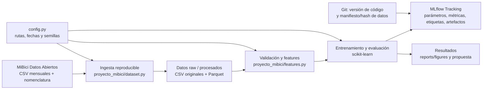

# Propuesta de solución MiBici

Este es el documento de trabajo para **todos los entregables de la Parte A**; se completará de manera incremental. El punto 1 responde las preguntas del ML Canvas. El punto 2 ya documenta el rango, las fuentes y un conteo inicial, y continuará inciso por inciso. Los puntos 3–7 se irán completando y respaldando con exploración, código y resultados conforme avance el proyecto. Las propuestas aún no aprobadas por el equipo están identificadas como tales.

## Parte A. Propuesta de solución

### 1. Formular el problema

Las preguntas de negocio P1, P2 y P3 que aparecen abajo se conservan **sin cambiar su redacción** respecto de [context.md](./context.md). Las columnas siguientes proponen cómo operacionalizarlas como tareas de ML; no modifican lo que pregunta el proyecto. El equipo debe validar esas decisiones antes de implementarlas. En particular, los datos disponibles no registran inventario de bicicletas ni anclajes ocupados, por lo que con los archivos actuales no se puede entrenar ni validar directamente si una estación se quedó sin bicicletas o sin anclajes.

#### Formulación de las preguntas

| Pregunta de negocio (redacción de `context.md`) | Tipo de tarea | Operacionalización propuesta: qué se predice o agrupa | Entidad, granularidad y horizonte | Relevancia operativa, usuario y decisión que apoyaría |
| --- | --- | --- | --- | --- |
| **P1:** ¿Cuántos viajes se iniciarán en una estación o zona en un periodo futuro? | Regresión | Número de viajes iniciados. Para acotar el primer experimento, se propone predecir viajes iniciados **por estación** (no por zona); sumar estaciones en una zona podría explorarse después si se define y justifica esa geografía. | Estación × hora; número de inicios durante la próxima hora (`t+1`), con predictores disponibles hasta el corte `t`. | Permite anticipar dónde se concentrarán los inicios de viaje. El operador del sistema podría priorizar estaciones y planear la disponibilidad de flota para el periodo cercano. |
| **P2:** ¿Una estación estará en riesgo de quedarse sin bicicletas o sin anclajes disponibles en un periodo futuro? | Clasificación | **Objetivo de negocio:** riesgo futuro de falta de bicicletas o de anclajes. **Limitación decisiva:** no hay registros de ocupación ni de eventos de falta, de modo que no es posible construir ni validar directamente la etiqueta verdadera con los datos disponibles. Como análisis alternativo, podría clasificarse presión de flujo, pero sería solo un proxy y no respondería por sí mismo si la estación efectivamente se quedó sin bicicletas o anclajes. | El grano propuesto para investigar el riesgo es estación × hora, con horizonte de la siguiente hora (`t+1`). El horizonte es una decisión de alcance inicial, no parte de la definición original. | La pregunta original es relevante para actuar antes de que una estación no pueda prestar o recibir bicicletas. El equipo de rebalanceo usaría la estimación para priorizar verificaciones o movimientos; sin inventario observado no se puede recomendar una acción fiable ni afirmar que el proxy mida ese riesgo real. |
| **P3:** ¿Qué grupos de estaciones comparten patrones de uso y dónde se ubican en la ciudad? | Clustering | Grupos de estaciones con patrones de uso similares y descripción de sus perfiles; ubicar cada estación del grupo en la ciudad usando coordenadas validadas. | Una entidad por estación, representada por un perfil agregado de uso del periodo octubre de 2025–septiembre de 2026. Es descriptivo y no tiene horizonte de pronóstico. | Ayuda a comparar patrones y su distribución espacial. Planeación urbana y responsables de expansión podrían usar los grupos para identificar zonas y estaciones para análisis adicional de cobertura o expansión, no como decisión automática. |

**P2: diferencia entre la pregunta y un proxy posible.** La pregunta de negocio establecida permanece “¿Una estación estará en riesgo de quedarse sin bicicletas o sin anclajes disponibles en un periodo futuro?”. No se redefine como “¿habrá presión de flujo?”. Los CSV informan viajes iniciados y terminados, pero no inventario inicial, ocupación de anclajes, faltantes observados ni acciones de redistribución; por ello falta la etiqueta necesaria para entrenar y medir directamente la clasificación de riesgo solicitada.

Si el equipo decide conservar un experimento de clasificación con los datos existentes, una variable sustituta posible es el balance de flujo:

`balance(s, t+1) = salidas(s, t+1) - llegadas(s, t+1)`

Opcionalmente podría normalizarse por capacidad solo si se valida que la capacidad de `nomenclatura_2026_09.csv` es pertinente para cada estación y fecha. Un umbral `τ` podría etiquetar dirección/intensidad de presión (por ejemplo, balance positivo elevado frente a negativo elevado), pero `τ` debe definirse sin usar prueba y el valor `0.25` del plan es únicamente un candidato exploratorio. **Ese resultado sería una predicción de presión neta de flujo, no una predicción verificada de quedarse sin bicicletas ni de no tener anclajes.** Para responder la pregunta de negocio literalmente se necesitarían datos históricos de disponibilidad/inventario o eventos de estaciones vacías/llenas, idealmente también de rebalanceo.

#### ML Canvas — respuestas a las preguntas del formato

**Diseñado para:** proyecto MiBici de TC5061, equipo 25.

**Diseñado por:** equipo del proyecto; nombres por completar.

**Fecha:** 15 de octubre de 2026. **Iteración:** propuesta inicial para discusión; las decisiones marcadas como pendientes deben validarse con el equipo.

##### Prediction Task

- **¿Qué tipo de tarea es?** P1 es regresión supervisada de conteos; P2 está planteada en el contexto como clasificación del riesgo de falta de bicicletas o anclajes, pero no hay etiqueta observada para entrenar/validar esa tarea; P3 es clustering no supervisado y descriptivo.
- **¿Sobre qué entidad se hacen las predicciones?** P1 y P2: cada entidad es una estación en una hora, con grano estación × hora. P3: cada entidad es una estación representada por un perfil de uso agregado.
- **¿Cuáles son los resultados posibles?** P1: conteo no negativo de viajes iniciados en la siguiente hora por estación. P2: la salida de negocio sería la clase de riesgo de falta de bicicletas o anclajes; su etiqueta no existe en los datos actuales. Si se acuerda usar un proxy, la salida sería una clase de presión de flujo y deberá nombrarse y reportarse como tal, no como riesgo real. P3: asignación de grupo, perfil interpretativo y ubicación geográfica validada de las estaciones.
- **¿Cuándo se observan los resultados?** P1: se produciría al cierre de cada hora para la hora siguiente (`t+1`) y el conteo real se obtendría después a partir de los viajes observados. P2: el evento real de falta tendría que observarse durante/después del horizonte futuro, pero los CSV actuales no lo registran. P3 no tiene horizonte futuro: resume el periodo de octubre de 2025 a septiembre de 2026 y solo puede interpretarse una vez agregados los datos del periodo.
- **P2 — etiqueta y alcance:** no se puede definir una etiqueta supervisada de riesgo real a partir de los CSV disponibles. Solo si el equipo lo aprueba se derivaría un proxy basado en el balance de salidas y llegadas, con clases de presión claramente diferenciadas del objetivo de negocio. La normalización por capacidad y el umbral requieren justificación y validación; el proxy no debe presentarse como predicción de una estación vacía/llena.

##### Decisions

- **¿Cómo se convierten las predicciones en recomendaciones o decisiones accionables?** Para P1, el prototipo mostraría conteos previstos y estaciones priorizables para revisión; no enviaría instrucciones ni movería bicicletas automáticamente. Para P2, solo si se consigue la etiqueta real se podría priorizar la verificación de estaciones en riesgo; un proxy de flujo no basta para recomendar un rebalanceo. Personal de operación tendría que contrastar cualquier señal con el estado real del sistema.
- **¿Qué parámetros del proceso usaría quien decide?** Como salida útil se propone ordenar estaciones por viajes previstos (P1). Para P2, solo si se obtiene y valida la etiqueta real, se podrían mostrar la clase de riesgo, el horizonte y la confianza del modelo; un eventual proxy se mostraría aparte como presión de flujo y no como riesgo. Umbrales de operación, capacidad real, rutas, costos y límites de recursos no están en los CSV y tendrían que ser definidos con MiBici.
- **¿Cómo se integra en el flujo de trabajo o interfaz?** Para la entrega académica, informes, tablas y artefactos del experimento. Una interfaz de operación no forma parte del alcance implementado. A futuro podría ser un tablero consultado por operación/planeación, sujeto a aprobación y a disponibilidad de datos operativos.

##### Value Proposition

- **¿Quién es beneficiario final y qué problema concreto se atiende?** Personas usuarias de MiBici se beneficiarían indirectamente si el sistema ayuda a planear disponibilidad; los usuarios directos son operación para P1, rebalanceo para la pregunta P2 si se obtienen etiquetas reales, y planeación urbana/expansión para P3. El problema planteado es anticipar demanda, investigar riesgo de falta de bicicletas/anclajes y resumir patrones de uso entre estaciones.
- **¿Cómo encaja la solución en su flujo?** P1 podría apoyar la priorización de revisiones y planificación de recursos. P2 solo podría apoyar decisiones una vez que se valide con observaciones reales de disponibilidad; sin ellas, el proxy de flujo se limita a análisis exploratorio. P3 proporcionaría grupos, perfiles y ubicaciones comparables para análisis de cobertura y expansión. No se propone automatizar decisiones ni sustituir la información operativa de campo.
- **¿Qué valor se espera?** Mejor información para priorizar atención y planeación. Ahorros, aumento de disponibilidad, reducción de viajes fallidos y otros beneficios son hipótesis: los datos disponibles no permiten cuantificarlos ni atribuirles causalidad.

##### Data Collection

- **¿Cómo se obtiene el conjunto inicial de entidades y resultados?** Descarga por lotes de los archivos CSV mensuales de viajes del rango confirmado y de la nomenclatura disponible; el procesamiento derivaría entidades estación-hora y los conteos observados. No se realizará etiquetado manual. La etiqueta de riesgo real de P2 no viene en estos datos y se tendría que conseguir de una fuente operativa; no debe reemplazarse silenciosamente por el proxy de flujo.
- **¿Cómo se actualizarán los datos controlando costo y frescura?** Para el proyecto, una ingesta local reproducible de los archivos descargados es suficiente. Si MiBici publica un nuevo mes, se podría añadir en una actualización mensual y regenerar agregados/versiones. No se requiere ni se ha comprobado una API o transmisión en tiempo real; la frescura depende de la publicación del proveedor.

##### Data Sources

- **¿Dónde se obtienen entidades y resultados observados?** En la página oficial de [Datos abiertos de MiBici](https://www.mibici.net/es/datos-abiertos/): archivos mensuales `datos_abiertos_AAAA_MM.csv` y `nomenclatura_2026_09.csv`. Los enlaces directos para el rango elegido constan en el punto 2. La nomenclatura es una instantánea de septiembre de 2026 y su validez para meses anteriores no está garantizada.
- **¿Hay fuentes internas?** No se cuenta en el repositorio con una tabla interna de inventario, disponibilidad, incidencias, rebalanceo ni decisiones del operador. Por tanto, esos resultados reales no se pueden usar como etiquetas.

##### Features

- **¿Qué representaciones se usan para las entidades en el momento de predecir?** P1: vector por estación-hora con calendario y conteos pasados. P2: para responder la pregunta original se necesitaría una etiqueta observada de falta de bicicletas/anclajes; dicha etiqueta no está disponible. Solo en un análisis proxy se usaría un vector por estación-hora con calendario y flujos pasados. P3: vector por estación con un perfil de demanda agregado (por ejemplo, actividad por hora/día de semana), junto con latitud/longitud validadas para mostrar dónde se ubican los grupos.
- **¿Qué agregaciones o transformaciones se aplican?** `Origen_Id` se agregaría como salidas y `Destino_Id` como llegadas por hora. Se completarían horas sin viajes para estaciones activas. Para P1 se usaría como objetivo el número de salidas en la siguiente hora. Para P2, una clasificación real requiere registros de disponibilidad/eventos; si no se obtienen, el balance de salidas y llegadas puede servir únicamente para crear una etiqueta proxy de presión, sin llamarla riesgo observado. Los predictores temporales candidatos incluyen calendario, rezagos de 1 h, 3 h, 24 h y 7 días, y promedios móviles calculados únicamente con observaciones ya disponibles. Para P3 se normalizarían perfiles para que el volumen no domine inadvertidamente la forma horaria, sujeto a exploración.
- **¿Qué se excluye?** `Usuario_Id`, `Genero` y `Año_de_nacimiento` no son necesarios para estas preguntas iniciales y se excluirán del modelado. No se usarán valores de viajes posteriores al corte para predecir P1/P2.

##### Making Predictions

- **¿Batch o tiempo real?** La propuesta académica es procesamiento por lotes e inferencia retrospectiva. La interpretación operacional sería una predicción horaria para P1 y, si se consiguen etiquetas reales de disponibilidad, P2; no se dispone de flujo de viajes en vivo para producirla en tiempo real.
- **¿Con qué frecuencia?** Entrenamiento y evaluación se ejecutarán cuando se prepare el experimento; una operación futura podría generar P1 cada hora cuando estén disponibles los datos. P2 requeriría además una fuente operativa con etiquetas reales y actualizaciones compatibles con el horizonte. P3 se actualizaría cuando se disponga de un nuevo periodo completo o cuando planeación requiera revisar los perfiles.
- **¿Cuánto tiempo hay para featurización y decisión?** No existe un SLA ni una medición de latencia. Para la entrega, los procesos pueden ejecutarse fuera de línea; tiempos y requisitos de una operación real se deben acordar con MiBici antes de desplegar.
- **¿Qué recursos computacionales se usarían?** Para explorar y entrenar con los archivos del proyecto se propone una computadora local con Python y las librerías fijadas en el repositorio; no se ha medido consumo ni se justifica aún un servicio en la nube o hardware especializado.

##### Building Models

- **¿Cuántos modelos se necesitan en producción?** No se propone ningún modelo listo para producción. Para comparar en la entrega se necesita al menos un baseline por pregunta y se podrá evaluar un candidato por tarea; P3 tendrá un método de clustering y una referencia sencilla, no un modelo supervisado de producción.
- **¿Cuándo se actualizan?** No se fija periodicidad de reentrenamiento antes de evaluar estabilidad. Como criterio futuro, revisar tras incorporar datos nuevos y ante cambios persistentes en error, distribución de demanda o composición de estaciones.
- **¿Cuánto tiempo hay para construirlos?** No hay plazo de inferencia/modelado operacional establecido. La entrega se hará como experimento reproducible fuera de línea.
- **¿Qué recursos se usan?** Python local y librerías de análisis/modelado del entorno del proyecto. La selección final dependerá del costo computacional medido y de que los resultados se puedan reproducir.

##### Impact Simulation

- **¿Cuánto cuestan o valen las decisiones correctas e incorrectas?** No se conocen costos monetarios ni consecuencias cuantificadas de una estación con presión, una alerta errónea o un movimiento de bicicleta. No se inventarán valores; operación tendría que proporcionarlos.
- **¿Qué datos simularían el impacto antes del despliegue?** Se necesitarían, como mínimo, inventario por estación y hora, disponibilidad de anclajes, eventos de estaciones vacías/llenas, acciones de rebalanceo, demanda no satisfecha y costos/tiempos de operación. Esos datos no están en los CSV disponibles. Por ahora solo se puede evaluar desempeño predictivo retrospectivo, no impacto causal.
- **¿Qué criterios permitirían desplegar?** Como mínimo: desempeño en prueba temporal frente al baseline, ausencia de fuga temporal, robustez por estación/periodo, revisión por operación y validación con inventario/impacto real. Los umbrales de aceptación numéricos se definirán cuando se acuerden métricas y consecuencias de error.
- **¿Hay restricciones de equidad?** No se usarían atributos demográficos de usuarios. Se debe revisar cobertura y error por estación/zona para detectar sistemáticamente áreas mal representadas o desatendidas. El equipo debe definir criterios de equidad con las personas responsables de las decisiones urbanas y operativas; no se pueden inferir solo de los CSV.

##### Monitoring

- **¿Qué métricas y KPIs medirían el impacto?** Para P1, error de conteos y sesgo por estación/periodo; para P2, solo después de obtener etiquetas de riesgo reales se medirían recall/F1 de esa tarea y la tasa de alertas. Si se evalúa el proxy, recall/F1 y matriz de confusión medirán exclusivamente clases de presión de flujo. Para P3, estabilidad de grupos, calidad estadística e interpretabilidad. KPIs operativos futuros incluirían disponibilidad de bicicletas/anclajes y eventos de falta, que requieren datos adicionales. Las métricas predictivas no deben presentarse como impacto en servicio.
- **¿Con qué frecuencia se revisan?** No hay un despliegue ni cadencia acordada. En el prototipo se revisarán en cada evaluación temporal. Si se desplegara, se propone revisión periódica (por ejemplo, mensual) y adicional ante cambios de datos o alertas de deriva; la periodicidad definitiva corresponde al equipo operativo.

**Supuestos y acuerdos pendientes de validación del equipo:** grano y horizonte propuestos de P1/P2; fuente de etiquetas reales para P2 y, solo si no se consigue, decisión explícita sobre hacer un análisis proxy de presión (incluidas sus clases y umbral `τ`); validez histórica de capacidades; conjunto final de variables de P3 y validez de las coordenadas para representar la ubicación en el periodo; y alcance del uso operacional. Estas propuestas se apoyan en [las preguntas del contexto](./context.md) y en [los acuerdos técnicos preliminares del plan](./Plan_de_trabajo_MiBici_4_integrantes.pdf), los cuales el propio plan indica que requieren validación del equipo.

### 2. Definir los datos

#### Rango de fechas propuesto

**Propuesta:** utilizar los viajes de **octubre de 2025 a septiembre de 2026**, ambos meses incluidos.

**Justificación:**

- Es una ventana reciente de 12 meses completos, lo que permite cubrir un ciclo anual y observar variaciones estacionales sin mezclar de entrada toda la historia del sistema.
- El inventario local contiene archivos mensuales consecutivos desde `datos_abiertos_2025_10.csv` hasta `datos_abiertos_2026_09.csv`, por lo que la ventana propuesta está disponible. Esto confirma la presencia de los archivos, pero no sustituye la revisión de su integridad ni el conteo de viajes.
- El rango coincide con la ventana propuesta en el [plan de trabajo](./Plan_de_trabajo_MiBici_4_integrantes.pdf). La validez de la nomenclatura de estaciones de septiembre de 2026 para representar estaciones y capacidades en meses anteriores deberá comprobarse antes de cerrar la selección de datos.

**Estado:** rango confirmado por el usuario para continuar la propuesta. La aprobación del resto del equipo aún se deberá verificar.

#### 1. Fuente

Los archivos se publican en la página oficial de [Datos abiertos de MiBici](https://www.mibici.net/es/datos-abiertos/), que ofrece descargas mensuales en CSV y un archivo de nomenclatura de estaciones. Se verificó que los enlaces directos siguientes respondían correctamente el 15 de octubre de 2026.

**Viajes mensuales del periodo seleccionado:**

| Mes | Archivo CSV oficial |
| --- | --- |
| 2025-10 | [datos_abiertos_2025_10.csv](https://www.mibici.net/site/assets/files/115104/datos_abiertos_2025_10.csv) |
| 2025-11 | [datos_abiertos_2025_11.csv](https://www.mibici.net/site/assets/files/116773/datos_abiertos_2025_11.csv) |
| 2025-12 | [datos_abiertos_2025_12.csv](https://www.mibici.net/site/assets/files/118153/datos_abiertos_2025_12.csv) |
| 2026-01 | [datos_abiertos_2026_01.csv](https://www.mibici.net/site/assets/files/120163/datos_abiertos_2026_01.csv) |
| 2026-02 | [datos_abiertos_2026_02.csv](https://www.mibici.net/site/assets/files/121761/datos_abiertos_2026_02.csv) |
| 2026-03 | [datos_abiertos_2026_03.csv](https://www.mibici.net/site/assets/files/123236/datos_abiertos_2026_03.csv) |
| 2026-04 | [datos_abiertos_2026_04.csv](https://www.mibici.net/site/assets/files/124927/datos_abiertos_2026_04.csv) |
| 2026-05 | [datos_abiertos_2026_05.csv](https://www.mibici.net/site/assets/files/125943/datos_abiertos_2026_05.csv) |
| 2026-06 | [datos_abiertos_2026_06.csv](https://www.mibici.net/site/assets/files/127734/datos_abiertos_2026_06.csv) |
| 2026-07 | [datos_abiertos_2026_07.csv](https://www.mibici.net/site/assets/files/129006/datos_abiertos_2026_07.csv) |
| 2026-08 | [datos_abiertos_2026_08.csv](https://www.mibici.net/site/assets/files/130362/datos_abiertos_2026_08.csv) |
| 2026-09 | [datos_abiertos_2026_09.csv](https://www.mibici.net/site/assets/files/131825/datos_abiertos_2026_09.csv) |

**Nomenclatura de estaciones:** [nomenclatura_2026_09.csv](https://www.mibici.net/site/assets/files/1118/nomenclatura_2026_09.csv). Este archivo corresponde a septiembre de 2026; su aplicabilidad a todo el periodo se analizará junto con las variables y la calidad de los datos.

**Avance del punto 2:**

1. Fuente y enlaces oficiales: documentados.
2. Tamaño real: calculado en la auditoría inicial.
3. Variables originales y construcción de objetivos: pendiente.
4. Condiciones de uso y tratamiento de datos personales: pendiente.
5. Partición temporal y prevención de fuga de información: pendiente.

Los incisos pendientes se completarán de manera incremental.

#### 2. Tamaño real

La lectura inicial de los 12 archivos mensuales encontró **4,497,877 filas de viajes**. La distribución mensual fue:

| Mes | Filas leídas |
| --- | ---: |
| 2025-10 | 420,064 |
| 2025-11 | 380,328 |
| 2025-12 | 335,420 |
| 2026-01 | 357,180 |
| 2026-02 | 333,756 |
| 2026-03 | 376,243 |
| 2026-04 | 351,851 |
| 2026-05 | 315,895 |
| 2026-06 | 355,303 |
| 2026-07 | 388,257 |
| 2026-08 | 393,524 |
| 2026-09 | 490,056 |
| **Total** | **4,497,877** |

En cuanto a estaciones:

- Los archivos de viajes contienen **471 IDs de estación distintos** en los campos de origen o destino.
- La nomenclatura de septiembre de 2026 contiene **484 filas y 484 IDs distintos**.
- **2 IDs observados en los viajes no aparecen en la nomenclatura**. Por ello, los conteos de estaciones de viajes y de nomenclatura no son intercambiables; la correspondencia debe revisarse antes de cerrar la integración de ambos datos.

Estos son conteos iniciales de filas e IDs leídos, no un conteo depurado de viajes válidos: aún no se revisaron duplicados, registros inválidos ni la cobertura histórica de las estaciones. La auditoría está en [1.0-eq25-auditoria-tamano-datos.ipynb](../../notebooks/1.0-eq25-auditoria-tamano-datos.ipynb); lee únicamente columnas de estaciones y presenta resultados agregados, no datos personales.

### 3. Diseñar el pipeline de ML

**Estado: diseño inicial; falta completar tras cerrar los incisos de datos y validar las decisiones del equipo.**

Propuesta común: leer los CSV mensuales, normalizar encabezados/codificación/fechas y tipos, auditar registros inválidos y estaciones no conciliadas, agregar viajes por hora y estación, crear las variables con cortes temporales correctos, ajustar cada transformación solo con entrenamiento, generar predicciones y evaluar en periodos posteriores. La ingesta y las transformaciones finales deberán vivir en el módulo del proyecto; los notebooks serán para exploración.

| Pregunta | Etapas específicas propuestas |
| --- | --- |
| **P1** | Usar `Inicio_del_viaje` y `Origen_Id` para contar viajes iniciados por estación-hora; completar horas sin salidas para estaciones activas. Construir objetivo de salidas en `t+1` y predictores de calendario y rezagos históricos. Entrenar regresor y comparar con baseline temporal; evaluar en partición cronológica. |
| **P2** | Para contestar la pregunta de negocio literalmente, primero se requieren datos etiquetados de disponibilidad o eventos de estaciones sin bicicletas/anclajes. Los CSV actuales no los contienen, por lo que la clasificación de riesgo no puede entrenarse ni evaluarse con verdad de terreno. Si el equipo acepta un análisis alternativo, agregar salidas y llegadas por estación-hora, completar ceros y calcular un proxy de presión de flujo en `t+1`; evaluar un clasificador de ese proxy y reportarlo expresamente como presión, no como riesgo de desabasto. |
| **P3** | Agregar por estación perfiles comparables de uso durante el periodo (por ejemplo, distribución de actividad por hora/día de semana). Tratar faltantes, escalar variables si el método lo requiere, agrupar estaciones e interpretar los grupos con sus ubicaciones y perfiles. Evitar que volumen, escala o coordenadas dominen sin justificación; documentar sensibilidad a la selección de variables. |

Las columnas originales candidatas, la construcción formal de objetivos y las reglas de limpieza se especificarán en el inciso 3 del punto 2 después de revisar calidad y tratamiento de datos.

### 4. Proponer modelos y métricas

**Estado: propuestas iniciales basadas en el plan; pendientes de acordar y ejecutar.**

| Pregunta | Baseline propuesto | Modelo candidato propuesto | Métricas de evaluación |
| --- | --- | --- | --- |
| **P1 — Regresión** | Usar como predicción las salidas de la misma estación para la misma hora de la semana anterior. | Regresión de conteos con variables de calendario y rezagos; seleccionar el algoritmo candidato después de validar la distribución y los datos de entrenamiento. | MAE de prueba como métrica principal, por su interpretación en viajes de error promedio; RMSE de prueba como apoyo para penalizar errores grandes. Reportar también por estación o segmento operativo. |
| **P2 — Clasificación del riesgo solicitado** | No se puede establecer un baseline supervisado válido sin etiquetas históricas de falta de bicicletas/anclajes. | No se debe presentar un clasificador entrenado con viajes como si predijera el riesgo real. Si el equipo aprueba explícitamente el proxy, `DummyClassifier` y `LogisticRegression` podrían comparar la clasificación de presión de flujo. | Para la tarea real: pendiente de obtener etiquetas y acordar métrica. Para el proxy solamente: recall/F1 por clase y macro, matriz de confusión; estos resultados miden presión de flujo, no faltantes reales. |
| **P3 — Clustering** | Segmentación interpretable de referencia en baja/alta actividad según la mediana del volumen de viajes; sirve para comparar con grupos más informativos, no como solución final de clustering. | `KMeans` sobre perfiles de estación normalizados, con número de grupos seleccionado usando entrenamiento/exploración y criterio interpretable. | Silhouette para particiones con más de un grupo, tamaños de grupos y análisis descriptivo/espacial. Ninguna métrica interna sustituye la interpretación de planeación. |

El baseline P1 y K-Means para P3 siguen las sugerencias del plan. Para P2, el plan contempla un baseline de clasificación, pero solo será metodológicamente válido si se obtiene una etiqueta real o se aprueba y nombra explícitamente una etiqueta proxy. Los algoritmos, estrategias y métricas finales se fijarán al diseñar el experimento, sin ajustar usando el conjunto de prueba.

### 5. Proponer la arquitectura del sistema

**Estado: arquitectura conceptual inicial; herramientas por validar conforme a las lecturas y al experimento.**

La propuesta reutiliza la estructura existente del repositorio: `data/` para datos, `notebooks/` para exploración, `proyecto_mibici/` para ingesta y lógica reutilizable, `models/` para modelos si se serializan, `reports/figures/` para artefactos y `references/` para documentación. Pandas/Parquet se proponen para procesamiento y almacenamiento tabular; scikit-learn para modelos y métricas; MLflow para experimentos reproducibles. Rutas, fechas y semillas deberán centralizarse en `config.py`. Los datos crudos y credenciales no se incluirán en Git. Esta arquitectura es un diseño, no evidencia de que todos sus componentes ya estén implementados.

### 6. Ejecutar el experimento base en MLflow

**Estado: pendiente de implementación y ejecución.** No hay resultados que reportar todavía.

Se registrará un experimento cuyo nombre incluya `equipo25` y al menos un run reproducible por P1, P2 y P3. Cada run deberá registrar rango de fechas, versión/hash de datos, semilla y parámetros del modelo; métricas con el conjunto indicado en su nombre (por ejemplo, `test_mae`); etiquetas de equipo, pregunta y commit de Git; y al menos un artefacto agregado relevante. Los runs se ejecutarán desde código del repositorio, no exclusivamente desde notebooks.

| Pregunta | Run | Resultado |
| --- | --- | --- |
| P1 | Pendiente | Se llenará tras ejecutar y validar el baseline. |
| P2 | Pendiente | Se llenará tras definir la etiqueta y ejecutar el baseline. |
| P3 | Pendiente | Se llenará tras construir perfiles, ajustar grupos y evaluar su interpretación. |

### 7. Capturar la evidencia

**Estado: pendiente; requiere que los runs estén registrados y MLflow esté disponible.**

Se incorporarán evidencias de: (1) lista de runs del experimento, (2) detalle de un run mostrando parámetros, métricas y etiquetas, (3) artefacto registrado y (4) comparación de dos o más runs. Las capturas no se crearán hasta tener resultados reales.

## Referencias

- [Contexto e instrucciones del proyecto](./context.md).
- [Plan de trabajo del equipo](./Plan_de_trabajo_MiBici_4_integrantes.pdf).
- [Formato Machine Learning Canvas v1.2](./Machine%20Learning%20Canvas%20(v1.2).pdf), de [OWNML](https://www.ownml.co/), Louis Dorard. Versión 1.2, licencia Creative Commons Atribución-CompartirIgual 4.0.
