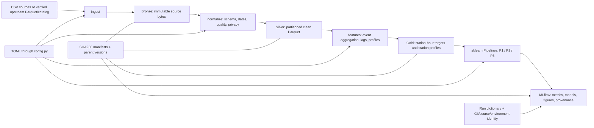

# Architecture and implementation decisions

## Data and execution flow

`scripts/bootstrap.ps1` and `scripts/bootstrap.sh` provision the chosen environment
and invoke a stage. `cli.run_e2e` composes acquisition, normalization, features and
training; standalone scripts call the same functions. There is no duplicate business
logic in the wrappers or notebooks.

## Environment and configuration

- `pyproject.toml` pins direct dependencies; `uv.lock` locks transitive dependencies
  and wheel hashes. Python is pinned in `.python-version`; Docker uses the same version.
- `configs/project.toml` is the declarative settings source. `config.py` loads it,
  validates temporal boundaries, and resolves project-relative paths. CLI overrides
  are recorded as the effective configuration of each run.
- Docker installs its environment under `/opt/project/.venv`; binding the repository
  at `/workspace` cannot hide the installed packages. The container sets `MIBICI_RUNTIME=docker`, automatically separating its
  tracking database/artifacts from Windows stores because artifact paths are absolute.
- No remote services, cloud credentials or external tracking server are necessary.
  SQLite plus local artifacts suffice for this delivery. Concurrent writers are
  outside this local workflow's supported execution model.

## Medallion contract

| Layer | Content | Validation and lineage |
|---|---|---|
| Bronze (`data/raw/bronze`) | Exact CSV or supplied Parquet bytes in SHA256 directories | Expected months/catalog, optional expected checksums, source URL and file hash |
| Silver (`data/interim/silver`) | Trip partitions and station catalog in Parquet | Named schema, encoding, date policy, duration/month/duplicate checks, rejected counts, Bronze version |
| Gold (`data/processed/gold`) | Station partitions with forecasting features and labels; station profiles | Explicit feature/label separation, warmup, split coverage, Silver version and effective settings |

Derived files are content-addressed too. Manifests live under
`references/data_versions/<layer>/<version>.json`; `<layer>.json` points at the latest
successful stage. A version hashes file metadata, parents and transformation details,
excluding the creation timestamp. Old objects/manifests are retained. Failed stages
do not publish a new pointer. Do not manually edit generated manifests.

Source copies, identifiers and per-trip data stay outside Git and MLflow. Silver
omits `usuario_id`, gender and birth year; Gold contains station aggregates.
Invalid catalog coordinates/IDs fail ingestion. Zero capacity is reported; stations
without positive capacity remain eligible for P1/P3 but have no P2 proxy label.

Dates are interpreted as the source's local wall-clock times; no UTC conversion is
assumed. Start-date ordering is inferred once per file against its stated month and
reused for end dates, including trips crossing midnight/month end. Ambiguous ordering
fails. Daily-light-saving ambiguity cannot be reconstructed from timezone-free CSVs.
Duplicates are rejected by trip ID within each monthly source (including across chunks).
Cross-month identity inconsistencies remain a data audit item.

## Modeling contracts

At forecast origin `t`, P1 predicts the count in `[t+24h,t+25h)`; it is an hourly
count 24 hours ahead, not a sum across the next day. P2 labels the complete window
`[t,t+2h)`. Horizons are configurable. Calendar fields are known at `t`, including
P1 target-hour calendar. Lagged flows use `t-1`, `t-24`, `t-168`; rolling means use
the previous 24 completed hours. Arrivals use trip end time.

The station grid starts at its first observed event and continues to the dataset end.
It does not use a future last-active timestamp to exclude quiet stations. Longest-lag
warmup ensures the activation event precedes the first prediction. Station closures
and expansions remain interpretation limitations because status histories are absent.

Train: October 2023 through March 2026; validation: April through June 2026;
test: July through September 2026. Split boundaries are exclusive and hourly.
Labels whose full target window crosses a partition boundary are removed per task.
Preprocessing fits training only. Later forecasts may use observed earlier validation
or test flows as lag inputs; evaluation represents repeated forecasts with observed
updates, not a fixed-origin multi-month forecast.

P2 proxy = `(departures - arrivals) / capacity_snapshot` summed over the next two
hours. Positive pressure >= tau means bike pressure; negative pressure <= -tau
means dock pressure; otherwise balanced. Tau is the 90th percentile of absolute
pressure on eligible training rows only, with minimum 0.01. The real run learned
**0.2631578947** and froze it for validation/test. Fixed thresholds remain an explicit
config option. Capacity is excluded from predictors; the September 2026 snapshot
cannot establish historical capacity or actual empty/full events.

P3 uses 168 hourly-of-week mean departure values and 168 arrival values, separately
normalized per station, computed **only over training history**, then scaled inside
Pipeline. Stations without eligible training history are excluded. Coordinates are
for visualization only. Silhouette is descriptive and in-sample, not a held-out score.

| Task | Baseline | Implemented candidate | Metrics / artifacts |
|---|---|---|---|
| P1 | Training-mean DummyRegressor | HistGradientBoostingRegressor | validation/test MAE, RMSE, WAPE where denominator > 0; daily comparison |
| P2 | Majority DummyClassifier | Balanced HistGradientBoostingClassifier | validation/test balanced accuracy, macro F1, each class's recall; confusion matrix |
| P3 | KMeans with fixed k=3 | Diagonal GaussianMixture with k=3 | descriptive silhouette, group sizes, profiles, geographic scatter |

All models are scikit-learn Pipelines: imputation, scaling, estimator. Identifiers
are not treated as ordinal numeric predictors. Initial candidate hyperparameters are
fixed; selection/tuning must use validation only. The test set is for final comparison.

## Central run dictionary and other artifacts

`modeling/train.py` constructs the run dictionary with schema version, run ID/time,
question, synthetic flag, effective settings, code hashes/Git SHA/dirty state,
environment versions, Gold version and parents, split row counts, estimator class/
parameters/features, metrics, artifact references/checksums and limitations.

The dictionary is logged as `reports/run_manifest.json`. Separate artifacts include:
model/signature/example/environment; figures; aggregate prediction/confusion/cluster
tables; configuration; exact Bronze/Silver/Gold ancestor manifests; source snapshot.
The manifests are resolved by parent IDs, not merely whichever layer pointer is newest.
Uncommitted runs carry source hashes and dirty labels; final evidence should be rerun
from an actual reviewed commit. Synthetic fixture results are isolated and labeled.

## Rationale and limits

TOML and uv provide one dependency/configuration source; Docker provides an alternate
environment boundary. Parquet and chunked CSV processing avoid concatenating millions
of raw rows. sklearn Pipelines bind preprocessing to the estimator. MLflow associates
parameters, evaluation and artifacts with a run. Hash manifests associate outputs with
their exact inputs while keeping data out of Git.

These are engineering rationales. Specific course-reading citations/pages have not
been supplied; do not claim they have been verified. Full 36-month ingestion, features
and baselines completed locally; Docker passed the isolated six-model synthetic
workflow. See `validation.md` for measured results and remaining acceptance limits.

## Reference archive import

`data/data_manifest.json` preserves the official main manifest. `ingest --source-parquet
PATH --stations PATH` verifies the supplied archive and catalog against its SHA256
values, copies them to Bronze, and records upstream commit and source provenance.
Silver reads only nonpersonal trip fields in bounded batches. The supplied archive
is ordered by month; out-of-order monthly groups are rejected. The 36 original CSV
checksums are inherited references, not claims that those CSV bytes were reverified.
Direct-download URLs for the first 24 months remain missing. See `upstream_changes.md`.
