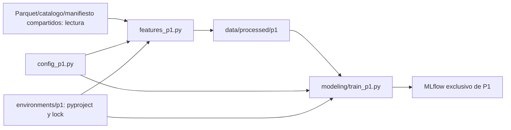

# Implementacion aislada de P1

Esta nota complementa los documentos de arquitectura del equipo sin modificarlos.

El modulo conserva rezagos pasados, calendario conocido, particiones temporales y
objetivos completos dentro de cada particion. P1 predice la hora a +24h; imputation,
escalado y modelo se ajustan dentro de sklearn Pipeline con entrenamiento.

Se mantienen intactos los scripts, dependencias, Makefile, pruebas y notebook de main.
El entorno P1 es virtual e independiente. Entradas compartidas se leen sin escribir;
features, figuras, base MLflow y artefactos usan subdirectorios p1. El entrenamiento
por defecto incluye solo P1, con baseline y candidato opcional.

La version del manifiesto de entrada, configuracion, seed y commit se registran junto
con modelos, tablas, metricas y figuras. Esta separacion evita reemplazar configuracion
o resultados de otros integrantes. Ver README seccion 8 para comandos.
