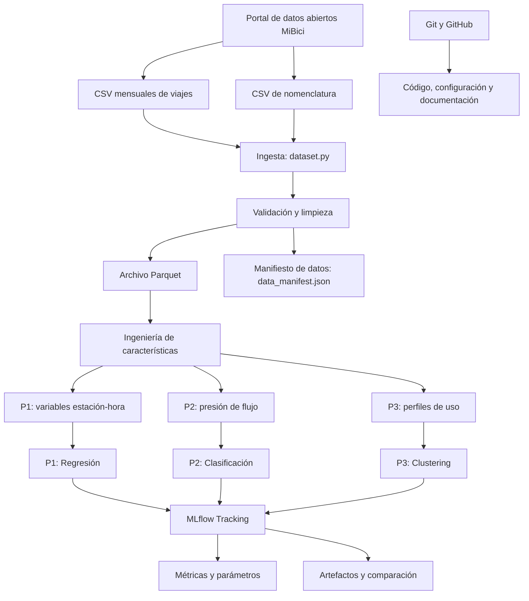

# Arquitectura del proyecto MiBici

**Materia:** TC5061 - Operaciones de Aprendizaje Automático (MLOps)
**Proyecto:** Predicción y análisis del sistema de bicicletas públicas MiBici
**Equipo:** 25
**Periodo de análisis:** Octubre 2023 - Septiembre 2026

---

## 1. Objetivo de la arquitectura

La arquitectura del proyecto tiene como propósito establecer un flujo de trabajo reproducible para procesar los datos históricos del sistema MiBici y desarrollar tres soluciones de Machine Learning.

Las preguntas que busca responder el proyecto son:

- **P1 - Regresión:** ¿Cuántos viajes se iniciarán en una estación durante un periodo futuro?
- **P2 - Clasificación:** ¿Qué nivel de presión operativa presentará una estación durante una ventana futura, considerando sus entradas, salidas y capacidad?
- **P3 - Clustering:** ¿Qué grupos de estaciones comparten patrones de uso similares y dónde se encuentran ubicadas?

La arquitectura busca garantizar:

1. Reproducibilidad de los experimentos.
2. Trazabilidad de los datos utilizados.
3. Separación entre ingesta, procesamiento, características y modelado.
4. Comparación de resultados mediante MLflow.
5. Colaboración y control de versiones con GitHub.

El proyecto tiene fines académicos y no contempla un despliegue productivo en esta etapa.

---

## 2. Fuentes de datos

Los datos utilizados provienen del portal oficial de datos abiertos de MiBici.

Fuente: https://www.mibici.net/es/datos-abiertos/

### 2.1. Archivos mensuales de viajes

Se utiliza información de octubre de 2023 a septiembre de 2026, correspondiente a 36 meses consecutivos.

El conjunto seleccionado contiene 13,621,885 registros de viajes.

Las variables originales incluyen:

- Viaje_Id
- Usuario_Id
- Genero
- Año_de_nacimiento
- Inicio_del_viaje
- Fin_del_viaje
- Origen_Id
- Destino_Id

Durante el procesamiento también se utiliza un identificador del mes correspondiente al archivo de origen.

Para construir los modelos se emplearán principalmente:

- Fecha y hora de inicio del viaje.
- Fecha y hora de finalización del viaje.
- Identificador de estación de origen.
- Identificador de estación de destino.

Los identificadores y atributos individuales de los usuarios no se utilizarán como variables predictoras.

### 2.2. Nomenclatura de estaciones

Se utiliza el archivo:

`nomenclatura_2026_09.csv`

Contiene los siguientes atributos:

- id: identificador de la estación.
- name: nombre de la estación.
- latitude: latitud.
- longitude: longitud.
- dpcapacity: capacidad de anclajes.

La nomenclatura permite relacionar los registros de viajes con información geográfica y capacidad de las estaciones.

Es importante señalar que este archivo representa una instantánea de septiembre de 2026 y no garantiza que la capacidad de las estaciones haya sido constante durante todo el periodo histórico.

---

## 3. Diagrama general de arquitectura

El diagrama representa la arquitectura objetivo. Algunos componentes ya están implementados y otros están pendientes de integración.

---

## 4. Componentes de la arquitectura

### 4.1. Ingesta de datos

**Archivo principal:** `dataset.py`

Su objetivo es obtener y preparar los registros históricos para su posterior procesamiento.

Sus responsabilidades son:

- Obtener o leer los archivos mensuales del periodo seleccionado.
- Leer la nomenclatura de estaciones.
- Identificar diferencias entre nombres de columnas.
- Manejar las codificaciones de los archivos.
- Convertir las fechas a formatos adecuados.
- Identificar registros inválidos.
- Consolidar los datos históricos.
- Guardar los resultados en formato Parquet.
- Generar un manifiesto de datos.

**Estado actual:**

El repositorio cuenta con una implementación de ingesta y generación de manifiesto.

La descarga automática de todos los archivos desde la fuente oficial todavía debe completarse o verificarse para cumplir con el requisito de reproducibilidad.

### 4.2. Validación y limpieza

La validación de datos tiene como propósito detectar inconsistencias que puedan afectar el entrenamiento de los modelos.

Entre las verificaciones realizadas se encuentran:

- Revisión del número de registros.
- Confirmación del periodo histórico.
- Identificación de estaciones distintas.
- Revisión de valores faltantes en columnas principales.
- Comparación de identificadores con el catálogo.
- Validación de capacidades y coordenadas.

Los resultados obtenidos incluyen:

| Indicador | Resultado |
|-----------|-----------|
| Periodo | Octubre 2023 - Septiembre 2026 |
| Meses | 36 |
| Registros de viajes | 13,621,885 |
| Estaciones distintas en viajes | 473 |
| Estaciones en nomenclatura | 484 |
| Estaciones coincidentes | 471 |
| Estaciones sin correspondencia | 2 |
| Viajes afectados por IDs 405 y 407 | 3,954 |
| Porcentaje de viajes afectados | 0.0290% |

Estos resultados permiten justificar las decisiones de calidad de datos utilizadas en el modelado.

Las reglas definitivas de eliminación, conservación y transformación de registros deberán documentarse dentro del pipeline reproducible.

### 4.3. Almacenamiento

**Herramienta:** Apache Parquet mediante PyArrow.

Parquet permite almacenar información tabular en formato columnar.

Sus principales ventajas para el proyecto son:

- Lectura eficiente de grandes volúmenes.
- Selección de columnas específicas.
- Reducción del espacio de almacenamiento.
- Integración con Pandas y otras herramientas de análisis.
- Facilitar el procesamiento sin cargar necesariamente todo el histórico en memoria.

Los archivos Parquet se utilizarán localmente.

No deben subirse al repositorio de GitHub.

### 4.4. Versionado de datos

**Archivo:** `data/data_manifest.json`

El manifiesto permite identificar la versión de los datos utilizada en los experimentos.

Se utiliza para documentar información como:

- Periodo de análisis.
- Cantidad de archivos procesados.
- Número de registros.
- Identificador de versión.
- Información de integridad de los archivos.
- Versiones de herramientas utilizadas.

La versión de datos deberá registrarse en las ejecuciones de MLflow para relacionar los resultados con los datos utilizados.

Este mecanismo permite mejorar la trazabilidad sin almacenar los conjuntos de datos completos en GitHub.

### 4.5. Ingeniería de características

**Archivos asociados:** `features.py` y módulos específicos por pregunta.

El objetivo es transformar los viajes individuales en conjuntos de características adecuados para los modelos.

#### Características para P1

Se propone construir información agregada por estación y hora.

Variables candidatas:

- Hora del día.
- Día de la semana.
- Mes.
- Identificador de estación.
- Conteos históricos de salidas.
- Rezagos temporales.
- Promedios móviles de demanda.
- Capacidad de estación, con las limitaciones del catálogo histórico.

El objetivo será predecir el número de viajes iniciados en una estación durante una hora futura.

El horizonte definitivo debe unificarse entre el Machine Learning Canvas, la propuesta y la configuración del proyecto.

#### Características para P2

Se plantea utilizar:

- Salidas históricas.
- Llegadas históricas.
- Balance entre entradas y salidas.
- Capacidad de estación.
- Indicadores temporales.
- Rezagos y tendencias recientes.

La etiqueta propuesta se construye utilizando un balance normalizado por capacidad.

Esta variable representa un indicador aproximado de presión de flujo, no una medición directa de estaciones vacías o saturadas.

El umbral utilizado para definir clases debe calcularse exclusivamente a partir de los datos de entrenamiento.

#### Características para P3

Se construyen perfiles históricos de uso por estación.

La implementación desarrollada en la rama `desarrolloP3` incluye perfiles de actividad semanal que consideran:

- Día de la semana.
- Hora.
- Salidas.
- Llegadas.
- Proporciones de uso.

El perfil propuesto incluye 336 características semanales, correspondientes a 168 intervalos de tiempo por dos direcciones de viaje.

Las coordenadas geográficas se utilizarán para visualizar e interpretar los grupos, pero no para determinar directamente la similitud entre estaciones.

**Estado actual:**

Existe código específico de características para P3.

El módulo general de características y la integración completa de las tres preguntas siguen pendientes de consolidación.

---

## 5. Modelos de Machine Learning

### 5.1. P1 - Regresión

**Objetivo:** estimar la demanda futura de viajes iniciados por estación.

Se utilizarán modelos de referencia y modelos candidatos.

Opciones de referencia:

- Predicción utilizando demanda histórica.
- Predicción basada en patrones equivalentes de semanas anteriores.

Modelos candidatos:

- Regresión lineal o regularizada.
- Random Forest Regressor.

Métricas principales:

- MAE: error absoluto medio.
- RMSE: raíz del error cuadrático medio.

La evaluación debe realizarse mediante una partición temporal para evitar utilizar información futura durante el entrenamiento.

**Estado actual:** implementación y experimentos pendientes de completar.

### 5.2. P2 - Clasificación

**Objetivo:** clasificar la presión futura de flujo de una estación.

La formulación escrita propone tres clases:

- -1: presión de salida, asociada a un posible riesgo de falta de bicicletas.
- 0: flujo dentro del intervalo de referencia.
- 1: presión de llegada, asociada a un posible riesgo de falta de anclajes.

La etiqueta se calcula a partir del balance entre llegadas y salidas, normalizado por capacidad.

Opciones de modelos:

- DummyClassifier como referencia.
- Regresión logística como modelo candidato.
- Random Forest Classifier como alternativa.

Métricas:

- Precision.
- Recall.
- F1-score.
- Matriz de confusión.

Estas métricas evaluarán la predicción de la etiqueta proxy y no demostrarán que se predicen incidentes reales de desabasto o saturación.

**Estado actual:** implementación y experimentos pendientes de completar.

### 5.3. P3 - Clustering

**Objetivo:** identificar grupos de estaciones con comportamientos de uso similares.

Se plantea utilizar:

- Perfiles semanales normalizados.
- Métodos de agrupamiento.
- Comparación de diferentes configuraciones de grupos.

El proyecto ya cuenta con un baseline basado en la proporción de uso durante fines de semana.

Se propone comparar posteriormente con K-Means.

Métricas y criterios de evaluación:

- Silhouette Score.
- Tamaño y distribución de los grupos.
- Estabilidad de los grupos.
- Interpretabilidad de los perfiles.

Los resultados se representarán geográficamente mediante las coordenadas del catálogo.

**Estado actual:** baseline implementado en la rama `desarrolloP3`, pendiente de integración completa y comparación con el modelo candidato.

---

## 6. Seguimiento de experimentos mediante MLflow

**Herramienta:** MLflow Tracking.

MLflow permite registrar y comparar los experimentos de Machine Learning.

Cada experimento deberá registrar:

### Parámetros

- Tipo de modelo.
- Periodo de entrenamiento.
- Periodo de validación.
- Periodo de prueba.
- Hiperparámetros.
- Semilla aleatoria.
- Versión de los datos.

### Métricas

Las métricas dependerán de cada pregunta:

- P1: MAE y RMSE.
- P2: Precision, Recall y F1-score.
- P3: Silhouette y métricas descriptivas del agrupamiento.

### Artefactos

Se podrán almacenar:

- Gráficas de evaluación.
- Matrices de confusión.
- Comparaciones de modelos.
- Visualizaciones de grupos.
- Reportes agregados.

### Etiquetas

Los experimentos deberán identificar:

- Equipo 25.
- Pregunta correspondiente.
- Versión o commit del código.
- Información necesaria para reproducir la ejecución.

Se requiere al menos una ejecución registrada para cada una de las tres preguntas.

Las carpetas locales de MLflow y los modelos serializados no deberán publicarse en GitHub.

---

## 7. Herramientas y justificación técnica

| Herramienta | Función | Justificación |
|-------------|---------|---------------|
| Python | Desarrollo del pipeline | Lenguaje principal del proyecto y ecosistema de ML |
| Pandas | Limpieza y transformación | Procesamiento flexible de datos tabulares |
| PyArrow | Procesamiento y Parquet | Manejo eficiente de información columnar |
| Scikit-learn | Modelos de ML | Baselines, modelos candidatos y métricas |
| MLflow | Seguimiento de experimentos | Registro y comparación reproducible |
| Jupyter Notebook | Análisis exploratorio | Visualización y experimentación inicial |
| Git | Control de versiones | Historial y trazabilidad del código |
| GitHub | Colaboración | Branches, Pull Requests y revisiones |
| Cookiecutter Data Science | Estructura del repositorio | Organización estándar del proyecto |

---

## 8. Estrategia de reproducibilidad

La arquitectura busca permitir que un integrante del equipo pueda reproducir los resultados siguiendo instrucciones documentadas.

Para ello se requiere:

1. Clonar el repositorio.
2. Crear un entorno de Python compatible.
3. Instalar las dependencias con versiones definidas.
4. Ejecutar la ingesta de datos.
5. Generar y verificar el manifiesto.
6. Construir las características.
7. Ejecutar los modelos de P1, P2 y P3.
8. Registrar los resultados en MLflow.
9. Comparar los experimentos obtenidos.

Los comandos definitivos deberán documentarse en el README.

---

## 9. Control de versiones y colaboración

El proyecto utiliza GitHub como plataforma colaborativa.

La estrategia de trabajo contempla:

- Mantener `main` como rama principal.
- Desarrollar nuevas funcionalidades en ramas independientes.
- Registrar cambios mediante commits descriptivos.
- Abrir Pull Requests.
- Solicitar revisiones antes de integrar cambios.
- Mantener excluidos del repositorio los datos y artefactos pesados.

Esto permite que los integrantes trabajen en distintos componentes sin modificar directamente la rama principal.

---

## 10. Estado actual y actividades pendientes

A partir de la revisión de las ramas `main`, `desarrolloP3` y `testing_branch`, se identificó el siguiente estado:

| Componente | Estado |
|------------|--------|
| Estructura Cookiecutter | Implementada |
| Ingesta de archivos y Parquet | Implementación inicial disponible |
| Descarga automática de datos | Pendiente de completar o verificar |
| Manifiesto de datos | Disponible |
| ML Canvas | Disponible |
| Ingeniería de características general | Pendiente de integración |
| Modelo P1 | Pendiente |
| Modelo P2 | Pendiente |
| Baseline P3 | Implementado en rama de desarrollo |
| Modelo candidato P3 | Pendiente de completar |
| Registro MLflow de las tres preguntas | Pendiente de verificar de forma integrada |
| Diagrama de arquitectura | Documentado en este archivo |
| README reproducible | Pendiente de completar |

---

## 11. Conclusión

La arquitectura propuesta organiza los componentes necesarios para desarrollar soluciones de Machine Learning a partir de datos históricos del sistema MiBici.

La separación entre ingesta, validación, almacenamiento, ingeniería de características, entrenamiento y seguimiento experimental permitirá mejorar la reproducibilidad del proyecto.

El uso de GitHub y MLflow facilitará la colaboración entre integrantes, el versionado del código y la comparación de resultados.

Como siguiente etapa será necesario integrar los componentes desarrollados en las distintas ramas, completar los modelos pendientes y verificar la ejecución reproducible de los tres experimentos.

La solución desarrollada corresponde a un prototipo académico; cualquier utilización operativa requeriría validación adicional con datos reales de disponibilidad de bicicletas, capacidad histórica y eventos de rebalanceo.